# Campus Equipment & Incident Hub — Project Progress & Team Contributions

> **Snapshot as of 26 Nov 2026 (Week 8, `main` `c4b7151`).** Maintained manually alongside weekly status refreshes. What is still left to do: [`docs/whats-left.md`](docs/whats-left.md). Back to setup & quick start: [`README.md`](README.md).

| Milestone | Date / Target | Status |
|---|---|---|
| Prototype (`v0.1.0-prototype`) | 31 Oct 2026 | ✅ Done |
| M1 (`v0.1.0`) | 11 Nov 2026 | ✅ Done |
| First AWS Deploy (OIDC `deploy.yml` wired 22 Nov; paused between demos) | 17 Nov 2026 | ✅ Done |
| Off-plan / new-feature cut | 30 Nov 2026 | ⏳ Upcoming |
| M2 (`v0.2.0`, local + AWS) | Sun 6 Dec 2026 | 🎯 Next milestone |
| Feature Freeze & Teacher Feedback Demo | Mon 7 Dec 2026 | 🎯 Scheduled |
| Defense (`v1.0.0`) | W11–W12 | 📅 Date from professor |

---

## 1. Why This Isn't a Simple CRUD App (And Can't Be One-Shotted)

At a glance, *"students reserve lab equipment and report broken items"* sounds like a CRUD app an LLM could generate in a single prompt. In reality, CRUD is the easiest 15% of this system. The remaining 85% lives in the failure modes that only appear when multiple students, admins, background sweeps, live browser tabs, and cloud edge proxies collide on real PostgreSQL 18.

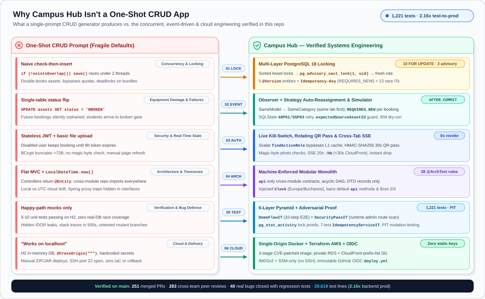

### PostgreSQL 18 Lock-Ordering Hierarchy & Real Bugs Caught

Every state-mutating workflow obeys a strict lock acquisition order across **`10` `SELECT ... FOR UPDATE` queries**, **`2` PostgreSQL advisory lock namespaces**, and **`5` `@Version` entities**, paired with isolated `REQUIRES_NEW` transactions. Most of these guardrails were hardened after adversarial reviews and multi-thread probes broke earlier versions during development:

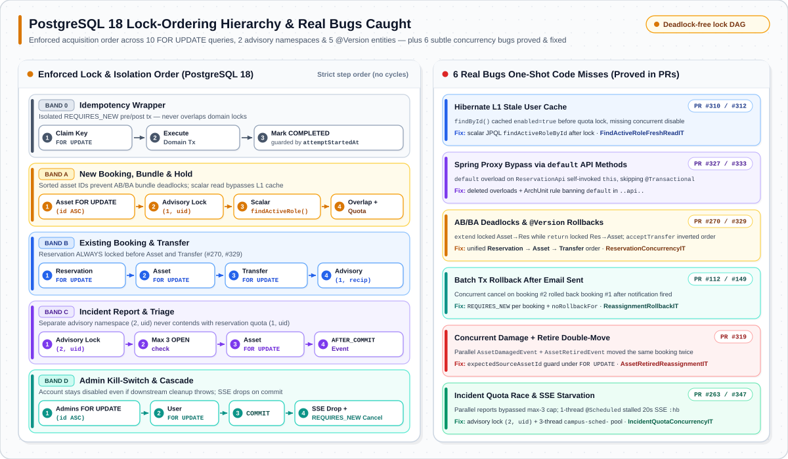

### Anatomy of a Real Interleaved Race (Account Disable vs. Live Booking, `#310` / `#312`)

A classic bug a one-shot prompt always ships: a student starts a booking while an admin disables their account. Even with a lock, Hibernate's L1 persistence context caches `User(enabled = true)` if the entity was loaded before waiting on the lock — letting a banned account finish booking, or letting a failing downstream cancellation roll back the admin's disable action. Here is the exact flow enforced in production and proved in [`ReservationConcurrencyIT`](backend/src/test/java/com/campus/reservation/service/ReservationConcurrencyIT.java) and [`FindActiveRoleFreshReadIT`](backend/src/test/java/com/campus/user/service/FindActiveRoleFreshReadIT.java):

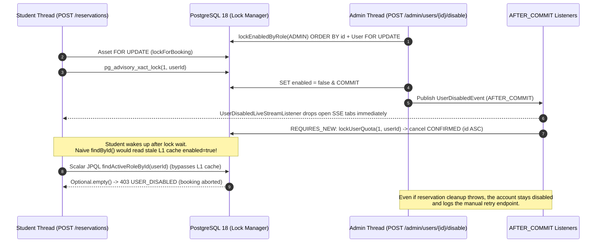

### 8 Engineering Arguments Against the "Simple CRUD" Label

| # | Dimension | What a One-Shot Prompt Generates | What Campus Hub Actually Engineers & Proves |
|---|---|---|---|
| **1** | **Concurrency & Lock Ordering** | `if (!existsOverlap()) save()` under default `READ COMMITTED`; races on double-bookings, quotas, and bundles | `10` `FOR UPDATE` queries, `2` non-colliding advisory lock namespaces (`(1, uid)` bookings, `(2, uid)` incidents), sorted multi-asset locking, `5` `@Version` entities, and `Idempotency-Key` (`REQUIRES_NEW` + `attemptStartedAt` stale-takeover guard) in [`IdempotencyService.java`](backend/src/main/java/com/campus/reservation/service/IdempotencyService.java) |
| **2** | **Event-Driven Auto-Reassignment & Dry-Run Simulator** | Flips `assets.status = 'BROKEN'` and strands upcoming bookings | Observer (`@Async` + `@TransactionalEventListener(AFTER_COMMIT)`) → Strategy (`SameModelStrategy` → `SameCategoryStrategy`, same lab room first), per-booking `REQUIRES_NEW` isolation with `noRollbackFor`, PostgreSQL SQLState (`40P01`/`55P03`/`40001`) retry, `expectedSourceAssetId` double-move guard, and a 90-day zero-write [`MaintenanceImpactSimulator`](backend/src/main/java/com/campus/reassignment/service/MaintenanceImpactSimulator.java) with virtual allocations & disruption scoring |
| **3** | **State Machines & Temporal Invariants** | Flat status strings and `LocalDateTime.now()` | `7`-state `ReservationStatus`, open-ended `OVERDUE` overlap SQL, session-counted bundles (`coalesce(bundleId, id)`), 1-min slot holds + 2-min anti-hoarding cooldown, 3-in-24h transfers with partial unique index (`WHERE status = 'PENDING'`), preventive 60-min overdue cascade, and injected `Clock` (`Europe/Bucharest` vs UTC AWS) |
| **4** | **Defense-in-Depth Identity & File Security** | Stateless JWT (8h stale access after disable), raw multipart upload | Scalar `findActiveRoleById` on every JWT request (`0s` revoke), BCrypt 72-byte UTF-8 guard, constant-time HMAC-SHA256 30s rotating 6-digit/QR [`PickupCodes`](backend/src/main/java/com/campus/user/service/PickupCodes.java), binary magic-byte + canonical-path photo validation ([`StorageValidation`](backend/src/main/java/com/campus/storage/service/StorageValidation.java)), IDOR `404` masking, and runtime `/api/v1/admin/**` route reflection in [`SecurityPassIT`](backend/src/test/java/com/campus/config/SecurityPassIT.java) |
| **5** | **Real-Time Cross-Tab SSE** | Polling or manual refresh | [`LiveStreams`](backend/src/main/java/com/campus/notification/service/LiveStreams.java): immediate `:connected` flush, 20s `:hb` heartbeat tuned below CloudFront's 30s timeout on a dedicated 3-thread `@Scheduled` pool (`campus-sched-`), atomic 5-stream/user cap via `ConcurrentHashMap.compute`, per-emitter write sync, and instant `completeAll` on account disable |
| **6** | **Domain Intelligence Beyond Forms** | Plain list/search tables | Bilingual RO/EN [`ProjectSearch`](backend/src/main/java/com/campus/project/service/ProjectSearch.java) (NFD diacritic folding, stop-words, stem/ambiguity scoring) + atomic multi-asset *"Reserve all"*; [`ReliabilityCalculator`](backend/src/main/java/com/campus/incident/service/ReliabilityCalculator.java) computing failures/100h, MTBF, repair hours, and model-relative `vsModel` (`INSPECT`/`WATCH`) |
| **7** | **Machine-Enforced Architecture (`28` `@ArchTest`)** | Tangled service/repo imports and leaked `@Entity` controllers | [`ModuleBoundaryArchitectureTest`](backend/src/test/java/com/campus/architecture/ModuleBoundaryArchitectureTest.java) & [`CodingConventionsArchitectureTest`](backend/src/test/java/com/campus/architecture/CodingConventionsArchitectureTest.java): `api`-only contracts, acyclic module DAG, no `default` methods in `..api..`, no unparameterized `*.now()`, no `@Entity` in controllers, Boot 4 / Jakarta / Jackson 3 enforcement |
| **8** | **Production Cloud & Adversarial Verification** | Localhost H2 + CORS `*` + happy-path mocks | 3-stage CVE-patched single-origin [`Dockerfile`](Dockerfile), Terraform VPC + private RDS + CloudFront prefix-list SG + IMDSv2 + SSM-only (no SSH) in [`infra/`](infra/), immutable GitHub OIDC [`deploy.yml`](.github/workflows/deploy.yml), `2.16×` test-to-prod ratio, PIT mutation testing, and [`defense-playbook.md`](docs/testing/defense-playbook.md) |

### 6 Real Subtle Bugs One-Shot Code Misses (Caught & Proved in PRs)

These are not hypothetical textbook examples — every row below was a real bug hit during peer review, multi-thread probing, or live deploy testing, fixed with a dedicated regression test:

| PRs | What Actually Broke | Why a Prompt Misses It | Fix & Regression Proof |
|---|---|---|---|
| `#310`, `#312` | Disabled student finished booking because `findById()` returned an L1-cached `User(enabled=true)` after waiting on the quota lock | Only triggers when two transactions interleave around `pg_advisory_xact_lock` inside one Hibernate session | Scalar JPQL `findActiveRoleById` after lock ([`FindActiveRoleFreshReadIT`](backend/src/test/java/com/campus/user/service/FindActiveRoleFreshReadIT.java)) |
| `#327`, `#333` | `default` overload methods on `ReservationApi` invoked `this.moveToAsset(...)`, silently bypassing Spring's `@Transactional` AOP proxy | Compiles and passes unit mocks; blows up at runtime with `"No active transaction"` | Removed overloads + added ArchUnit rule banning `default` methods in `..api..` |
| `#270`, `#329`, `#336` | AB/BA deadlocks (`extend` vs `return`; `acceptTransfer` vs `cancelUpcoming`) and `@Version` batch rollbacks on concurrent `rejectTransfer` | Requires exact cross-thread interleaving across `Reservation`, `Asset`, and `ReservationTransfer` rows | Unified `Reservation → Asset → Transfer` lock order + `ORDER BY r.id ASC` ([`ReservationConcurrencyIT`](backend/src/test/java/com/campus/reservation/service/ReservationConcurrencyIT.java)) |
| `#112`, `#149` | Concurrent cancel on booking #2 rolled back booking #1 *after* booking #1's reassignment notification had already fired | Single shared `@Transactional` loop looks clean until a mid-loop conflict occurs | Isolated `REQUIRES_NEW` per booking + `noRollbackFor` + candidate lookup outside write tx ([`ReassignmentRollbackIT`](backend/src/test/java/com/campus/reassignment/service/ReassignmentRollbackIT.java)) |
| `#319` | Parallel `AssetDamagedEvent` + `AssetRetiredEvent` moved the same booking twice and wrote duplicate reassignment logs/emails | Only appears when two async `AFTER_COMMIT` engines race on the same asset | `expectedSourceAssetId` guard under `FOR UPDATE` ([`AssetRetiredReassignmentIT`](backend/src/test/java/com/campus/reassignment/service/AssetRetiredReassignmentIT.java)) |
| `#263`, `#347` | Parallel incident reports bypassed the 3-open limit; a single `@Scheduled` thread starved 20s SSE heartbeats behind 5-min sweeps | Hidden locally until real concurrent requests or CloudFront's 30s idle timeout hit | Advisory lock `(2, reporterId)` ([`IncidentQuotaConcurrencyIT`](backend/src/test/java/com/campus/incident/service/IncidentQuotaConcurrencyIT.java)) + 3-thread `campus-sched-` pool |

### Live Demos — Prove Every Claim Yourself

#### Demo A: 60-Second Automated Proof Suite (CLI on Real PostgreSQL 18)

With PostgreSQL 18 running, execute this single command inside `backend/` to verify **75 end-to-end, concurrency, idempotency, security, and architecture proofs** live (verified **`75 / 75` green in `41s`** on `main`):

```bash
cd backend && ./gradlew test --rerun \
  --tests "com.campus.DemoFlowIT" \
  --tests "com.campus.config.SecurityPassIT" \
  --tests "com.campus.architecture.*" \
  --tests "com.campus.reservation.service.ReservationConcurrencyIT" \
  --tests "com.campus.reservation.service.IdempotencyServiceIT" \
  --tests "com.campus.reassignment.service.AssetRetiredReassignmentIT" \
  --tests "com.campus.reassignment.service.ReassignmentRollbackIT" \
  --tests "com.campus.user.service.FindActiveRoleFreshReadIT" \
  --tests "com.campus.incident.service.IncidentQuotaConcurrencyIT"
```

| Suite | Live Tests | What It Proves in Real Time |
|---|---:|---|
| `DemoFlowIT` | `10` | Full 10-step HTTP E2E story: register → twin assets → book → `409` overlap → `HIGH` damage → `UNDER_MAINTENANCE` → `AFTER_COMMIT` auto-move to twin → reassignment audit log |
| `ReservationConcurrencyIT` | `13` | Multi-thread double-book lock, advisory quota lock, deadlock-free `return`/`extend`, `pg_stat_activity` disable-vs-booking/bundle/hold/transfer races, `checkOut` vs `noShow` |
| `IdempotencyServiceIT` | `7` | 10-thread same-key race runs action once, `FAILED` key retry under `FOR UPDATE`, `>60s` stale takeover, `attemptStartedAt` anti-clobber guard |
| `SecurityPassIT` | `7` | Cross-student IDOR `404` masking, spoofed `userId` ignored, reflection sweep of every `/api/v1/admin/**` route (`403`/`401`), zero SQL/stacktrace leaks |
| `CodingConventions` + `ModuleBoundary` (`ArchUnit`) | `28` | `api`-only boundaries, acyclic module DAG, no `default` in `..api..`, injected `Clock`, DTO records only, Boot 4 / Jackson 3 imports |
| `AssetRetired` + `ReassignmentRollback` + `FindActiveRole` + `IncidentQuota` ITs | `10` | `CyclicBarrier(2)` double-move guard, `REQUIRES_NEW` rollback isolation, Hibernate L1 bypass, advisory `(2, uid)` 3-open incident cap |

*(Want to try breaking the code yourself? Run `cd backend && ./gradlew pitest` to mutate bytecode on purpose and verify which rules our tests catch — full defense drill in [`docs/testing/defense-playbook.md`](docs/testing/defense-playbook.md).)*

#### Demo B: 3-Minute Live Interactive Browser Demo (2 Windows: Student + Admin)

Start the backend (`./gradlew bootRun`) and frontend (`npm run dev`), then open **Window 1** (`student1@campus.test` / `password`) and **Window 2** (`admin@campus.test` / `password`, incognito):

1. **Atomic Project Kit & Overlap Lock (Window 1):** Open **Projects**, search in Romanian or English (e.g., *"osciloscop"* or *"solar"*), and click **Reserve all** to atomically book every asset in a kit as a single session; try booking an overlapping slot on the same asset → `409 RESERVATION_CONFLICT` RFC 9457 `ProblemDetail`.
2. **Real-Time Auto-Reassignment + Live SSE Toast (Window 2 → Window 1):** Keep Window 1 open (do **not** refresh). In Window 2 (or `student2@campus.test`), report `HIGH` damage with a photo on the booked asset → the damaged unit flips `UNDER_MAINTENANCE`, the `AFTER_COMMIT` engine moves Window 1's booking to a same-model twin, and **Window 1 immediately pops a live SSE toast** announcing the reassignment.
3. **Zero-Write Dry-Run Simulator & Equipment Health (Window 2):** Open `/admin/reliability` to inspect MTBF and `vsModel` failure ratios (`INSPECT` / `WATCH`), or call `POST /api/v1/admin/reassignments/simulate` in Swagger (`/swagger-ui.html`) to preview maintenance disruption without modifying a single row.
4. **30-Second Rotating QR Pickup Pass (Window 1 → Window 2):** Show the rotating 6-digit + QR code on **Pickup pass** (Window 1) and verify/scan it on **Reservations desk** (Window 2) to check out the item.
5. **Instant Security Kill-Switch (Window 2 → Window 1):** Disable `student1` on **Admin Users** (Window 2) → Window 1's SSE stream drops immediately, upcoming `CONFIRMED` bookings auto-cancel in an isolated transaction, and the very next click in Window 1 returns `401` (not 8 hours later).

---

## 2. System Overview Sketch

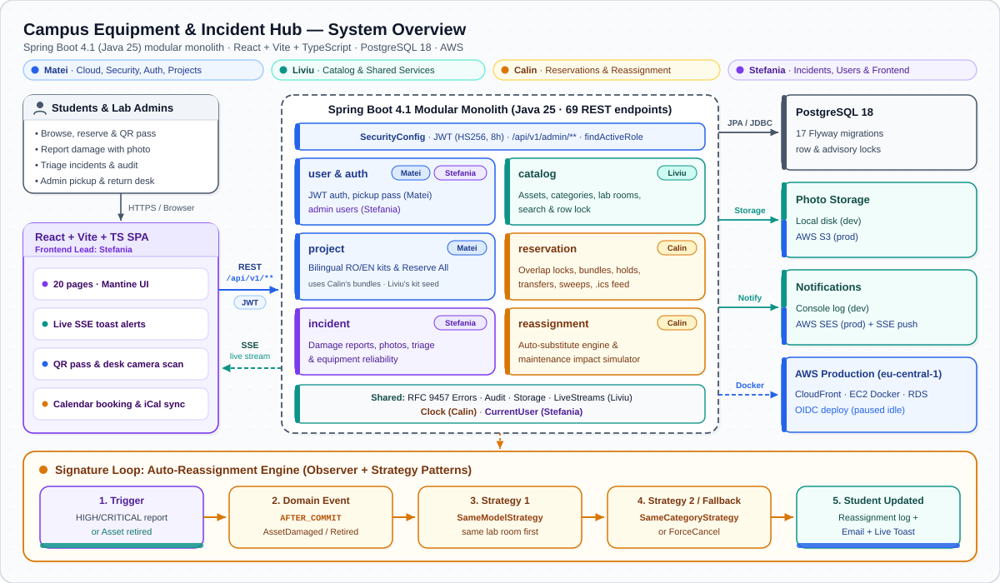

Students and admins interact with the React + Vite + TypeScript single-page app, which calls the Spring Boot 4.1 modular monolith over REST (`/api/v1/**`) and receives live tab updates over server-sent events (`/api/v1/live/stream`). The backend persists all domain state in PostgreSQL 18 via Flyway migrations, stores incident photos on local disk in development or Amazon S3 in production, and dispatches notifications to local logs or Amazon SES. When a high-severity damage report is filed or an asset is retired, an Observer event (`AssetDamagedEvent` or `AssetRetiredEvent`) triggers the auto-reassignment engine, which applies the Strategy pattern (same model first, then same category, preferring the same lab room) to move affected future bookings to a free substitute or force-cancel them.

---

## 3. Project Timeline & Milestones (W1–W12)

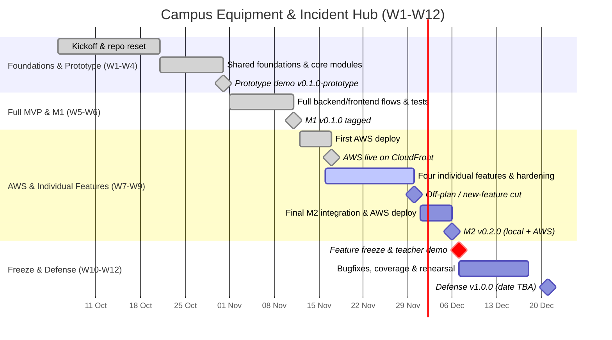

---

## 4. Who Owns What (Module Ownership & Contracts)

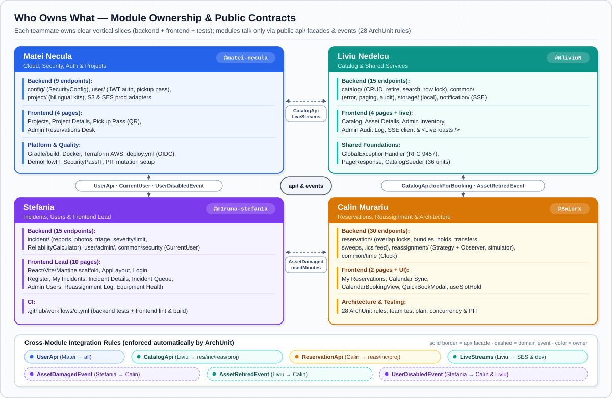

Every backend module exposes only its `api` package (facades, summary records, and events) to teammates, enforced automatically by ArchUnit. Each member also builds the frontend pages for their own module on top of Stefania's shared UI shell.

| Member | Focus | Backend Modules & Endpoints | Frontend Pages | Platform / Shared / Quality |
|---|---|---|---|---|
| **Matei Necula** (`@matei-necula`) | Cloud, security, auth & projects | `9` endpoints: `user` auth/me/pickup-pass (`6`), `project` (`3`) | `4` pages: `Projects`, `Project Details`, `Pickup Pass`, `Reservations Desk` | Gradle build, Docker, Terraform, GitHub OIDC `deploy.yml`, S3/SES adapters, `DemoFlowIT`, `SecurityPassIT`, PIT setup |
| **Liviu Nedelcu** (`@NliviuN`) | Catalog, shared services & live notifications | `15` endpoints: `catalog` (`13`), `common/audit` (`1`), `notification/live` (`1`) | `4` pages: `Catalog`, `Asset Details`, `Admin Inventory`, `Admin Audit Log` + SSE client (`live.ts`) & `<LiveToasts />` | `GlobalExceptionHandler`, shared exceptions, `PageResponse`, `PageRequests`, `AuditService`, `LocalStorageService`, `LoggingNotificationService`, `CatalogSeeder` |
| **Calin Murariu** (`@Swiorx`) | Reservations & auto-reassignment | `30` endpoints: `reservation` (`28`), `reassignment` (`2`) | `2` pages: `My Reservations`, `Calendar Sync` + `CalendarBookingView`, `QuickBookModal`, `useSlotHold` | Shared `Clock`, `28` ArchUnit rules, team test plan, concurrency & PIT suites, Strategy/Observer docs |
| **Stefania** (`@m1runa-stefan1a`) | Incidents, user admin, frontend lead & CI | `15` endpoints: `incident` (`10`, incl. reliability), `user/admin` (`5`) | `10` pages: `Login`, `Register`, `My Incidents`, `Incident Details`, `Incident Queue`, `Admin Users`, `Reassignment Log`, `Equipment Health`, `NotFound`, `Placeholder` | React + Vite + TypeScript + Mantine scaffold, API client, `AppLayout`, `CurrentUser`, `.github/workflows/ci.yml` |

---

## 5. How We Work & Contribution Profile

> **Why commit and PR counts are not a scoreboard:** Our team divides work by ownership and delivered features, not by PR volume. Raw counts reflect the shape of each role rather than relative effort: Matei maintains repo governance, weekly status refreshes, ADRs, and AWS infrastructure (over 40 docs, infra, and CI PRs alongside auth, projects, and pickup pass); Calin ships many small incremental bugfix and test PRs (`28` fix and `9` test PRs) while hardening concurrency and locking rules; Liviu and Stefania deliver cohesive, multi-file PRs that bundle backend services, migrations, tests, and full frontend pages together. Generated lockfiles (`package-lock.json`) and static HTML prototypes are excluded from code-footprint stats.

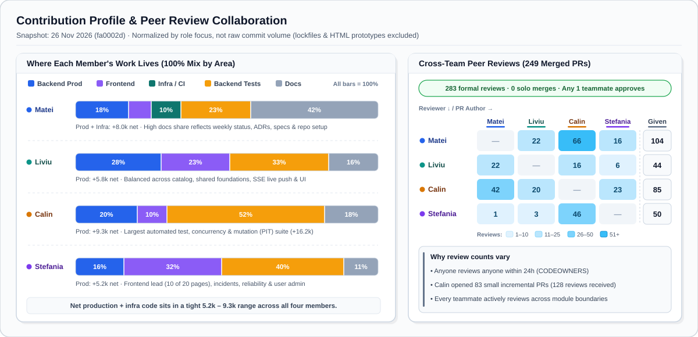

*(Per-member role-mix and peer-review heatmap snapshotted at `fa0002d`, prior to the `PROGRESS.md` docs PRs `#357` and `#358`.)*

### Team Weekly Delivery Pace (W1–W8)

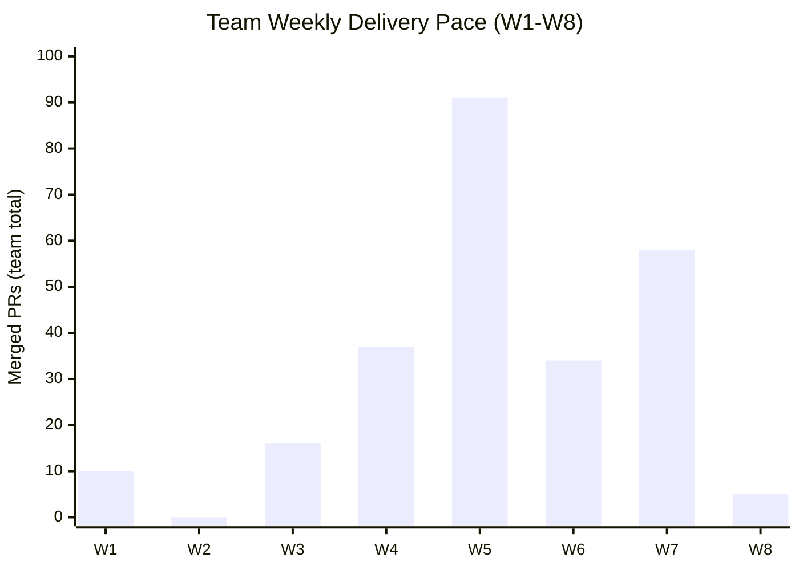

*Notes:* W2 had `0` merges during the 21 Oct repository restart; W6 ended with M1 (`v0.1.0`) tagged on 11 Nov; W7 covered the first live AWS deploy and the four individual features; W8 is a partial week through 26 Nov (`251` merged PRs total, `241` post-reset incl. `#73`; `8` PRs are currently open in review).

### Codebase Footprint Snapshot

| Area | Snapshot (`main` `c4b7151`) |
|---|---|
| Engineering code + tests | `58,211` lines (`50,927` non-empty) across `481` files (`51%` automated tests / `49%` production app, config & infra) |
| Backend Java files | `215` main + `113` test across `11` packages (`126` files total under `backend/src/test/`) |
| Automated tests | `1,221` test methods (`1,163` `@Test`, `30` `@ParameterizedTest`, `28` `@ArchTest`) |
| REST API surface | `21` `@RestController`s, `69` endpoints (`33` POST, `29` GET, `4` PUT, `3` DELETE) |
| Database | `12` PostgreSQL 18 tables via `17` Flyway migrations |
| Frontend | `67` `.ts`/`.tsx` files (`10,833` lines), `20` `*Page.tsx` route pages |
| Documentation | `157` personal docs (`documentation/`), `52` shared docs & diagrams (`docs/`, root `.md`) |
| Collaboration | `251` merged PRs (`240` post-reset commits on `main`, `241` post-reset PRs incl. `#73`), `283` formal cross-team peer reviews |

---

## 6. Lines of Code by Explicit Category & Purpose

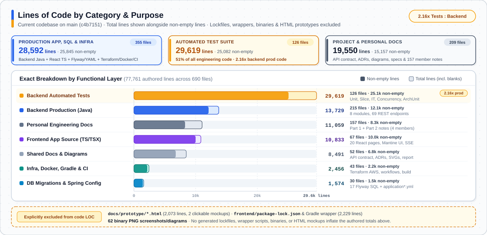

Every tracked file at `main` `c4b7151` (counted via `git ls-files`) is grouped by purpose below, keeping production source, automated tests, written documentation, and excluded artifacts clearly separated.

| Category & Path | Files | Total Lines | Non-empty Lines | Purpose |
|---|---:|---:|---:|---|
| Backend Automated Tests (`backend/src/test/`) | `126` | `29,619` | `25,082` | Unit, Slice, IT, Concurrency, ArchUnit (**2.16× backend production code**) |
| Backend Production Java (`backend/src/main/java/`) | `215` | `13,729` | `12,125` | 8 domain modules, 69 REST endpoints |
| Frontend Application Source (`frontend/src/`) | `67` | `10,833` | `10,021` | 20 React pages, Mantine UI, SSE client |
| Infra, Docker, Gradle & CI (`infra/`, `Dockerfile`, `.github/`, build files) | `43` | `2,456` | `2,155` | AWS Terraform, Docker image, CI/deploy/docs-check/sync-wiki workflows |
| DB Migrations & Spring Config (`backend/src/main/resources/`) | `30` | `1,574` | `1,544` | 17 Flyway SQL migrations & Spring YAML profiles |
| **Engineering Code Subtotal** | **`481`** | **`58,211`** | **`50,927`** | **`51%` automated tests / `49%` production app, config & infra** |
| Personal Engineering Docs (`documentation/`) | `157` | `11,059` | `8,343` | Part 1 + Part 2 notes across all 4 teammates |
| Shared Docs, API Contract & Diagrams (`docs/`, root `.md`) | `52` | `8,491` | `6,814` | API contract, ADRs, SVGs, report chapters, test plans |

**Excluded from code LOC (listed transparently):** `docs/prototype/*.html` (`2` files, `2,073` lines: clickable pre-React UI mockups), `frontend/package-lock.json` & Gradle wrapper (`2,229` lines), and `62` binary PNGs.

---

## 7. Testing Pyramid & Concurrency Defense

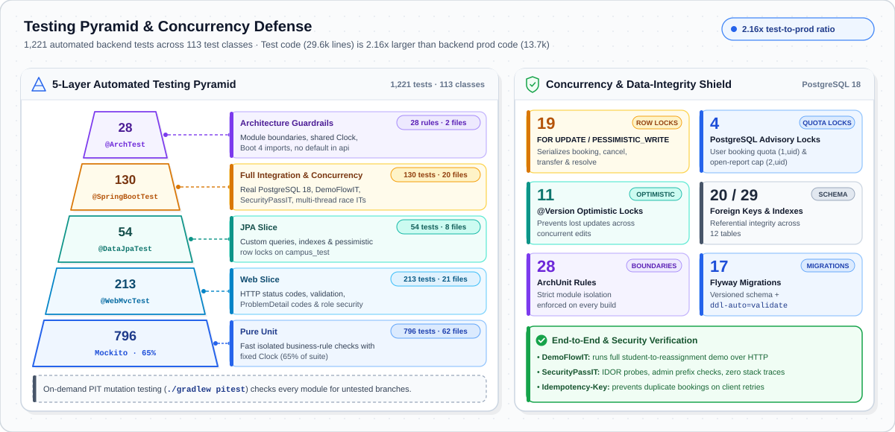

Tests are layered from fast, isolated unit suites up to full Spring Boot and PostgreSQL 18 concurrency tests, backed by automated architecture rules so module boundaries cannot drift.

| Layer | Test Files | Tests / Rules | Scope |
|---|---:|---:|---|
| Pure Unit | `62` | `796` | Service rules, calculators, state transitions, and boundary checks with Mockito and a fixed `Clock` |
| Web Slice (`@WebMvcTest`) | `21` | `213` | HTTP status codes, validation errors, RFC 9457 `ProblemDetail` payloads, and role guards |
| Full Integration & Concurrency (`@SpringBootTest`) | `20` | `130` | End-to-end HTTP flows (`DemoFlowIT`, `SecurityPassIT`), multi-thread race tests, and live Postgres locking |
| JPA Slice (`@DataJpaTest`) | `8` | `54` | Custom repository queries, overlap checks, and Flyway-migrated PostgreSQL 18 schema behavior |
| Architecture (`ArchUnit`) | `2` | `28` | Module `api` boundaries, Boot 4 conventions, `@Transactional` placement, and shared `Clock` usage |
| **Total** | **`113`** | **`1,221`** | **Full backend verification run on every PR in CI** |

**Concurrency & data-integrity guardrails:** `19` pessimistic row locks (`FOR UPDATE`), `4` PostgreSQL advisory locks, `11` `@Version` optimistic locks, `20` foreign keys, `29` database indexes, `Idempotency-Key` replay protection on booking creation, and on-demand PIT mutation testing (`./gradlew pitest`).

---

## 8. Engineering Process & Review Health

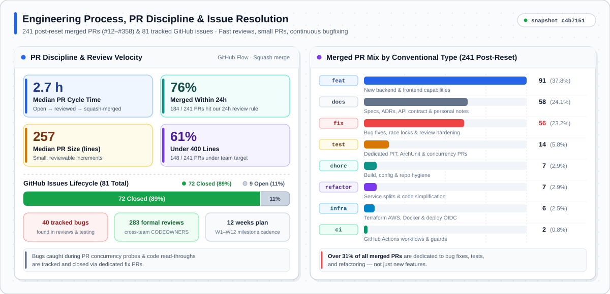

Metrics across all **`241` post-reset merged PRs** (`#12–#358`, `21 Oct – 26 Nov 2026`):

- **Small, reviewable PRs:** median size is **`257` lines**, with **`61.4%`** at or below the `400`-line guideline in `AGENTS.md`.
- **Fast peer review:** median open-to-merge time is **`2.7 hours`**, with **`76.3%`** merged within the 24-hour review rule (`0` solo merges).
- **Issue closure:** **`72 / 81` GitHub issues closed (`89%`)**, including `40` tracked bugs resolved with regression tests.
- **Balanced PR mix:** `91` `feat`, `58` `docs`, `56` `fix`, `14` `test`, `7` `chore`, `7` `refactor`, `6` `infra`, and `2` `ci`. Over **`31%`** of merged PRs focus on bugfixes, automated tests, and refactoring.

---

## 9. Module Complexity, REST API Surface & Database Map

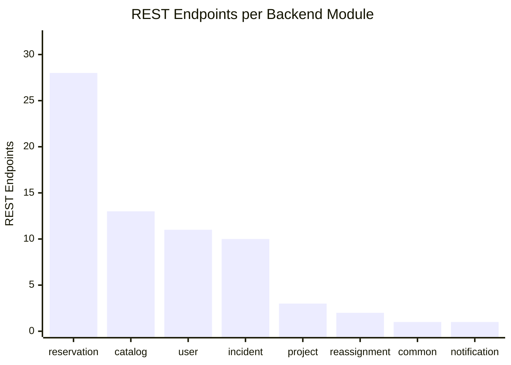

**API surface:** **`69` endpoints total** (`33` POST · `29` GET · `4` PUT · `3` DELETE), split by access tier into **`4` Public** (auth and `.ics` calendar token), **`38` Authenticated Student/User**, and **`27` Admin-only (`/api/v1/admin/**`)**.

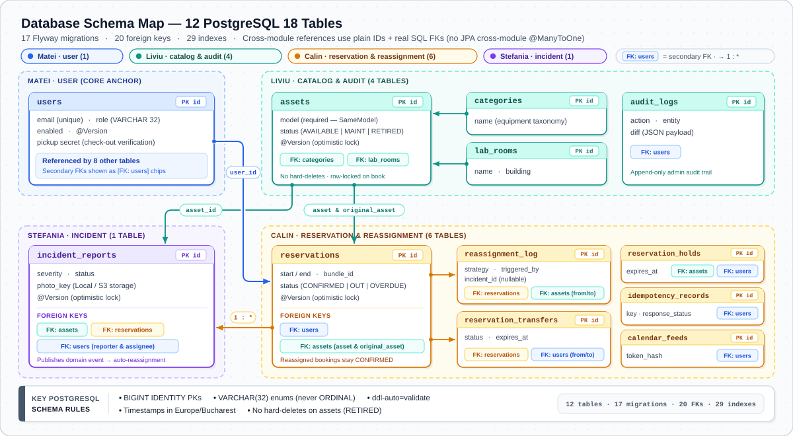

All `12` PostgreSQL 18 tables are managed strictly through Flyway migrations (`ddl-auto=validate`). Cross-module references stay plain `BIGINT` IDs in Java entities while keeping real SQL foreign keys in the database, so modules remain decoupled without sacrificing referential integrity. For full column definitions and relations, see [`docs/diagrams/database-er.mmd`](docs/diagrams/database-er.mmd).

---

## 10. Detailed Work Delivered per Member

### Matei Necula: cloud, security, auth & projects

**Key highlights:**
- **Security, auth & verification:** built BCrypt + JWT auth (`/api/v1/auth/**`, `/users/me`), real-time active-role enforcement (`findActiveRole`) so disabled accounts lose access immediately, RFC 9457 `ProblemDetail` security error responses, `SecurityPassIT`, `DemoFlowIT` (full HTTP demo check), PIT mutation testing, and required `docs-check` CI validation.
- **Projects feature (`#140`):** shipped bilingual project search and detail endpoints (`GET /api/v1/projects`, `/projects/{slug}`) with live per-model availability, 10 demo projects, student Projects pages, and one-click "Reserve all" bundle booking.
- **Pickup pass & Reservations desk:** built rotating 6-digit desk codes and QR codes (`/users/me/pickup-pass`), student pass page, desk camera scan and Verify dialog, and the admin **Reservations desk** page for daily pickups and returns.
- **AWS & automated deploys:** created the single-origin Docker image (serving React from Spring Boot), production S3 photo and SES email adapters (including live push to open tabs), Terraform infrastructure, the first live AWS deploy on CloudFront (17 Nov), and GitHub OIDC `deploy.yml` (applied and proved 22 Nov).
- **Platform & governance:** set up the Gradle/Java 25/PostgreSQL 18 skeleton, 3-thread `@Scheduled` pool (`campus-sched-`), ADRs 001–005, UML component/deployment & AWS diagrams, the defense playbook, and weekly team status refreshes.

**Next:** resume AWS ahead of M2 (`v0.2.0`, Sun 6 Dec) and the teacher feedback demo (Mon 7 Dec; `deploy.yml` OIDC is already applied and proved on 22 Nov and skips cleanly while EC2 is paused); final coverage, rehearsal, and defense prep (W10–W12). Full list: [`docs/whats-left.md`](docs/whats-left.md).

<details>
<summary>Full merged PR log</summary>

| Done (merged) | PRs |
|---|---|
| Repo restart: README, CONTRIBUTING, AGENTS, CODEOWNERS, PR/issue templates, `ci` workflow, `main` protection | #12, #16, #18, #26, #49 |
| Gradle backend skeleton (Java 25, Spring Boot 4.1, PostgreSQL 18, Flyway, Spotless, JaCoCo, Swagger) | #13 |
| Decisions log + API contract draft | #15 |
| `users` table, `User` entity and repository | #17 |
| Password hashing (BCrypt), JWT signing, `/api/v1/admin/**` admin-only, Swagger "Authorize" | #25 |
| 401/403 answers as ProblemDetail JSON | #44 |
| `@Async` + `@Scheduled` switched on (for Calin's jobs and listeners) | #45 |
| `UserApi` contract + `UserSummary`, implemented by `UserService` | #46, #48 |
| Register/login request and response records | #47 |
| AWS architecture diagram + ADRs 001-005; AWS account with budget alerts | #20 |
| Clickable prototype of the app (fake data) | #41, #42 |
| Error responses keep their `code` for validation errors, bad JSON and unknown paths | #52 |
| Register + login endpoints (JWT with `sub`, `email`, `roles`; 8 h) | #54 |
| Dev test accounts created on startup (2 students, 1 admin) | #55 |
| `archunit-junit5` added for Calin's architecture tests | #62 |
| Security tests probe paths no controller maps | #70 |
| `AGENTS.md`: `CurrentUser` as an injectable bean in the contract | #53 |
| `GET /api/v1/users/me` (the logged-in user's profile) | #82 |
| First admin on AWS from `ADMIN_EMAIL` / `ADMIN_PASSWORD` (`prod` only) | #88 |
| Status updates in README + AGENTS, team plan W4-W6, what's-left list, 4 new-feature specs & plans | #50, #56, #57, #81, #83, #93, #106, #136, #144, #218, #237, #251, #274, #276, #301, #307, #313, #334 |
| Docker image: builds the React app and serves it from Spring Boot (one origin, ADR-002), non-root, health check | #114 |
| No more review buddies: anyone can review anyone's PR (CODEOWNERS + ruleset) | #104 |
| Old tokens ignored on the public `/api/v1/auth/**` endpoints | #126 |
| Firewall-rejected URLs answer ProblemDetail JSON | #127 |
| Disabled or deleted users lose access at once (`UserApi.findActiveRole`, checked on every request with a token) | #128 |
| S3 + SES adapters for `prod` (photos in S3, e-mails through SES); missing S3 keys, slow or failing sends handled | #129, #177 |
| `users.created_at` in whole seconds | #135 |
| Register trims spaces around the email; a token with a bad subject gets 401, not 500 | #175, #176 |
| Admin **Reservations desk** page (today's pickups and returns, check-out/return), sorted by start time on the backend | #138, #194 |
| Security pass as tests: IDOR with two students, students rejected on admin endpoints, no stack traces (`SecurityPassIT`) | #139 |
| Mutation testing on demand (`./gradlew pitest`) + tests for the gaps it found in my code | #180, #182 |
| `DemoFlowIT`: the whole demo through the HTTP API; a failure names the step and its owner | #181 |
| Defense playbook (`docs/testing/defense-playbook.md`) + test rules in `AGENTS.md` | #183 |
| Swagger: 401/403 and `ProblemDetail` errors documented on every endpoint | #184 |
| Security chapter of the report + JWT sequence diagram; UML component + deployment diagrams | #185, #186 |
| All security rules in `docs/api-contract.md` §2; SSM arrow fixed in the AWS diagram | #195 |
| README quick start (run, open, test) at the top | #200 |
| Projects feature (#140): design + plan; engine with bilingual search and free units per model (`GET /api/v1/projects`, `/projects/{slug}`); 10 projects; Projects pages; Reserve all; confirmation banner | #232, #236, #239, #238, #243, #248 |
| Terraform part 1 (state bucket, VPC, subnets, security groups) and part 2 (photo bucket, ECR, instance role, SSM parameters; RDS off until W7), applied; first image pushed to ECR | #249, #250 |
| Docker image with OS security updates; clean ECR scan noted | #252, #253 |
| Login rejects passwords over 72 bytes; project search false hits and details page errors fixed | #271, #272, #273 |
| End-of-task docs rule (`AGENTS.md` §4) + `docs-check` CI job made a required check on `main` | #277, #279, #281 |
| Pickup pass backend: rotating 6-digit desk code, `/users/me/pickup-pass` + admin verify | #283 |
| Public calendar feed path in `SecurityConfig` (for Calin's calendar feed) | #295 |
| `AGENTS.md`: `cancelUpcomingReservationsForUser` in the `ReservationApi` contract | #282 |
| Pickup pass pages: student pass page + desk Verify dialog on the Reservations desk | #284 |
| **First AWS deploy**: EC2 t3.small + Elastic IP + CloudFront, RDS on, SES sender, admin credentials in SSM; app live on CloudFront (17 Nov), then paused to save credits | #304 |
| Live-check fixes: relative Swagger server URL, `HEAD` on public pages | #308 |
| E-mail alert when AWS restarts the stopped RDS after 7 days | #309 |
| `findActiveRole` reads the user row fresh, so a re-check inside a transaction sees a disable | #312 |
| Pickup pass: QR code and desk camera scan | #318 |
| `deploy.yml`: after a green `ci` on `main`, build and push to ECR, deploy over SSM, health check; GitHub OIDC role applied and proved on 22 Nov | #320 |
| Team decisions settled (off-plan features, open rows) | #321, #323 |
| Live SES notifications also pushed to open tabs | #332 |
| `UserDisabledEvent` listener contract Javadoc + personal doc 61 | #335 |
| 3-thread `@Scheduled` pool (`campus-sched-`) so background sweeps do not block the 20 s SSE heartbeat | #347 |
| Dedicated `PROGRESS.md` page with 3 SVG architecture/contribution sketches and 2 Mermaid charts | #357 |
| Top navigation bar in `README.md` and `.github/workflows/sync-wiki.yml` auto-syncing `PROGRESS.md` to the GitHub Wiki | #358 |
| Personal docs 01-64 + README index of them | #14 + each PR above, #137 |

*Note: pre-reset PRs `#1–#10` (6–8 Oct 2026) preceded the 21 Oct repository restart.*

</details>

---

### Liviu Nedelcu: catalog, shared services & live notifications

**Key highlights:**
- **Shared backend foundation:** built `GlobalExceptionHandler` (RFC 9457 `ProblemDetail` errors), `PageResponse<T>`, `PageRequests`, `AuditService` (`audit_logs` table, field-level diffs, admin search), `LocalStorageService` (with file type, size, and path-traversal guards), and `LoggingNotificationService`.
- **Equipment catalog & dev seeding:** delivered `categories`, `lab_rooms`, and `assets` tables, `CatalogApi` (including `lockForBooking`), admin CRUD and retire (`AssetRetiredEvent`), paginated search and filters, and `CatalogSeeder` with lab assets and student project hardware kits.
- **Live notifications end-to-end (`#290`):** shipped `GET /api/v1/live/stream` (SSE), `LoggingNotificationService` live push, `UserDisabledLiveStreamListener` closing open streams when a user is disabled, plus the frontend SSE client (`live.ts`) and `<LiveToasts />` toast stack.
- **Frontend pages:** built **Catalog**, **Asset details**, **Admin inventory** (split per tab), and **Admin audit log** (with action filters and strict date validation).
- **Quality & documentation:** added Swagger error codes, `STALE_VERSION` tests, PIT survivor coverage across `catalog`/`common`/`storage`, class and ER diagrams, and module guides (`docs/modules/catalog.md`, `docs/modules/common.md`).

**Next:** merge the `#290` polish PR (`#344`, ready to merge); finish `#268` leftovers (category and lab room version checks); assist Calin on substitute-search edge cases; coverage, final diagrams, and defense prep (W10–W12). Full list: [`docs/whats-left.md`](docs/whats-left.md).

<details>
<summary>Full merged PR log</summary>

| Done (merged) | PRs |
|---|---|
| Shared exceptions + `GlobalExceptionHandler` (ProblemDetail errors) | #22 |
| `PageResponse<T>` for paginated lists | #22 |
| `AuditService`, `StorageService`, `NotificationService` interfaces + dev versions (logging, local disk) | #22 |
| Personal documentation folder | #21 |
| Catalog: `categories`, `lab_rooms`, `assets` tables + entities, real `CatalogApi` (incl. `lockForBooking`), `docs/modules/catalog.md` | #24 |
| Real `AuditService` writing the `audit_logs` table | #64 |
| Personal docs W2-W4 | #68 |
| Category, lab room and asset CRUD + retire (admin), asset details | #66 (+ #73) |
| Catalog admin actor via `CurrentUser` | #89 |
| Local disk storage with security checks (type, size, path traversal) | #90 |
| Asset search, filters and paging (`GET /api/v1/assets`) | #92 |
| Query-parameter validation errors → 400 `VALIDATION_FAILED` | #110 |
| Large page offsets → 400, audit errors kept apart from duplicate-name errors, error contract aligned | #143 |
| Fewer catalog queries, audit times in whole seconds, constraint checks | #192 |
| **`CatalogSeeder`** (dev): 4 categories, 3 lab rooms, 18 assets, several units of the same model | #193 |
| Frontend: catalog page, asset details page, admin inventory page | #196 |
| `docs/modules/common.md` | #197 |
| Audit log search `GET /api/v1/admin/audit-logs` + audit log page | #217, #221 |
| Swagger error codes, `STALE_VERSION` test, PIT survivors in catalog/common/storage | #220 |
| Catalog/common class + ER diagrams, report chapter | #222 |
| Search debounce spinner, audit filter actions, seed asset 14 set available | #242 |
| Reject timezone offsets on audit log date filters | #244 |
| Student project hardware kits in the dev seed (18 units, 8 models) for Projects | #275 |
| Code read-through fixes (#268): version check on asset update, retired assets hidden from students, field-level audit diffs; shared `PageRequests` paging helper; admin inventory page split per tab, `PICKUP_PASS_VERIFIED` audit filter | #278, #287, #288 |
| `AssetRetiredEvent` published when an asset is retired (for the retire flow, #245) | #280 |
| Live notifications: server-sent event stream `GET /api/v1/live/stream` for open tabs (#290) | #317 |
| Live notifications frontend: SSE client (`live.ts`) & `<LiveToasts />` toast stack (#290) | #339 |
| `LoggingNotificationService` live push + `UserDisabledLiveStreamListener` closing open streams on disable (#290) | #340 |

</details>

---

### Calin Murariu: reservations & auto-reassignment

**Key highlights:**
- **Reservation engine & concurrency hardening:** built the shared `Clock` (Europe/Bucharest), booking and bundle booking with pessimistic `FOR UPDATE` locks and advisory quota locks, overlap checks, `Idempotency-Key` replay, 1-minute slot holds, extend, transfer, check-out/return windows, and scheduled no-show/overdue sweeps, plus locked cancellation and `checkOut`-vs-`markNoShow` concurrency tests.
- **Auto-reassignment engine & simulator:** built the Observer + Strategy reassignment engine reacting to `AssetDamagedEvent` and `AssetRetiredEvent` (same model, then same category, preferring the same lab room; force-cancel fallback), per-booking transactions, `reassignment_log`, and the dry-run maintenance impact simulator endpoint (`POST /api/v1/admin/reassignments/simulate`, `#351`).
- **Calendar feed & cross-module facades:** shipped the iCalendar feed (`GET /api/v1/calendar/{token}.ics`, `IcsWriter`, **Calendar sync** page), `ReservationApi.bookBundle` for Projects, `ReservationApi.usedMinutesByAsset` for Equipment health, and automatic cancellation on `UserDisabledEvent`.
- **Frontend booking UX:** built **My reservations** (with moved/force-cancelled badges, extend, transfer, and pickup pass shortcut), `CalendarBookingView` with hold countdown (`useSlotHold`), and `QuickBookModal` on catalog and asset details.
- **Architecture & testing discipline:** wrote `28` ArchUnit rules enforcing module boundaries and Boot 4 conventions (including Rule 15 forbidding `default` methods in `api`), boundary/concurrency/PIT test suites, the team test plan, and Strategy/Observer documentation.

**Next:** land the open off-plan PRs currently in review ahead of the 30 Nov / 7 Dec cut: maintenance impact simulator UI (`#58` PR 2, `#352`; PR 1 `#351` is merged), FIFO waitlist (`#59`: `#349`, `#350`), and next free slots (`#61`: `#353`, `#354`); clean up remaining old `moveToAsset`/`forceCancel` references in docs and finish ArchUnit strict-mode cleanup. Full list: [`docs/whats-left.md`](docs/whats-left.md).

<details>
<summary>Full merged PR log</summary>

| Done (merged) | PRs |
|---|---|
| Shared `Clock` bean (Europe/Bucharest) for every "now" in the app | #27 |
| Reservations table, entity and `ReservationApi` | #34 |
| Booking with overlap check and row locking | #35 |
| My reservations, cancel, facade, seeder | #36 |
| Auto-reassignment engine on `AssetDamagedEvent` (same model, then same category, else cancel) | #37 |
| Reservation + reassignment docs | #39 |
| ArchUnit module boundary and coding convention rules | #76 |
| Admin desk: reservation search, check-out, return | #80 |
| Check-out/return windows, scheduled no-show and overdue jobs | #60 |
| Equipment availability endpoint | #78 |
| Frontend: My reservations page + calendar booking view, `/reservations/me/summary` | #87 |
| Fix: rollback test used the real clock and broke once its date passed | #95 |
| `GET /api/v1/admin/reassignments` (paged reassignment log) | #96 |
| Concurrency test: two threads book the same slot, exactly one wins | #97 |
| Boundary tests for every booking rule | #98 |
| Engine hardening: retired assets excluded, deterministic tie-break | #99 |
| "Moved" / "force-cancelled" badges in My reservations | #100 |
| Reservation diagrams, team test plan, Strategy pattern doc | #101 |
| More unit + web slice tests, 3 new ArchUnit rules (shared `Clock`, `@Transactional` placement, no ORDINAL enums) | #102 |
| Review follow-ups: badge check, test cleanup, coverage worded as a target | #109 |
| Timestamps in whole seconds (reservations, reassignment log) | #130 |
| No check-out of an overdue or non-bookable asset | #131 |
| Reassignment: one transaction per booking, one failed move no longer rolls back the rest | #132 |
| My reservations: loader and error reset on every fetch | #133 |
| OVERDUE bookings block the asset until returned | #141 |
| Reassignment: candidate lookup outside the lock transaction, retry with the next substitute; same room first in the preventive cascade | #152, #161 |
| Huge page offsets → 400; per-user booking limit checked under an advisory lock | #153, #173 |
| Admin cancel reason and notification, `sortDir` on the admin search | #172 |
| Sweep/reassignment indexes + admin Swagger docs; Swagger examples and error codes | #162, #191 |
| Frontend fixes: Today button, 14-day slot horizon, campus clock, no cancel after the start | #154, #163, #174 |
| More ArchUnit rules: method-level `@CrossOrigin`/`@Transactional`, Boot 4 imports, admin prefix | #179 |
| Tests for remaining branches and PIT survivors in reservation and reassignment | #178, #201 |
| Test plan with PIT, Strategy pattern doc, booking sequence diagram, report chapter, personal doc 15 | #199, #205, #204, #203, #202 |
| Observer pattern doc | #207 |
| New (not in the original plan): multi-asset bundle booking, extend an active booking, transfer a booking to a classmate, 1-minute slot hold | #212, #213, #214, #219 |
| Frontend: quick-book modal on the catalog and asset details, report-incident button | #226 |
| Extend + transfer in My reservations; hold countdown in the calendar view; tests for the remaining PIT survivors | #224, #225, #227 |
| Time-zone offsets rejected; bundle/transfer/hold security fixes (#228); `ReservationApi.bookBundle` for Projects | #233, #234, #235 |
| Bundle booking confirmation banner in My reservations | #246 |
| Bundle quota counting, after-commit emails and edge-case guards (#240) | #247 |
| `Idempotency-Key` on `POST /reservations` and `/reservations/bundle`: a retry replays the first answer | #262 |
| Cancel a user's upcoming bookings: `ReservationApi.cancelUpcomingReservationsForUser` + admin endpoint (#229) | #266 |
| Code read-through fixes and refactors (#267): holds, locking, lifecycle; `isAssetFree` hold owner; unified OVERDUE queries, single hold sweep; `HoldService`, `TransferService`, slot validator; frontend `useSlotHold` + shared booking rules | #270, #292, #293, #294, #296 |
| Same-model substitute suggestions on a slot conflict | #286 |
| Calendar feed (#289): token settings + `IcsWriter`, `GET /api/v1/calendar/{token}.ics`, Calendar sync page; `ReservationApi.usedMinutesByAsset` for Stefania's equipment reliability | #297, #298, #299, #300 |
| Calendar sync button in My reservations (closes #314) | #315 |
| PIT survivors covered in the reservation module | #316 |
| Retired asset → reassignment: `AssetRetiredEvent` listener, nullable `reassignment_log.incident_id` (#245) | #311 |
| Reassignment log column `trigger` renamed to `triggered_by`, generated IDs in the retire-flow test | #326 |
| `moveToAsset` / `forceCancel` check the expected source asset (closes #319) | #327 |
| Active user re-checked after the booking quota lock (#229) | #310 |
| Disabled user's bookings: row lock order, `FOR UPDATE` on the cancel, automatic cancel on `UserDisabledEvent` (#229) | #329, #330 |
| "Show pickup pass" button on today's confirmed bookings in My reservations | #328 |
| Clean-up: no self-invoking default overloads on `ReservationApi` | #333 |
| `FOR UPDATE` row lock on `cancelReservation`, ArchUnit Rule 15 forbidding `default` methods in `api`, lock-order tests and docs sync | #336 |
| `FOR UPDATE` on `cancelBundle` and `markNoShow`, race ITs and personal docs sync | #338 |
| Locked no-show owner notification, `checkOut`-vs-`markNoShow` concurrency IT, `Clock`-based dates and generated IT IDs | #348 |
| Dry-run maintenance impact simulator endpoint `POST /api/v1/admin/reassignments/simulate` (#58 PR 1) | #351 |

*Open in review (off-plan features):* `#58` PR 1 landed (`#351`); `#58` PR 2 (`#352`), FIFO waitlist (`#349`, `#350` / `#59`), and next free slots (`#353`, `#354` / `#61`) are open in review.

</details>

---

### Stefania: incidents, user admin, frontend lead & CI

**Key highlights:**
- **Incident reporting & triage:** implemented incident creation (`AssetDamagedEvent` on `HIGH`/`CRITICAL`, max 3 open reports per student), audited triage transitions (start repair, resolve, reject), photo upload/view with orphan cleanup, and the **My incidents**, **Incident details** (`/incidents/:id`), and **Incident queue** pages.
- **Equipment reliability (`#291`):** delivered the pure ranking engine (`ReliabilityCalculator`), `ReliabilityService` + `GET /api/v1/admin/reliability`, and the admin **Equipment health** page (`/admin/reliability`).
- **User administration & security helper:** built the injectable `CurrentUser` bean, admin user management endpoints (search, details, enable/disable publishing `UserDisabledEvent`, role change), and the admin **Users** and **Reassignment log** pages.
- **Frontend lead & shared shell:** created the Vite + React + TypeScript + Mantine scaffold, API client and auth context, role-based routes, **Login** and **Register** pages, `AppLayout` (with `<LiveToasts />` mounted), QR dependency setup, and `docs/modules/frontend.md`.
- **CI & prototype:** delivered the redesigned clickable HTML prototype (`docs/prototype/campus-hub-redesign.html`) and kept `.github/workflows/ci.yml` running reliably across backend and frontend jobs.

**Next:** merge approved incident concurrency ITs (`#355`, ready to merge); finish `#269` leftovers; add the app-wide RO/EN language choice (`#140`); coverage, final UI polish, and defense prep (W10–W12). Full list: [`docs/whats-left.md`](docs/whats-left.md).

<details>
<summary>Full merged PR log</summary>

| Done (merged) | PRs |
|---|---|
| Personal documentation folder | #19 |
| Redesigned clickable prototype (`docs/prototype/campus-hub-redesign.html`) | #51 |
| `CurrentUser` as an injectable bean | #74 |
| Incident reporting flow, persistence, `AssetDamagedEvent` | #40 |
| Frontend scaffold (Vite + React + TypeScript + Mantine, routing) | #84 |
| API client, auth context, login page | #85 |
| App layout, role-based routes, shared components, conventions (`docs/modules/frontend.md`) | #86 |
| Register page | #107 |
| Incident triage (start repair, reject), `GET /incidents/me`, `GET /incidents/{id}` | #108 |
| Every triage action audited, list indexes, error responses in Swagger | #208 |
| Incident photo upload + view (reporter or admin), orphan files cleaned up | #210 |
| Admin user endpoints: search, details, enable/disable, change role | #206 |
| ADR-002 ✅ in `docs/decisions.md` (Spring serves the React build) | #111 |
| Frontend: keep the token when the backend is down on startup; unique `ErrorAlert` keys, `/admin` index route | #142, #145 |
| Personal docs; `CurrentUser.isAdmin()` Javadoc fix | #198, #215 |
| Frontend: My incidents page + Report a problem form with photo | #216 |
| Frontend: admin incident queue (start repair, resolve, reject, photo view) | #223 |
| Only HIGH/CRITICAL incidents take the asset out of use at once; max 3 open reports per student (#229) | #263 |
| `UserDisabledEvent` published on disable, so upcoming bookings are cancelled (#229) | #302 |
| QR libraries for the pickup pass; `ci.yml` steps no longer skipped by `hashFiles` guards | #303 |
| Admin **Users** page (search, enable/disable, role change) and **Reassignment log** page (#305, #306) | #331 |
| `ReliabilityCalculator` pure ranking engine (#291 PR 1) | #337 |
| `ReliabilityService` + `GET /api/v1/admin/reliability` (#291 PR 2) | #341 |
| Frontend **Equipment health** page `/admin/reliability` (#291 PR 3) | #342 |
| Frontend **Incident details** page `/incidents/:id` with photo add/replace and admin triage | #343 |
| Mount `<LiveToasts />` in `AppLayout` (#290) | #345 |

</details>

---

## 10. Everyone & Further Reading

**Open team items:** only two items remain open in [`docs/decisions.md`](docs/decisions.md): the recurring weekly meeting time (`⏳`) and the exact defense date (to be announced by the professor).

- **What is still to do:** [`docs/whats-left.md`](docs/whats-left.md)
- **Architecture & UML diagrams:** [`docs/diagrams/README.md`](docs/diagrams/README.md)
- **REST API & error contract:** [`docs/api-contract.md`](docs/api-contract.md)
- **Team decision log:** [`docs/decisions.md`](docs/decisions.md)
- **Defense playbook:** [`docs/testing/defense-playbook.md`](docs/testing/defense-playbook.md)
- **Personal member docs (`157` files):** [`documentation/`](documentation/)
