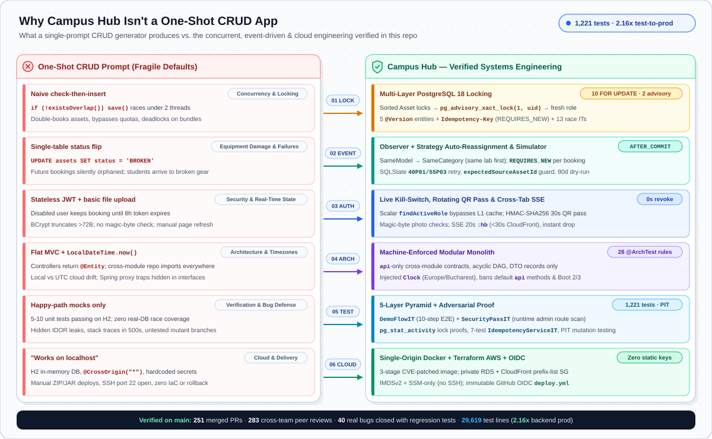

# Campus Equipment & Incident Hub

> **[Project Progress & Team Contributions](PROGRESS.md)** · **[Wiki](https://github.com/FundamenteleInginerieiSoftware/campus-hub/wiki)** · **[What's Left](docs/whats-left.md)** · **[Template Blueprint](docs/reusable-template-blueprint.md)** · **[Contributing](CONTRIBUTING.md)**

University project for **Fundamentele Ingineriei Software (FIS)**.
Students reserve shared lab equipment by time slot and report broken equipment with a photo.
When an asset is reported damaged, an **auto-reassignment engine** moves its upcoming bookings to a substitute (or cancels them) and notifies the students.

## Why This Isn't a Simple CRUD App (And Can't Be One-Shotted)

On paper, *"book lab equipment and report broken items"* sounds like a weekend CRUD prompt. Under real concurrency, failing hardware, security abuse, and cloud latency, a one-shot generated app breaks immediately — double-booking gear, deadlocking on multi-item kits, letting disabled users keep booking for 8 hours, or stranding students with broken equipment.



What makes this system genuinely hard — and empirically proved on `main` across **`1,221` automated tests** (`2.16×` larger than backend production code) and **`40` real bugs closed with regression tests**:

- **Deadlock-free PostgreSQL 18 concurrency:** `10` `SELECT ... FOR UPDATE` queries, `2` PostgreSQL advisory lock namespaces (`(1, userId)` for booking quota, `(2, userId)` for incident quota), `5` `@Version` entities, `Idempotency-Key` replay/takeover protection in isolated `REQUIRES_NEW` transactions, and a strict lock-ordering DAG proved by multi-thread `pg_stat_activity` tests ([`ReservationConcurrencyIT`](backend/src/test/java/com/campus/reservation/service/ReservationConcurrencyIT.java), [`IdempotencyServiceIT`](backend/src/test/java/com/campus/reservation/service/IdempotencyServiceIT.java)).
- **Event-driven auto-reassignment & 90-day dry-run simulator:** `HIGH`/`CRITICAL` damage or retirement fires `AFTER_COMMIT` events into a Strategy pipeline (`SameModelStrategy` → `SameCategoryStrategy`, same lab room first) with per-booking `REQUIRES_NEW` isolation, PostgreSQL SQLState (`40P01`/`55P03`/`40001`) retry, an `expectedSourceAssetId` double-move guard, and a zero-write virtual allocation simulator ([`MaintenanceImpactSimulator`](backend/src/main/java/com/campus/reassignment/service/MaintenanceImpactSimulator.java)).
- **Zero-delay security kill-switch, rotating QR pass & real-time SSE:** every JWT request runs a scalar `findActiveRoleById` query bypassing Hibernate's L1 cache (`0s` account revocation), 30-second HMAC-SHA256 rotating 6-digit/QR pickup passes verified in constant time, binary magic-byte photo validation, and `/api/v1/live/stream` SSE toasts with 20s `:hb` heartbeats tuned below CloudFront's 30s idle timeout and instant disconnect on disable.
- **Rich state machines & temporal invariants:** 7-state reservations with open-ended `OVERDUE` overlap checks, session-counted multi-asset bundles (`coalesce(bundleId, id)`), 1-minute holds with 2-minute anti-hoarding cooldown, 3-in-24h transfers, preventive 60-minute overdue cascades, bilingual RO/EN project search + atomic *"Reserve all"*, and an injected `Clock` (`Europe/Bucharest` vs UTC on AWS).
- **Machine-enforced modular monolith (`28` `@ArchTest` rules):** `api`-only module encapsulation, acyclic dependency DAG, banning `default` methods on `..api..` interfaces after catching a real Spring `@Transactional` proxy bypass (`#327`/`#333`), banning `LocalDateTime.now()` without `Clock`, and on-demand PIT mutation testing (`./gradlew pitest`).
- **Production AWS with zero static deploy keys:** 3-stage CVE-patched single-origin Docker image, Terraform VPC + private RDS + CloudFront prefix-list security group + IMDSv2 + SSM-only (no SSH), and immutable GitHub OIDC [`deploy.yml`](.github/workflows/deploy.yml).

<details>
<summary><strong>▶ Prove it in 60 seconds — run the 75-test live proof suite on PostgreSQL 18</strong></summary>

With local PostgreSQL 18 running (Quick start step 1), run this single command inside `backend/` to execute **75 live tests** (`DemoFlowIT` E2E auto-reassignment, `SecurityPassIT` IDOR/admin-route reflection, `28` ArchUnit rules, and all multi-thread locking, idempotency, rollback, and L1-cache-bypass ITs — verified green in ~41 s):

```bash
cd backend && ./gradlew test --rerun \
  --tests "com.campus.DemoFlowIT" \
  --tests "com.campus.config.SecurityPassIT" \
  --tests "com.campus.architecture.*" \
  --tests "com.campus.reservation.service.ReservationConcurrencyIT" \
  --tests "com.campus.reservation.service.IdempotencyServiceIT" \
  --tests "com.campus.reassignment.service.AssetRetiredReassignmentIT" \
  --tests "com.campus.reassignment.service.ReassignmentRollbackIT" \
  --tests "com.campus.user.service.FindActiveRoleFreshReadIT" \
  --tests "com.campus.incident.service.IncidentQuotaConcurrencyIT"
```

</details>

> **Full technical case, PostgreSQL lock-ordering diagram, 6 real concurrency bugs caught in PRs, and a 3-minute live two-window browser demo:** see **[`PROGRESS.md` §1](PROGRESS.md#1-why-this-isnt-a-simple-crud-app-and-cant-be-one-shotted)** (auto-synced to the **[GitHub Wiki](https://github.com/FundamenteleInginerieiSoftware/campus-hub/wiki)**).

---

## ▶ Quick start: run it, open it, test it

Needs JDK 25, PostgreSQL 18 with the `campus` user and databases, and Node.js 24 (first time? sections 1 and 1.1).

**1. Start PostgreSQL and check it answers**

```bash
sudo service postgresql start      # Linux/WSL, after every reboot (Windows/macOS: it starts by itself)
pg_isready -h localhost            # → "localhost:5432 - accepting connections"
```

**2. Start the backend** (terminal 1, http://localhost:8080)

```bash
cd backend
./gradlew bootRun                  # Windows: gradlew.bat bootRun. Wait for "Started CampusHubApplication"
```

**3. Start the frontend** (terminal 2, http://localhost:5173)

```bash
cd frontend
npm ci                             # first time, or after package.json changed
npm run dev                        # sends every /api call on to :8080, so start the backend first
```

**4. Open it**

| Address | What it is | You should see |
|---|---|---|
| <http://localhost:5173> | **The app** (React) | The login page. Log in with an account below |
| <http://localhost:8080/swagger-ui.html> | **Swagger**: try every API endpoint by hand | All endpoints. Log in with `POST /api/v1/auth/login`, copy `accessToken`, click **Authorize**, paste it |
| <http://localhost:8080/actuator/health> | Is the backend up? | `{"status":"UP"}` |
| <http://localhost:8080/api/v1/auth/ping> | Does security let public calls through? | A short JSON message |
| pgAdmin → `localhost:5432`, database `campus`, user `campus` / `campus` | The data itself | The tables (`users`, `assets`, `reservations`, …) |

**Dev accounts** (password `password` for all): `student1@campus.test`, `student2@campus.test`, `admin@campus.test`. On an empty database the app also creates demo equipment (categories, lab rooms, several assets of the same model) and a few bookings.

**What works in the browser today:** login and register, plus live toast notifications across open tabs; catalog + asset details with quick booking, **My reservations** with the booking calendar, **Calendar sync**, **Pickup pass**, **My incidents** + report form, **Incident details** (`/incidents/:id`), and **Projects** pages (students); admin inventory, incident queue, **Equipment health** (`/admin/reliability`), admin users, reassignment log, audit log, and the **Reservations desk** for pickups and returns (admin).

**5. Run the tests**

| Command (in `backend/`, PostgreSQL running) | What it checks |
|---|---|
| `./gradlew build` | Everything: all tests + format check + coverage. Must end in `BUILD SUCCESSFUL` |
| `./gradlew test --tests DemoFlowIT` | **The whole demo in one test**: register → login → book → double-book 409 → report damage → the booking moves to a twin asset. A failure names the step, its owner and the class to open |
| `./gradlew test --tests AssetServiceTest` | One test class |
| `./gradlew test --rerun` | Runs every test again (Gradle skips unchanged ones otherwise) |
| `./gradlew pitest` | Mutation testing, on demand (~3 min): breaks the code on purpose and lists what no test caught. Report: `backend/build/reports/pitest/index.html` |
| `cd frontend && npm run lint && npm run build` | Frontend lint + type check + production build |

Reports after `build`: tests in `backend/build/reports/tests/test/index.html`, coverage in `backend/build/reports/jacoco/test/html/index.html`. How to read a red test and what to do at the defense: [`docs/testing/defense-playbook.md`](docs/testing/defense-playbook.md).

**If something doesn't start**

| Problem | Fix |
|---|---|
| `Connection to localhost:5432 refused` | PostgreSQL isn't running: step 1 |
| `password authentication failed for user "campus"` | The user/databases were never created: section 1.1 |
| Flyway error (`checksum mismatch`, `Detected applied migration not resolved locally`) after switching branches | Reset the local database (section 2) |
| `Port 8080 was already in use` | Another backend is still running: stop it (IntelliJ ■ or `Ctrl+C`) |
| The app at :5173 shows errors or "network error" on every page | The backend isn't running, or not on :8080 |

---

## What it is built with

| | |
|---|---|
| Backend | Java 25, Spring Boot 4.1, Gradle (wrapper), Spring Security (JWT), JPA + Flyway |
| Database | PostgreSQL 18: installed on your laptop (+ pgAdmin), a service container in CI, RDS on AWS |
| Frontend | React + Vite + TypeScript (in `frontend/`) |
| Cloud | AWS: one EC2 server (Docker) behind CloudFront, RDS PostgreSQL 18, S3, SES ([ADR-002](docs/adr/002-single-ec2-behind-cloudfront.md)), managed by Matei. **You don't need an AWS account.** |

> **Status (26 Nov 2026, week 8):** **M1 done (`v0.1.0` tagged 11 Nov).** On `main`: security (register/login with JWT, `/users/me`, admin-only `/api/v1/admin/**`, admin user endpoints; disabling a user cancels upcoming bookings and closes live streams automatically), **catalog** with admin CRUD, retire, search and dev seed data, **reservations** (overlap check, my reservations, cancel, availability, check-out/return, no-show/overdue jobs, bundle booking, extend, transfer, 1-minute slot hold, iCalendar feed, and dry-run maintenance impact simulator endpoint `#351`), **incidents** (report, triage, my incidents, photo upload, **Incident details** `/incidents/:id`, and **Equipment reliability** `/admin/reliability`), the **auto-reassignment engine** (damage and retire flows), ArchUnit rules, **Projects** (search, details, Reserve all), **Pickup pass** (rotating desk code, QR code, desk camera scan), and **live notifications end-to-end** (SSE stream, dev/SES push, `<LiveToasts />` in `AppLayout`, and a 3-thread scheduler). Cloud & CI: Docker image, S3/SES adapters, Terraform, the **first AWS deploy** (17 Nov, paused between demos to save credits), and GitHub OIDC **`deploy.yml`** (applied and proved on 22 Nov; skips while EC2 is paused). **The whole demo runs on `main`** and is checked by `DemoFlowIT`. Full visual progress, ownership map, timeline and per-member PR logs: **[`PROGRESS.md`](PROGRESS.md)**. What is still left until the defense: **[`docs/whats-left.md`](docs/whats-left.md)** (next: M2 `v0.2.0` on Sun 6 Dec, local + AWS; feature freeze and teacher feedback demo moved to Mon 7 Dec). New here? Install the tools (section 1), set up the database (section 1.1), then follow the **Quick start** at the top and do your practice PR (section 3).

---

## 1. Install (once)

Everyone uses the **same major versions**. Version mismatches are the #1 cause of "works on my machine".

| Tool | Version | Notes |
|---|---|---|
| **JDK** | **25** | Must be a JDK, not a JRE. Windows/macOS: [Eclipse Temurin 25](https://adoptium.net/). Linux/WSL: `sudo apt install openjdk-25-jdk` |
| **PostgreSQL** | **18** | See section 1.1. pgAdmin 4 comes with the Windows/macOS installer |
| **IntelliJ IDEA** | latest | Free Ultimate with a student license (it also has a built-in Database tool) |
| **Git** | latest | |
| **Node.js** | 24 LTS | Only needed once the frontend exists |

You do **not** install Gradle. Always use the wrapper: `./gradlew` (macOS/Linux/WSL) or `gradlew.bat` (Windows).

**Configure Git with your GitHub email** (otherwise your commits don't count as yours):

```bash
git config --global user.name  "Your Name"
git config --global user.email "the-email-on-your-github-account@example.com"
```

**Windows + WSL users:** clone the repo inside the Linux filesystem (`~/…`), **not** in `/mnt/c/…` (builds are very slow there).

### 1.1 PostgreSQL 18 + pgAdmin

**Install:**

| OS | How |
|---|---|
| Windows / macOS | The EDB installer from <https://www.postgresql.org/download/> (version **18**). Keep the default port **5432**, tick **pgAdmin 4**, and choose a password for the `postgres` superuser (it stays on your laptop; never commit it). |
| Linux / WSL | `sudo apt install postgresql` and check `psql --version` says **18**. If your distro ships an older version, add the official repo first (<https://www.postgresql.org/download/linux/>). Start it with `sudo service postgresql start`. pgAdmin: install it on Windows (or Linux) and connect to `localhost:5432` (WSL forwards it). |

**Create the project user and databases** (once). In pgAdmin: connect as `postgres` → right-click the server → **Query Tool**, then run:

```sql
CREATE ROLE campus LOGIN PASSWORD 'campus';
CREATE DATABASE campus OWNER campus;
CREATE DATABASE campus_test OWNER campus;
```

On Linux/WSL without pgAdmin: `sudo -u postgres psql` and paste the same three lines.

`campus` / `campus` is a **dev-only** login that everyone uses, so the app needs no configuration. The app creates all tables itself (Flyway) on first start. If you ever need different values, set `DB_URL`, `DB_USERNAME` and `DB_PASSWORD` in your IntelliJ run configuration; never commit them.

**Check it works:** in pgAdmin, add a server `localhost:5432` with user `campus` / password `campus`, and open the `campus` database.

---

## 2. Clone and run

```bash
git clone https://github.com/FundamenteleInginerieiSoftware/campus-hub.git
cd campus-hub/backend
./gradlew build          # build + tests (PostgreSQL must be running), should end with BUILD SUCCESSFUL
./gradlew bootRun        # starts the app on http://localhost:8080
```

On Windows (PowerShell / cmd) use `gradlew.bat build` and `gradlew.bat bootRun`.

The first build downloads Gradle and the dependencies and takes a few minutes. Later builds are fast.

**Check that it works:**

| Open | You should see |
|---|---|
| <http://localhost:8080/actuator/health> | `{"status":"UP"}` |
| <http://localhost:8080/swagger-ui.html> | Swagger UI with the API endpoints |
| <http://localhost:8080/api/v1/auth/ping> | a short JSON message: security lets you through without a token |

**Log in (to call protected endpoints):** on first start, the app creates three dev accounts, all with the password `password`: `student1@campus.test`, `student2@campus.test` and `admin@campus.test`. In Swagger, call `POST /api/v1/auth/login` with `{"email": "admin@campus.test", "password": "password"}`, copy `accessToken`, click **Authorize** and paste it. Every call then sends your token. The accounts are only created when the `users` table is empty: if you added users by hand before, reset the database (below).

**Reset the local database:** stop the app, then in pgAdmin's Query Tool (connected as `postgres`):
`DROP DATABASE campus WITH (FORCE); CREATE DATABASE campus OWNER campus;`
Flyway rebuilds all tables on the next start.

### Open in IntelliJ

1. **File → Open →** the `campus-hub` folder (the repo root).
2. If IntelliJ shows "Gradle build scripts found", click **Load**. Otherwise right-click `backend/build.gradle` → **Link Gradle Project**.
3. **File → Project Structure → SDK:** pick your JDK 25. In **Settings → Build Tools → Gradle**, set **Gradle JVM** to the same JDK 25.
4. **Settings → Build, Execution, Deployment → Compiler → Annotation Processors:** tick **Enable annotation processing** (needed for Lombok).
5. If IntelliJ asks to add IDE settings (`.idea/`) to Git, click **Don't Ask Again**.
6. Run the application class with the green ▶ button.

---

## 3. Your first task: practice pull request

Goal: everyone learns the branch → PR → review flow before writing real code.

```bash
git checkout main
git pull
git checkout -b docs/<your-name>-intro
```

1. Create your personal documentation folder: `documentation/<Surname_Name>/README.md`. Write 3–5 lines: your role and what you will work on in the next two weeks.
2. Commit and push:
   ```bash
   git add documentation/
   git commit -m "docs(<your-name>): add personal documentation folder"
   git push -u origin docs/<your-name>-intro
   ```
3. On GitHub, open a **Pull Request** into `main`. GitHub asks the whole team to review; any teammate can approve.
4. After 1 approval and a green `ci` check, merge with **Squash and merge**. The branch is deleted automatically.

---

## 4. Rules (short version)

The full rules are in [CONTRIBUTING.md](CONTRIBUTING.md) and in the team plan (PDFs in the team chat). Where the plan PDFs disagree with this repo (they still mention Maven, Java 21 and H2), **the repo wins**. The most important rules:

- `main` is protected: **no direct pushes**, every change goes through a PR with **1 approval** and a green `ci` check.
- **One branch per task**, from a fresh `main`: `feat/<module>-<desc>`, `fix/…`, `test/…`, `docs/…`, `chore/…`
- **Commit messages** follow Conventional Commits: `feat(catalog): add asset search`, `fix(reservation): reject end before start`
- **Small PRs** (under ~400 changed lines). Sync daily: `git fetch && git rebase origin/main`.
- Before pushing, run `./gradlew spotlessApply build` (formats code, then build + tests).
- **Only Matei edits the build files** (`build.gradle`, `settings.gradle`, `gradle/`) and `application*.yml`. Need a library? Open an issue labeled `dependency`.
- **Never commit secrets** (passwords, keys, `.env`). If it happens, tell Matei immediately.
- **Never edit a Flyway migration that is already on `main`.** Write a new one.
- Stuck for more than **2 hours**? Ask in the group chat.

---

## 5. Project structure

```
campus-hub/
├── backend/                  Spring Boot app (Gradle, Java 25)
│   ├── build.gradle          (Matei only)
│   └── src/main/
│       ├── java/com/campus/  one package per module: user, catalog, reservation, incident, reassignment, ...
│       │                     (each has a package-info.java: purpose, owner, allowed dependencies)
│       └── resources/
│           ├── application.yml          shared settings
│           ├── application-dev.yml      local dev (local PostgreSQL, default profile)
│           ├── application-prod.yml     AWS (everything from env vars)
│           └── db/migration/            Flyway SQL migrations
├── frontend/                 React + Vite + TypeScript app (Stefania leads)
├── docs/                     decisions log, API contract, AWS ADRs + diagram, clickable prototype (docs/prototype/)
├── documentation/            one folder per member (personal docs)
├── infra/                    Terraform for AWS: network, security groups, photo bucket, ECR, instance role, SSM parameters; RDS is written but off until the W7 deploy (Matei)
├── .github/                  CODEOWNERS, CI workflow, PR template, issue templates
└── CONTRIBUTING.md           Git, code, database and test rules (read before your first PR)
```

Inside every module the code is split the same way: `api/` (the only package other modules may import), `domain/`, `repository/`, `service/`, `web/`. Details in [CONTRIBUTING.md](CONTRIBUTING.md).

---

## 6. Team

| # | Member | Role | Owns (code) | GitHub |
|---|---|---|---|---|
| 1 | Matei Necula | Cloud, Security & Auth | build files, `application*.yml`, `config/`, `user/` (auth), `messaging/`, all AWS (`infra/`, Dockerfile, deploy), S3/SES adapters; admin reservations desk page | [@matei-necula](https://github.com/matei-necula) |
| 2 | Liviu Nedelcu | Catalog, Inventory & Shared Services | `catalog/`, `common/error`, `common/paging`, `common/audit`, `storage/`, `notification/`; catalog, inventory and audit log pages | [@NliviuN](https://github.com/NliviuN) |
| 3 | Calin Murariu | Reservations, Scheduling & Reassignment | `reservation/`, `reassignment/`, `common/time` (`Clock`), ArchUnit rules; booking and My reservations pages | [@Swiorx](https://github.com/Swiorx) |
| 4 | Stefania | Incidents, Users & Frontend Lead | `incident/`, user admin (`user/admin/`), `common/security` (`CurrentUser`), `frontend/` (lead), CI (`ci.yml`) | [@m1runa-stefan1a](https://github.com/m1runa-stefan1a) |

**Anyone can review anyone's PR**, within 24h: `.github/CODEOWNERS` requests all teammates on every PR, and 1 approval from any of them is enough. The first one free picks it up.

---

## 7. Progress: what each of us has done

For the full visual project overview (system overview sketch, W1–W12 timeline, module-ownership map, contribution profile, and complete per-member merged PR logs), see **[`PROGRESS.md`](PROGRESS.md)** (snapshot as of 26 Nov 2026, Week 8). For what is still left to do per member until the defense, see **[`docs/whats-left.md`](docs/whats-left.md)**.

| Milestone | Date / Target | Status |
|---|---|---|
| Prototype (`v0.1.0-prototype`) & M1 (`v0.1.0`) | 31 Oct / 11 Nov 2026 | ✅ Done |
| First AWS Deploy & GitHub OIDC `deploy.yml` | 17 Nov / 22 Nov 2026 | ✅ Done (paused between demos) |
| M2 (`v0.2.0`, local + AWS) & Feature Freeze / Teacher Demo | Sun 6 Dec / Mon 7 Dec 2026 | 🎯 Next milestone |
| Defense (`v1.0.0`) | W11–W12 | 📅 Date from professor |
