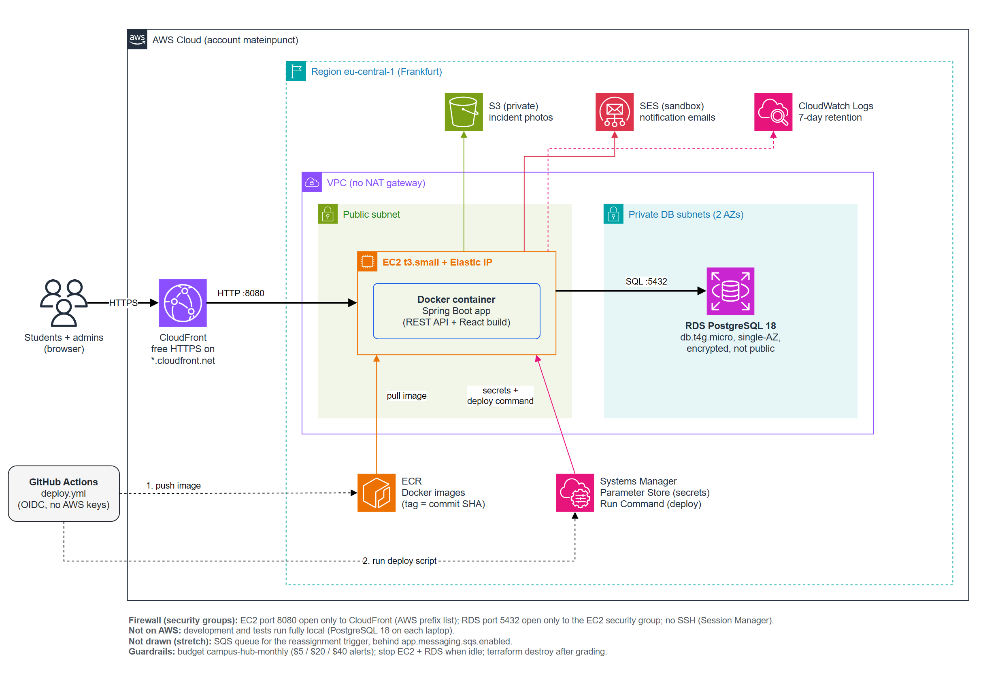

# ADR-002: One EC2 instance behind CloudFront, no ECS, ALB or NAT

**Status:** Accepted · **Date:** 2026-10-23 · **Owner:** Matei
**Diagram:** `docs/diagrams/aws-architecture.drawio` (source, edit in draw.io) · `aws-architecture.png` (export)

## Context
The plan suggested ECS Fargate + an Application Load Balancer + S3/CloudFront for the frontend. For one small app, one demo and a $100 budget, that is more pieces than we need: the ALB alone costs about $20/month, and every extra piece is something that can break and that we must explain at the defense.

## Decision
| Piece | Choice |
|---|---|
| Compute | **One EC2 `t3.small`** (x86, 2 GB RAM, Amazon Linux 2023) with an Elastic IP, running the app as **one Docker container** |
| Frontend | The React build is **copied into the same Docker image** and served by Spring Boot. One container, one origin, so no CORS |
| HTTPS | **CloudFront** in front of EC2, default `*.cloudfront.net` domain (free certificate). Caching off for `/api/*` |
| Database | **RDS PostgreSQL 18**, `db.t4g.micro`, 20 GB, single-AZ, encrypted, not publicly accessible |
| Network | Small VPC: 1 public subnet (EC2), 2 private DB subnets (RDS needs 2 AZs). **No NAT gateway** |
| Firewall | Security groups in a chain: EC2 accepts `8080` **only from CloudFront** (AWS prefix list `com.amazonaws.global.cloudfront.origin-facing`); RDS accepts `5432` **only from the EC2 security group**. No SSH port: shell access through SSM Session Manager |
| Other services | S3 (photos), SES (emails), SSM Parameter Store (secrets, ADR-003), ECR (images), CloudWatch Logs (7 days) |
| Permissions | The app uses the **EC2 instance role** (no AWS keys on the server): its own S3 bucket, `ses:SendEmail`, read `/campus/*` parameters, pull from ECR, write logs |
| Deploy | GitHub Actions (OIDC role, no stored AWS keys): build image → push to ECR tagged with the commit SHA → SSM Run Command on the instance: pull, restart the container, check `/actuator/health`. Rollback = run it again with the previous SHA |

## Why
| | Plan (ECS + ALB) | This ADR (EC2) |
|---|---|---|
| Rough cost, 24/7 | ~$60-70/month (ALB ~20, Fargate ~18, RDS ~16, public IPs) | **~$35/month** (EC2 ~17, Elastic IP ~4, RDS ~16) |
| Pieces to explain | cluster, service, task definition, 2 IAM roles, target group, listener, ALB, S3 site + CloudFront Function | one server, one container, one role |
| Debugging | logs only through CloudWatch | also `docker logs` through Session Manager |

Prices are rough (eu-central-1, on-demand, October 2026). Stopping EC2 and RDS when idle (ADR-001) cuts them further. CloudFront, S3, SES, SSM and ECR cost cents at our size.

`t3.small` and not the cheaper ARM `t4g.small`: GitHub Actions builds x86 images by default, and an ARM server would fail with `exec format error` on an x86 image. One less trap.

## Consequences
- **No high availability:** one server, so ~30 s of downtime per deploy and none of the automatic replacement ECS would do. Fine for a course demo. In the report: "production would run 2+ ECS tasks behind an ALB, and Multi-AZ RDS".
- **CloudFront → EC2 is plain HTTP.** The browser → CloudFront part is HTTPS, and only CloudFront can reach port 8080. Production would add a domain + certificate on the origin.
- **We patch the server ourselves** (`dnf upgrade` before the demo).
- **Stefania:** nothing changes in dev (Vite proxy). For prod, Matei's Dockerfile runs `npm ci && npm run build` and copies `frontend/dist` into the image; Spring needs a small fallback that sends unknown non-API paths (like `/reservations`) to `index.html` (Matei, in `config/`).

## Alternatives considered
| Option | Why not |
|---|---|
| ECS Fargate + ALB (the plan) | Cost and complexity above. Still the "production" answer in the report |
| Elastic Beanstalk / Lightsail | Hides what happens (harder to explain at the defense); Lightsail containers can't use an instance role for S3/SES |
| PostgreSQL in Docker on the same EC2 | Saves ~$16 but we'd lose managed backups and encryption, and a lost instance means lost data |
| Frontend in S3 + CloudFront | One more bucket, a CloudFront Function for SPA routes, cache invalidations; not needed when Spring can serve the files |
