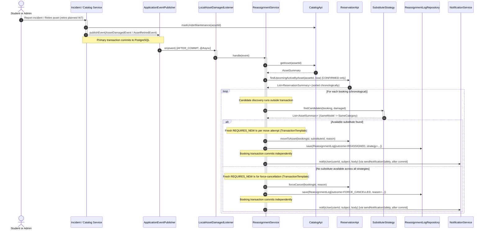

# Module: Auto-Reassignment Engine

**Owner:** Călin Murariu ([@Swiorx](https://github.com/Swiorx))  
**Base Package:** `com.campus.reassignment`  

---

## 1. Purpose

The `reassignment` module provides automated disaster recovery and continuity for laboratory equipment bookings. When an asset becomes damaged, enters maintenance, or is permanently retired, the engine automatically:
1. Detects the event without coupling the reporting module to the booking tables.
2. Identifies all upcoming confirmed reservations affected by the unavailable asset (via `ReservationApi.findUpcomingActiveByAsset`, which executes the repository's `findUpcomingConfirmedByAsset` query matching `status = CONFIRMED and endTime > :from`; in-use `CHECKED_OUT` bookings are not moved).
3. Evaluates pluggable substitution strategies to find operational, free substitute assets.
4. Moves reservations to substitute units or force-cancels them if no substitutes exist.
5. Writes an immutable audit trail to PostgreSQL (`reassignment_log`).
6. Dispatches notification alerts to affected students.

---

## 2. Design Patterns Applied

### A. Observer Pattern (`LocalAssetDamagedListener` & Event Listeners)

The module employs the **Observer Pattern** (via Spring Application Events) to decouple asset lifecycle events from reservation reassignment:
- **Loose Coupling:** The `incident` and `catalog` modules know nothing about reservations, strategies, or notifications. They simply publish an event when an asset's state changes.
- **Transaction Safety (`AFTER_COMMIT`):**
  ```java
  @Async
  @TransactionalEventListener(phase = TransactionPhase.AFTER_COMMIT)
  public void on(AssetDamagedEvent event) {
      reassignmentService.handle(event);
  }
  ```
  The listener only executes *after* the triggering transaction has successfully committed to PostgreSQL. If the incident report or asset update rolls back, no reassignment occurs, preventing ghost reassignments.
- **Asynchronous Execution (`@Async`):** Reassignment processing runs in a background thread, ensuring that student HTTP incident reporting requests remain fast and responsive even if dozens of upcoming bookings must be processed.
- **Infrastructure Abstraction:** Switched via `app.messaging.sqs.enabled`:
  - `false` (default / Dev / CI): In-memory Spring Application Events.
  - `true` (AWS Prod): SQS message bridge managed by Matei Necula (planned stretch goal; only `messaging/package-info.java` exists today).

#### 🔄 Retirement Triggering Architecture (Planned W7 Integration)
When an admin retires equipment (`POST /api/v1/admin/assets/{id}/retire`), the asset is permanently decommissioned. Future bookings must not remain orphaned on a retired asset.
- **Trigger Event:** `AssetService` will publish an `AssetRetiredEvent(Long assetId, Long retiredById, Instant occurredAt)`.
- **Engine Reaction:** A corresponding `@TransactionalEventListener(phase = AFTER_COMMIT)` will invoke the reassignment engine for the retired asset ID.
- **Audit Logging Alignment:** A Flyway migration will alter `reassignment_log.incident_id` to `BIGINT NULL` (or introduce a trigger source column), allowing retirement reassignments to record an immutable audit trail without requiring a dummy incident.

---

### B. Strategy Pattern (`SubstituteStrategy`)

The substitution algorithm is encapsulated using the **Strategy Pattern**, allowing alternative substitution heuristics to be introduced or re-ordered without altering the orchestration engine.

```
                  ┌──────────────────────┐
                  │  SubstituteStrategy  │ (interface)
                  └──────────┬───────────┘
                             │
            ┌────────────────┴────────────────┐
            ▼                                 ▼
┌───────────────────────┐         ┌───────────────────────┐
│   SameModelStrategy   │         │ SameCategoryStrategy  │
│      (@Order 1)       │         │      (@Order 2)       │
└───────────────────────┘         └───────────────────────┘
```

#### Strategy Contract
```java
public interface SubstituteStrategy {
    String name();
    List<AssetSummary> findCandidates(ReservationSummary reservation, AssetSummary damaged);
    default Optional<AssetSummary> findSubstitute(ReservationSummary reservation, AssetSummary damaged) {
        return findCandidates(reservation, damaged).stream().findFirst();
    }
}
```

#### Concrete Strategies
1. **`SameModelStrategy` (`@Order(1)`):**
   - Matches operational units (`status == AVAILABLE`) sharing the exact model string (`damaged.model()`).
   - **Locality Preference:** Assets in the same physical laboratory room (`labRoomId == damaged.labRoomId()`) are ranked first.
   - **Deterministic Tie-Breaking:** If multiple units are located in the same room, sorting by `id ASC` guarantees deterministic substitute selection across repeated runs.
2. **`SameCategoryStrategy` (`@Order(2)`):**
   - Fallback strategy evaluated only when `SameModelStrategy` yields no free units.
   - Matches operational units in the same equipment category (`damaged.categoryId()`).
   - Applies the same locality preference (same room first, then deterministic `id ASC`).

#### Cross-Strategy Candidate Deduplication
Strategies filter candidate assets with `reservationApi.isAssetFree`, returning only currently free units. However, under concurrency, a candidate might be booked between discovery and the move attempt, causing a `SubstituteNoLongerFreeException`. To prevent trying the same candidate again under subsequent strategies, `ReassignmentBookingProcessor` maintains an `attemptedCandidateIds` set per booking. If an asset candidate was already attempted and failed during `SameModelStrategy`, it is skipped if it also appears as a candidate in `SameCategoryStrategy` (#149).

---

## 3. Workflow & Data Flow



---

## 4. Transaction Isolation (`TransactionTemplate` with `PROPAGATION_REQUIRES_NEW` per booking)

`ReassignmentService.handle(...)` coordinates the loop, delegating each reservation to `ReassignmentBookingProcessor.processSingleBooking(...)` using programmatic `TransactionTemplate` with `PROPAGATION_REQUIRES_NEW`:
- **Decoupled from Trigger:** Reassignment runs asynchronously `AFTER_COMMIT` of the incident or retirement request (`LocalAssetDamagedListener`).
- **Why programmatic `TransactionTemplate` instead of `@Transactional`?**
  In `#149`, candidate discovery runs outside any write transaction so that `lockForBooking` inside `moveToAsset` is the very first touch of the `Asset` row in the persistence context (avoiding stale L1 Hibernate snapshots). Each candidate move attempt (or final force-cancellation) executes in its own isolated `REQUIRES_NEW` transaction via `TransactionTemplate`. If `moveToAsset` throws `SubstituteNoLongerFreeException`, that transaction rolls back cleanly, and the processor immediately tries the next candidate in a brand-new persistence context.
- **Per-Booking Boundary:** If one booking encounters an unexpected issue or concurrent lock contention, only that single booking fails. All preceding and subsequent reassignments commit successfully.
- **Post-Commit Notifications:** Student notification alerts are only dispatched via `notificationService.notifyUser(...)` wrapped in `sendNotificationSafely` from `ReassignmentService` *after* the individual booking transaction has committed to PostgreSQL.

---

## 5. How to Test

```bash
cd backend

# Run all unit tests for engine and strategies:
./gradlew test --tests "com.campus.reassignment.service.*"

# Run integration tests verifying transaction rollback boundaries:
./gradlew test --tests "com.campus.reassignment.service.ReassignmentRollbackIT"

# Run PIT mutation tests:
./gradlew pitest
```
