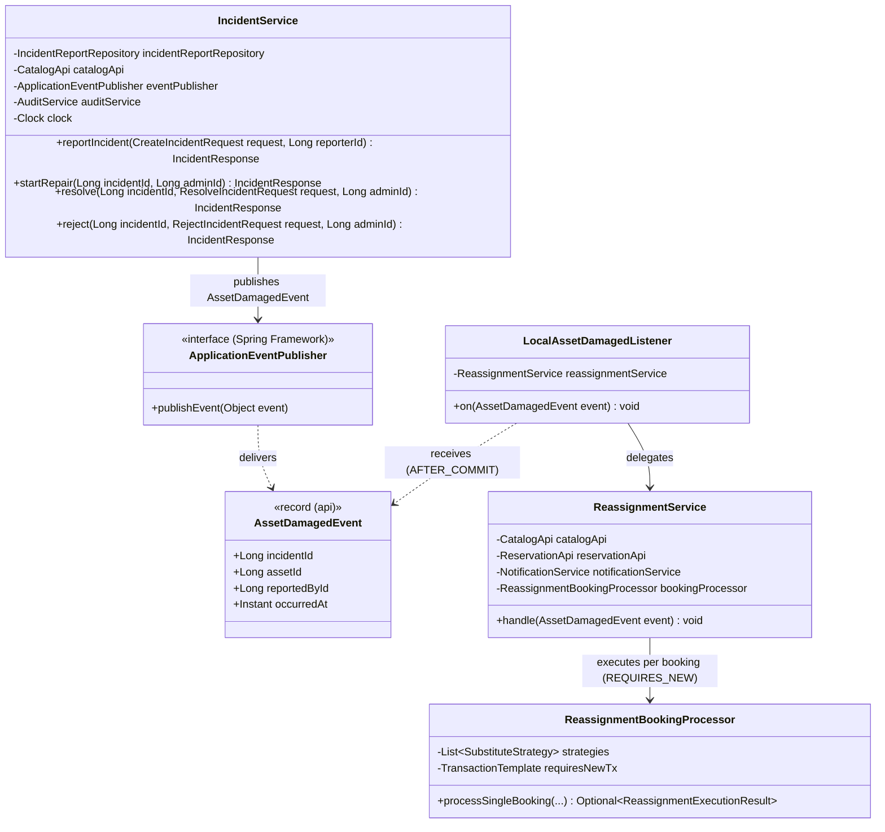
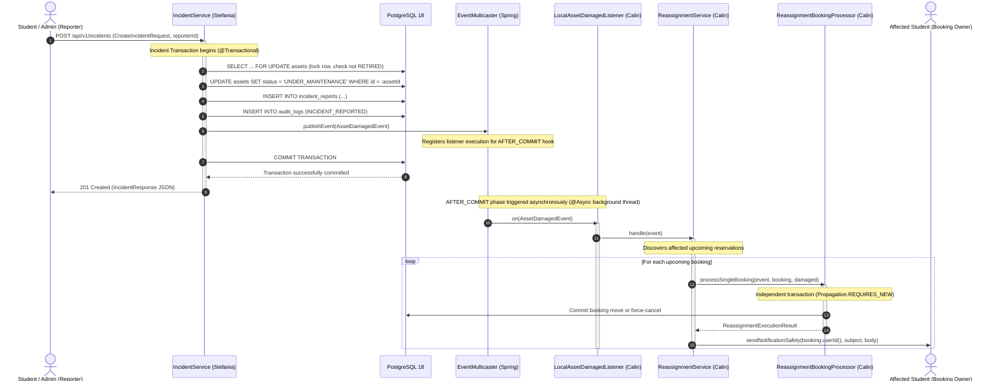

# Observer Pattern Specification: Event-Driven Incident & Reassignment Architecture

**Authors:** Călin Murariu (Member 3: Reservations & Reassignment) & Ștefania Vișan (Member 4: Incidents & Users)  
**Base Packages:** `com.campus.incident.api`, `com.campus.reassignment.service`  
**Pattern Classification:** Gang of Four (GoF) Behavioral Pattern — Observer (Publish-Subscribe)  
**State of Code:** `main` (November 2026)  

---

## 1. Problem Statement & Motivation

In a campus equipment management platform, reporting broken hardware triggers a critical operational cascade:
1. The damaged unit's operational status must immediately switch to `UNDER_MAINTENANCE` in the equipment catalog.
2. The incident report, description, severity, and photo reference must be persisted in the audit ledger.
3. All future active student bookings on that damaged unit must be rescued (reassigned to substitute equipment or force-cancelled with notification).

### The Naive Anti-Pattern (Direct Monolithic Invocation)
A naive approach would have `IncidentService` call `ReassignmentService` directly inside its reporting method:

```java
// Anti-pattern: tightly coupled, breaks encapsulation, shared transaction hazard
@Transactional
public IncidentResponse reportIncident(ReportIncidentRequest req) {
    IncidentReport report = incidentRepository.save(new IncidentReport(...));
    catalogApi.markUnderMaintenance(req.assetId());
    
    // Direct synchronous coupling!
    reassignmentService.reassignDamagedAsset(req.assetId()); 
    
    return IncidentResponse.from(report);
}
```

**Why this fails in production:**
1. **Violates Architectural Boundaries (ArchUnit):** The `incident` module would directly import and depend on the internal `reassignment` module. Our team dependency rules strictly state: `catalog` and `incident` must NOT depend on `reassignment`.
2. **Shared Transaction Failure (Rollback Contagion):** If `IncidentService` and `ReassignmentService` execute in the same database transaction, any downstream transient failure during reassignment (e.g. an email/SMS notification failure or an unexpected conflict on booking #5) would roll back the incident report. The broken equipment would remain marked as `AVAILABLE`, exposing subsequent students to broken hardware!
3. **HTTP Response Latency:** The student submitting an incident report would be forced to wait while the backend discovers candidate substitutes, queries availability, moves bookings, and connects to email gateways.
4. **Monolithic Lock-in:** The system could never scale to distributed microservices, message queues (AWS SQS), or event streaming without rewriting the incident reporting service.

### The GoF Observer Solution
The **Observer Pattern** (Publish-Subscribe) cleanly decouples the event producer from consumers:
- **Subject / Producer:** `IncidentService` publishes an immutable `AssetDamagedEvent` via Spring's `ApplicationEventPublisher`.
- **Event Contract:** `AssetDamagedEvent` lives in the public `com.campus.incident.api` package, containing only primitive IDs and an `Instant` timestamp.
- **Observer / Consumer:** `LocalAssetDamagedListener` in `com.campus.reassignment.service` listens for this event.
- **Transaction Guarantee (`AFTER_COMMIT`):** The listener triggers only after the incident reporting transaction has successfully committed to PostgreSQL.
- **Background Execution (`@Async`):** Reassignment executes asynchronously, freeing the student's HTTP request immediately.

---

## 2. Structural Architecture & Class Diagram



### Module Boundary Isolation
The dependency graph strictly adheres to the clean architecture matrix enforced by ArchUnit:
$$\texttt{incident (core)} \longleftarrow [\texttt{AssetDamagedEvent}] \longleftarrow \texttt{reassignment (listener)}$$
`IncidentService` knows nothing about reservations, substitutes, or reassignment. It only announces what occurred in its domain.

---

## 3. Transaction Boundary & `AFTER_COMMIT` Semantics

Standard Spring `@EventListener` executes **synchronously inside the open transaction** of the caller. In contrast, our implementation employs:

```java
@Async
@TransactionalEventListener(phase = TransactionPhase.AFTER_COMMIT)
public void on(AssetDamagedEvent event) {
    reassignmentService.handle(event);
}
```



### Critical Architectural Guarantees:
1. **Lock-Before-Insert Concurrency Safety:** `catalogApi.markUnderMaintenance` acquires a pessimistic write lock (`SELECT ... FOR UPDATE`) on the asset row *before* inserting into `incident_reports` or publishing the event. This prevents race conditions between simultaneous report and resolve/reject calls on the same asset, rejects missing (`404`) or retired (`409`) assets upfront without persisting bogus incidents, and ensures the asset is already `UNDER_MAINTENANCE` before any observer can wake up.
2. **Atomicity of Incident Persistence & Audit:** The asset state change, incident record, and audit entry (`INCIDENT_REPORTED`) commit together in a single atomic transaction. If database persistence fails or validation rejects the input, the transaction rolls back, and `LocalAssetDamagedListener` is never triggered.
3. **Fresh Read Consistency:** Because reassignment runs *after* commit, any database query executed by `ReassignmentService` reads the committed `UNDER_MAINTENANCE` status, ensuring the damaged asset is never selected as its own replacement candidate.
4. **Zero Rollback Contagion:** Any exception, timeout, or concurrency failure inside reassignment or notification delivery cannot roll back or invalidate the persisted incident report.
5. **Immediate Client Feedback:** The HTTP response (201 Created) returns to the student in milliseconds without waiting for batch rescheduling.

---

## 4. Production Code Implementation

### Event Payload Contract (`com.campus.incident.api`)
```java
package com.campus.incident.api;

import java.time.Instant;

/**
 * Domain event published when laboratory hardware is marked damaged or inoperable.
 */
public record AssetDamagedEvent(
        Long incidentId, 
        Long assetId, 
        Long reportedById, 
        Instant occurredAt
) {}
```

### Publisher: `IncidentService` (`com.campus.incident.service`)
```java
@Transactional
public IncidentResponse reportIncident(CreateIncidentRequest request, Long reporterId) {
    // 1. Lock asset row first (SELECT ... FOR UPDATE) and switch to UNDER_MAINTENANCE:
    catalogApi.markUnderMaintenance(request.assetId());

    // 2. Persist incident entity:
    IncidentReport report = new IncidentReport(
            request.assetId(), null, reporterId, request.description(), request.severity(), null, now());
    IncidentReport saved = incidentReportRepository.save(report);

    // 3. Record audit trail in the same transaction:
    audit(reporterId, "INCIDENT_REPORTED", saved, saved.getSeverity().name());

    // 4. Publish domain event to decoupled observers:
    eventPublisher.publishEvent(
            new AssetDamagedEvent(saved.getId(), saved.getAssetId(), reporterId, clock.instant()));

    return toResponse(saved);
}
```

### Observer: `LocalAssetDamagedListener` (`com.campus.reassignment.service`)
```java
@Component
@ConditionalOnProperty(name = "app.messaging.sqs.enabled", havingValue = "false", matchIfMissing = true)
@RequiredArgsConstructor
class LocalAssetDamagedListener {

    private final ReassignmentService reassignmentService;

    // AFTER_COMMIT guarantees that if the incident transaction rolls back, no reassignment occurs.
    // With @Async enabled via AsyncConfig, reassignment runs in a background thread after the student's
    // report request completes, so any reassignment error is logged and never fails the HTTP response.
    @Async
    @TransactionalEventListener(phase = TransactionPhase.AFTER_COMMIT)
    public void on(AssetDamagedEvent event) {
        reassignmentService.handle(event);
    }
}
```

### Consumer Orchestrator: `ReassignmentService` (`com.campus.reassignment.service`)
```java
@Slf4j
@Service
@RequiredArgsConstructor
public class ReassignmentService {

    private final CatalogApi catalogApi;
    private final ReservationApi reservationApi;
    private final NotificationService notificationService;
    private final ReassignmentBookingProcessor bookingProcessor;
    private final ReassignmentLogRepository reassignmentLogRepository;
    private final Clock clock;

    public void handle(AssetDamagedEvent event) {
        AssetSummary damaged = catalogApi.getAsset(event.assetId());
        LocalDateTime now = LocalDateTime.now(clock);
        List<ReservationSummary> upcoming = reservationApi.findUpcomingActiveByAsset(event.assetId(), now);

        List<ReservationSummary> sortedBookings = upcoming.stream()
                .sorted(Comparator.comparing(ReservationSummary::start))
                .toList();

        for (ReservationSummary booking : sortedBookings) {
            try {
                Optional<ReassignmentBookingProcessor.ReassignmentExecutionResult> resultOpt =
                        bookingProcessor.processSingleBooking(event, booking, damaged);

                if (resultOpt.isPresent()) {
                    ReassignmentBookingProcessor.ReassignmentExecutionResult result = resultOpt.get();
                    if (result.outcome() == ReassignmentOutcome.REASSIGNED) {
                        sendNotificationSafely(
                                booking.userId(),
                                "Reservation Reassigned",
                                "Your reservation #" + booking.id() + " has been reassigned to asset "
                                        + result.substituteAssetName() + " due to equipment maintenance.");
                    } else {
                        sendNotificationSafely(
                                booking.userId(),
                                "Reservation Cancelled",
                                "Your reservation #" + booking.id()
                                        + " has been cancelled due to equipment failure (incident #"
                                        + event.incidentId() + ") and no available substitutes.");
                    }
                }
            } catch (Exception ex) {
                log.error("Failed to reassign booking #{} during incident #{}: {}", 
                        booking.id(), event.incidentId(), ex.getMessage(), ex);
            }
        }
    }
}
```

---

## 5. Resilience & Extensibility to AWS Cloud (SQS Bridge — Planned Stretch Goal)

The Observer pattern provides complete infrastructural agility via Spring's conditional bean registration (`@ConditionalOnProperty`). On `main`, the in-memory event bus is active. The SQS bridge (`SqsIncidentEventPublisher`, `SqsReassignmentListener`, and AWS SQS FIFO queue) is defined as Matei's Week 9 stretch architecture (`docs/whats-left.md` §4):

```mermaid
flowchart LR
    A["IncidentService<br/>publishEvent(AssetDamagedEvent)"] --> B{"app.messaging.sqs.enabled"}
    
    B -->|false (Active on main / Local / CI)| C["LocalAssetDamagedListener<br/>(@TransactionalEventListener)"]
    C --> E["ReassignmentService.handle"]
    
    B -->|true (Planned AWS Stretch Goal)| D["SqsIncidentEventPublisher<br/>(Amazon SQS Queue)"]
    D -.->|Async Queue Poller| F["SqsReassignmentListener<br/>(Worker Container)"]
    F --> E
```

1. **Local & CI Mode (`app.messaging.sqs.enabled=false` — Active on `main`):**
   - Zero external infrastructure required.
   - Spring Framework handles the in-memory pub-sub bus.
   - 100% testable in unit and integration tests without Docker or LocalStack.
2. **AWS Cloud Production Mode (`app.messaging.sqs.enabled=true` — Planned Stretch):**
   - If workload increases, an SQS bridge bean captures the same `AssetDamagedEvent` and pushes it to an Amazon SQS FIFO queue.
   - Reassignment workers process the queue asynchronously across multiple EC2 or container instances.
   - `IncidentService` and `ReassignmentService` require **zero code changes** to support cloud distribution.

---

## 6. How to Add a New Observer in 4 Steps

To listen for `AssetDamagedEvent` in a new feature (e.g. an administrative alert or lab technician dashboard):

1. **Create the listener component:**
   ```java
   @Component
   @RequiredArgsConstructor
   public class LabTechnicianAlertListener {
       private final NotificationService notificationService;
       private final UserApi userApi;

       @Async
       @TransactionalEventListener(phase = TransactionPhase.AFTER_COMMIT)
       public void on(AssetDamagedEvent event) {
           // Notify responsible staff dynamically (e.g. active admins or reporter):
           userApi.findFirstActiveAdminId().ifPresent(adminId ->
               notificationService.notifyUser(
                       adminId,
                       "Equipment Damaged Alert",
                       "Hardware asset #" + event.assetId() + " was damaged in incident #" + event.incidentId())
           );
       }
   }
   ```
2. **Specify transaction phase:** Use `AFTER_COMMIT` to ensure notifications are dispatched only for confirmed incidents.
3. **Annotate with `@Async`:** Prevents slowing down the original reporter's request.
4. **Zero modifications to existing modules:** `IncidentService`, `ReassignmentService`, and database tables remain untouched (Open-Closed Principle).

---

## 7. Defense Questions & Academic Answers

### Q1: "Why use the Observer pattern instead of calling `ReassignmentService` directly inside `IncidentService`?"
> **Answer:**  
> **Modularity, Single Responsibility, and Fault Tolerance.**  
> 1. In our modular monolith, ArchUnit rules strictly enforce that the `incident` module must not import `reassignment`. Incident management is concerned with reporting defects, while reassignment is disaster recovery for laboratory bookings.
> 2. Direct invocation forces both operations into a single transaction. If sending an email notification fails or an unexpected concurrency conflict occurs during reassignment, the incident report would roll back, leaving broken equipment marked as available.
> 3. The Observer pattern allows new observers (analytics, inventory logs, SMS alerts, AWS SQS) to be added without touching `IncidentService` (Open-Closed Principle).

### Q2: "What is the crucial difference between `@EventListener` and `@TransactionalEventListener(phase = AFTER_COMMIT)`?"
> **Answer:**  
> A standard `@EventListener` executes synchronously *before* the caller's transaction commits. If the listener throws an exception, it marks the transaction for rollback.  
> `@TransactionalEventListener(phase = TransactionPhase.AFTER_COMMIT)` waits until PostgreSQL acknowledges the successful commit. This guarantees:
> - Reassignment is only executed if the incident is truly persisted.
> - Any failure in reassignment or email notifications cannot undo the persisted incident.
> - The listener reads clean, committed database records rather than uncommitted Hibernate state.

### Q3: "Why did you add `@Async` to the event listener?"
> **Answer:**  
> Without `@Async`, a Spring `@TransactionalEventListener(phase = TransactionPhase.AFTER_COMMIT)` would execute synchronously on the caller's HTTP request thread immediately after transaction commit, blocking the response until all observer work finishes. If 10 student bookings need reassignment and email dispatch, the student who reported the incident would experience a several-second UI delay.  
> By annotating the listener with `@Async`, Spring hands off the event to the background task executor (`ThreadPoolTaskExecutor` in `AsyncConfig`). The caller's HTTP thread completes immediately and returns `201 Created` with `IncidentResponse`, while all subsequent candidate discovery, rescheduling, and notifications execute completely in the background.

### Q4: "How does the Observer pattern ease the transition from a modular monolith to AWS microservices?"
> **Answer:**  
> The Observer pattern decouples the publisher from the delivery mechanism. Because `IncidentService` only publishes an immutable `AssetDamagedEvent` to an abstraction (`ApplicationEventPublisher`), we can swap the in-memory Spring event bus with an AWS SQS / SNS queue publisher simply by toggling `app.messaging.sqs.enabled=true`. The producer code remains 100% unchanged.
