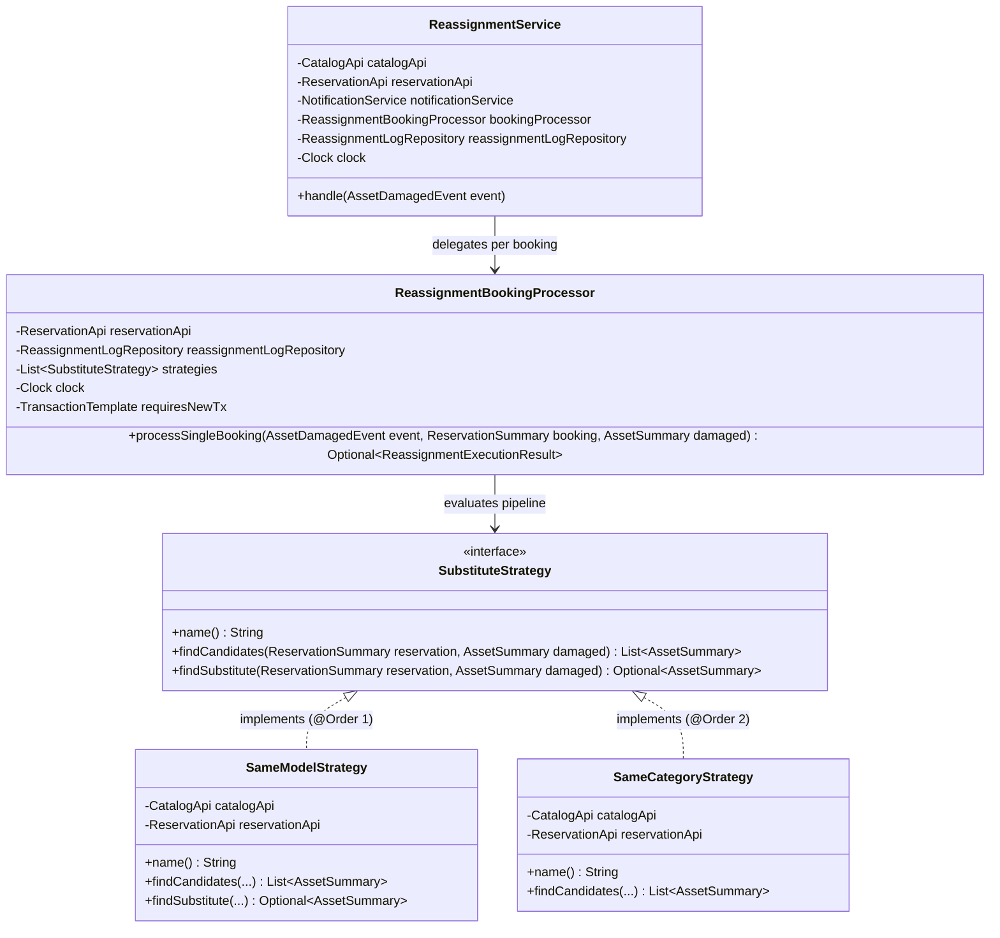
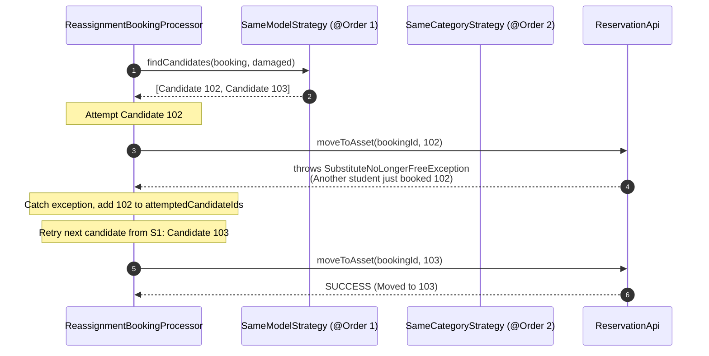

# Strategy Pattern Specification: Auto-Reassignment Engine

**Author:** Călin Murariu (Member 3: Reservations & Reassignment)  
**Base Package:** `com.campus.reassignment`  
**Pattern Classification:** Gang of Four (GoF) Behavioral Pattern — Strategy  
**State of Code:** `main` (November 2026)  

---

## 1. Problem Statement & Motivation

In a campus equipment booking platform, hardware outages are inevitable: students drop multimeters, short-circuit oscilloscopes, or equipment is recalled for mandatory maintenance. When an asset becomes non-operational, future student reservations cannot proceed on that physical unit.

### The Naive Anti-Pattern (Monolithic Hardcoding)
A naive implementation embeds all substitution heuristics directly inside the service:
```java
// Anti-pattern: tightly coupled, violates Open-Closed Principle (OCP)
if (hasSameModelInSameRoom(damaged)) {
    // move to identical unit in room
} else if (hasSameModelInAnyRoom(damaged)) {
    // move to identical unit anywhere
} else if (hasSameCategory(damaged)) {
    // move to compatible unit
} else {
    // cancel
}
```
**Why this fails in practice:**
1. **Violates the Open-Closed Principle (OCP):** Introducing a new substitution rule (e.g., cross-faculty lending or high-tier upgrades) requires modifying and re-testing the monolithic engine.
2. **Untestable in Isolation:** You cannot test or mutate a specific substitution algorithm without booting or simulating the entire reassignment context.
3. **Rigid Ranking & Ordering:** Changing the prioritization (e.g., preferring same-room over same-model during short breaks) requires rewriting nested branching logic.

### The GoF Strategy Solution
The **Strategy Pattern** encapsulates each family of substitution algorithms into independent, interchangeable classes implementing a common interface (`SubstituteStrategy`). The orchestration engine (`ReassignmentService` and `ReassignmentBookingProcessor`) acts as the Context, delegating candidate discovery to an ordered pipeline of strategies without knowing their internal criteria.

---

## 2. Structural Architecture & Class Diagram



---

## 3. Strategy Contract & Concrete Implementations

### Strategy Interface (`SubstituteStrategy`)
```java
package com.campus.reassignment.service;

import com.campus.catalog.api.AssetSummary;
import com.campus.reservation.api.ReservationSummary;
import java.util.List;
import java.util.Optional;

public interface SubstituteStrategy {

    /**
     * Unique identifier for logging and metrics (e.g. "SameModelStrategy", "SameCategoryStrategy").
     */
    String name();

    /**
     * Finds operational, free candidates ranked according to the strategy's heuristics.
     */
    List<AssetSummary> findCandidates(ReservationSummary reservation, AssetSummary damaged);

    /**
     * Default helper returning the top-ranked candidate.
     */
    default Optional<AssetSummary> findSubstitute(ReservationSummary reservation, AssetSummary damaged) {
        return findCandidates(reservation, damaged).stream().findFirst();
    }
}
```

### Concrete Strategy 1: `SameModelStrategy` (`@Order(1)`)
Package-private component implementing identical model matching:
```java
@Component
@Order(1)
@RequiredArgsConstructor
class SameModelStrategy implements SubstituteStrategy {

    private final CatalogApi catalogApi;
    private final ReservationApi reservationApi;

    @Override
    public String name() {
        return "SameModelStrategy";
    }

    @Override
    public Optional<AssetSummary> findSubstitute(ReservationSummary reservation, AssetSummary damaged) {
        return findCandidates(reservation, damaged).stream().findFirst();
    }

    @Override
    public List<AssetSummary> findCandidates(ReservationSummary reservation, AssetSummary damaged) {
        List<AssetSummary> candidates = catalogApi.findAvailableByModel(damaged.model(), damaged.id());

        return candidates.stream()
                .filter(candidate -> candidate.status() == AssetStatus.AVAILABLE)
                .sorted(Comparator.comparing((AssetSummary a) -> Objects.equals(a.labRoomId(), damaged.labRoomId()))
                        .reversed()
                        .thenComparing(AssetSummary::id))
                .filter(candidate -> reservationApi.isAssetFree(
                        candidate.id(), reservation.start(), reservation.end(), reservation.id()))
                .toList();
    }
}
```
- **Intent:** Find identical hardware so students experience zero discrepancy in laboratory assignments, manuals, or interfaces.
- **Criteria:**
  1. `catalogApi.findAvailableByModel(damaged.model(), damaged.id())`
  2. `candidate.status() == AssetStatus.AVAILABLE`
  3. `reservationApi.isAssetFree(candidate.id(), reservation.start(), reservation.end(), reservation.id()) == true`
- **Locality Preference & Deterministic Tie-Breaking:**
  - Candidates located in the **same laboratory room** (`labRoomId == damaged.labRoomId()`) are ranked first so students do not have to move to another room.
  - Secondary sort by `candidate.id ASC` ensures deterministic behavior across repeated executions.

### Concrete Strategy 2: `SameCategoryStrategy` (`@Order(2)`)
Package-private component implementing category fallback:
```java
@Component
@Order(2)
@RequiredArgsConstructor
class SameCategoryStrategy implements SubstituteStrategy {

    private final CatalogApi catalogApi;
    private final ReservationApi reservationApi;

    @Override
    public String name() {
        return "SameCategoryStrategy";
    }

    @Override
    public Optional<AssetSummary> findSubstitute(ReservationSummary reservation, AssetSummary damaged) {
        return findCandidates(reservation, damaged).stream().findFirst();
    }

    @Override
    public List<AssetSummary> findCandidates(ReservationSummary reservation, AssetSummary damaged) {
        List<AssetSummary> candidates = catalogApi.findAvailableByCategory(damaged.categoryId(), damaged.id());

        return candidates.stream()
                .filter(candidate -> candidate.status() == AssetStatus.AVAILABLE)
                .sorted(Comparator.comparing((AssetSummary a) -> Objects.equals(a.labRoomId(), damaged.labRoomId()))
                        .reversed()
                        .thenComparing(AssetSummary::id))
                .filter(candidate -> reservationApi.isAssetFree(
                        candidate.id(), reservation.start(), reservation.end(), reservation.id()))
                .toList();
    }
}
```
- **Intent:** Fallback when identical models are unavailable or fully booked. Finds functional equivalents in the same broader category (e.g., another digital oscilloscope model).
- **Ranking:** Same laboratory room preference first, then deterministic `candidate.id ASC`.

---

## 4. Spring Framework Integration (`@Order` Pipeline)

Spring Framework provides native support for the Strategy pattern by auto-wiring all beans that implement `SubstituteStrategy` into an ordered list.

`ReassignmentBookingProcessor` declares an explicit constructor configuring its isolated `REQUIRES_NEW` transaction boundary:

```java
@Slf4j
@Service
class ReassignmentBookingProcessor {

    private final ReservationApi reservationApi;
    private final ReassignmentLogRepository reassignmentLogRepository;
    private final List<SubstituteStrategy> strategies;
    private final Clock clock;
    private final TransactionTemplate requiresNewTx;

    @Autowired
    ReassignmentBookingProcessor(
            ReservationApi reservationApi,
            ReassignmentLogRepository reassignmentLogRepository,
            List<SubstituteStrategy> strategies,
            Clock clock,
            PlatformTransactionManager transactionManager) {
        this.reservationApi = reservationApi;
        this.reassignmentLogRepository = reassignmentLogRepository;
        this.strategies = strategies;
        this.clock = clock;
        TransactionTemplate tt = new TransactionTemplate(transactionManager);
        tt.setPropagationBehavior(TransactionDefinition.PROPAGATION_REQUIRES_NEW);
        this.requiresNewTx = tt;
    }
    ...
}
```

Meanwhile, `ReassignmentService` acts as the event-driven orchestrator:
```java
@Slf4j
@Service
@RequiredArgsConstructor
public class ReassignmentService {

    private final CatalogApi catalogApi;
    private final ReservationApi reservationApi;
    private final NotificationService notificationService;
    private final ReassignmentBookingProcessor bookingProcessor;
    private final ReassignmentLogRepository reassignmentLogRepository;
    private final Clock clock;

    public void handle(AssetDamagedEvent event) { ... }
}
```

### Architectural Benefits:
- **Zero Configuration Boilerplate:** No factory classes or manual registries required.
- **Strict Execution Order:** `@Order(1)` runs before `@Order(2)`.
- **Open-Closed Extensibility:** Adding a new strategy requires only a new `@Component` with an appropriate `@Order` value. Neither `ReassignmentBookingProcessor` nor `ReassignmentService` is modified.

---

## 5. Concurrency Race Handling & Candidate Deduplication

Under concurrent user activity, a substitute asset that appears free during strategy evaluation (`isAssetFree`) might be reserved by another student before the reassignment engine acquires the write lock.



### Deduplication Across Strategy Passes:
If all candidates from `SameModelStrategy` fail (or throw `SubstituteNoLongerFreeException`), the engine moves to `SameCategoryStrategy`. Since candidates of the same model also belong to the same category, `ReassignmentBookingProcessor` keeps a `Set<Long> attemptedCandidateIds = new HashSet<>()` and skips candidates that were already attempted, avoiding redundant database locks and duplicate attempts.

### Isolated Transaction Execution & Fallback:
Inside `ReassignmentBookingProcessor.processSingleBooking`:
```java
// Fallback when no strategy finds a free substitute:
return inRequiresNewTransaction(() -> {
    boolean cancelled =
            reservationApi.forceCancel(booking.id(), "Equipment failure, incident #" + event.incidentId());

    if (cancelled) {
        ReassignmentLog logEntry = new ReassignmentLog(
                event.incidentId(),
                booking.id(),
                event.assetId(),
                null,
                ReassignmentOutcome.FORCE_CANCELLED,
                null,
                LocalDateTime.now(clock).truncatedTo(ChronoUnit.SECONDS));
        reassignmentLogRepository.save(logEntry);

        return Optional.of(new ReassignmentExecutionResult(ReassignmentOutcome.FORCE_CANCELLED, null));
    }

    return Optional.empty();
});
```

Notifications are dispatched **after** successful transaction commit by `ReassignmentService`:
```java
if (resultOpt.isPresent()) {
    ReassignmentBookingProcessor.ReassignmentExecutionResult result = resultOpt.get();
    if (result.outcome() == ReassignmentOutcome.REASSIGNED) {
        sendNotificationSafely(
                booking.userId(),
                "Reservation Reassigned",
                "Your reservation #" + booking.id() + " has been reassigned to asset "
                        + result.substituteAssetName() + " due to equipment maintenance.");
    } else {
        sendNotificationSafely(
                booking.userId(),
                "Reservation Cancelled",
                "Your reservation #" + booking.id()
                        + " has been cancelled due to equipment failure (incident #"
                        + event.incidentId() + ") and no available substitutes.");
    }
}
```

---

## 6. How to Add a New Strategy in 5 Steps

To introduce a new substitution strategy (for instance, a tier-based substitute or cross-lab equipment strategy):

1. Create a class under `com.campus.reassignment.service`:
   ```java
   @Component
   @Order(3) // Runs after SameModel (1) and SameCategory (2)
   @RequiredArgsConstructor
   class CrossLabSameModelStrategy implements SubstituteStrategy {
       private final CatalogApi catalogApi;
       private final ReservationApi reservationApi;

       @Override
       public String name() {
           return "CrossLabSameModelStrategy";
       }

       @Override
       public List<AssetSummary> findCandidates(ReservationSummary reservation, AssetSummary damaged) {
           return catalogApi.findAvailableByModel(damaged.model(), damaged.id()).stream()
                   .filter(asset -> asset.status() == AssetStatus.AVAILABLE)
                   .filter(asset -> reservationApi.isAssetFree(
                           asset.id(), reservation.start(), reservation.end(), reservation.id()))
                   .sorted(Comparator.comparing(AssetSummary::id))
                   .toList();
       }
   }
   ```
2. Annotate with `@Component` and desired `@Order`.
3. Spring auto-registers it into the strategy pipeline in `ReassignmentBookingProcessor`.
4. Existing tests pass; add targeted unit tests verifying `findCandidates`.
5. No other classes in the monolith need modification.

---

## 7. Defense Questions & Academic Answers

### Q1: "Why use the Strategy pattern instead of Chain of Responsibility?"
> **Answer:**  
> In **Chain of Responsibility**, each handler in the chain decides whether to process the request or pass it to the next handler, embedding dispatch and flow control inside the handlers themselves. In our system, the strategy objects are pure evaluators: they find candidate equipment matching specific domain rules. The orchestration engine (`ReassignmentBookingProcessor`) retains control over transaction boundaries (`REQUIRES_NEW`), concurrency retries, candidate deduplication, logging, and notifications. This separation of algorithm from execution context is the exact definition of the **Strategy Pattern**.

### Q2: "How does the engine handle multiple available substitutes of the same model?"
> **Answer:**  
> `SameModelStrategy` applies a deterministic two-tier ranking:
> 1. **Locality Preference:** Assets located in the same lab room as the damaged asset (`Objects.equals(a.labRoomId(), damaged.labRoomId())`) are sorted first, avoiding unnecessary student travel between rooms or buildings.
> 2. **Deterministic Tie-Breaking:** If multiple units are in the same room, candidates are sorted by `id ASC`. This guarantees reproducible, predictable reassignments during testing, audits, and demos.

### Q3: "What guarantees that a failure on one booking does not roll back the entire reassignment?"
> **Answer:**  
> Each affected booking is processed in an independent transaction via `TransactionTemplate` with `Propagation.REQUIRES_NEW` inside `ReassignmentBookingProcessor`. If moving booking #4 encounters a deadlock or database error, its transaction rolls back independently, while reassignments for bookings #1, #2, #3, and #5–#10 remain committed and intact in PostgreSQL.
