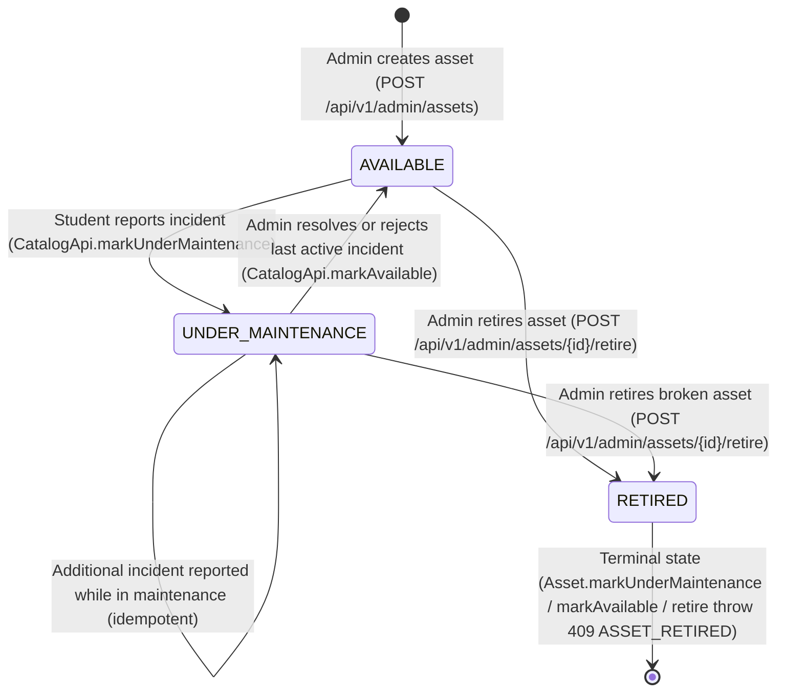

# Catalog, Inventory & Shared Foundations (Liviu Nedelcu)

**Author:** Liviu Nedelcu (Member 2: catalog, inventory, shared services) · **State of the code:** `main` at `a2e3908` (8 Nov 2026)  
**Scope:** Equipment catalog domain (`Category`, `LabRoom`, `Asset`, `AssetStatus`), `CatalogApi` cross-module facade, pessimistic booking locks and optimistic admin concurrency control, `Specification` + `@EntityGraph` asset search, RFC 9457 `ProblemDetail` error architecture (`common.error`), standardized pagination (`PageResponse<T>`), transactional PostgreSQL audit trail (`common.audit`), and profile-switched storage and notification adapters (`storage`, `notification`).

Everything below was verified directly against the production code, Flyway migrations, and tests on `main`.

---

## 1. Domain Requirements & Architectural Boundaries

The `catalog` module and the shared packages (`common`, `storage`, `notification`) form the foundational layer upon which `reservation`, `incident`, `reassignment`, and `user` operate:

1. **Single Source of Truth for Lab Hardware (`com.campus.catalog`):** Manages equipment categories, physical lab rooms, and individual lab assets, exposing a narrow `CatalogApi` facade so downstream modules never import catalog JPA entities or repositories directly.
2. **Uniform RFC 9457 Error Contract (`com.campus.common.error`):** Ensures every business rule violation, validation error, optimistic lock collision, or framework error produces a standardized `ProblemDetail` JSON with a machine-readable `code`.
3. **Database-Internal Decoupling (`com.campus.common.paging`):** Replaces Spring Data's `Page<T>` with `PageResponse<T>` on all paginated REST endpoints.
4. **Atomic Audit Trail (`com.campus.common.audit`):** Records state-changing operations across all modules in the PostgreSQL `audit_logs` table within the caller's transaction and exposes filtered search (`GET /api/v1/admin/audit-logs`).
5. **Pluggable Infrastructure (`com.campus.storage`, `com.campus.notification`):** Decouples business logic from AWS cloud services via `@Profile("!prod")` local adapters (`LocalStorageService`, `LoggingNotificationService`) and `@Profile("prod")` cloud adapters (`S3StorageService`, `SesNotificationService`).

### Core Catalog Business Rules & Invariants

| Invariant | Rule / Enforcement | Why | Where (Code / Migration) |
|---|---|---|---|
| **Operational-Only Asset Status** | `AssetStatus` has only 3 values: `AVAILABLE`, `UNDER_MAINTENANCE`, `RETIRED`. Never `RESERVED` or `IN_USE`. | An asset can be operational today and booked tomorrow from 14:00 to 16:00. Time-slot availability is a function of reservations, not a static flag on the asset row. | `AssetStatus.java`, `Asset.isBookable()` |
| **No Hard Deletion of Assets** | Assets are never deleted via `DELETE FROM assets`; they transition to `RETIRED` (`POST /api/v1/admin/assets/{id}/retire`). | Historical `reservations`, `incident_reports`, and `reassignment_log` rows hold foreign keys (`REFERENCES assets(id)`). Hard-deleting an asset would either fail on FK constraints or destroy historical lab records. | `Asset.retire(now)`, `AssetService.retireAsset` |
| **Mandatory Model Identifier** | `assets.model` is `NOT NULL` (`@NotBlank`, max 150 chars) and indexed (`idx_assets_model`). | Călin's `SameModelStrategy` matches damaged equipment to substitutes with the exact same `category_id` and `model` (`LOWER(model)`). | `V2026_10_24_1345__catalog_create_tables.sql`, `AssetRepository.findByCategoryIdAndModelIgnoreCaseAndStatusAndIdNotOrderByIdAsc` |
| **Immutable Serial Number** | `serialNumber` is set at creation (`CreateAssetRequest`) and absent from `UpdateAssetRequest`. | Physical manufacturer serial numbers identify a specific piece of hardware; changing them after stickers are printed would break inventory tracking. | `CreateAssetRequest.java`, `UpdateAssetRequest.java`, `Asset.updateDetails` |
| **Case-Insensitive Uniqueness** | `categories.name`, `lab_rooms.code`, and `assets.serial_number` enforce case-insensitive uniqueness at both the service pre-check and PostgreSQL functional index levels. | Prevents duplicates like `"oscilloscopes"` vs `"Oscilloscopes"` even when two admin requests race concurrently. | `uq_categories_name_lower`, `uq_lab_rooms_code_lower`, `uq_assets_serial_number_lower` |
| **Referential Integrity on Lookups** | Categories and lab rooms cannot be deleted while referenced by any asset (`409 CATEGORY_IN_USE` / `409 LAB_ROOM_IN_USE`). | Prevents orphaned equipment or raw database constraint exceptions. | `CategoryService.deleteCategory`, `LabRoomService.deleteLabRoom` |
| **Role-Aware Visibility of `RETIRED` Assets** | `GET /api/v1/assets` hides `RETIRED` equipment from students (`status != RETIRED`); even if a student passes `?status=RETIRED`, the filter returns an empty page. Admins see all statuses. | Students only browse equipment that exists in active lab inventory, while admins audit retired hardware. | `AssetSpecification.withFilters(..., includeRetired)`, `AssetService.searchAssets` |

---

## 2. Equipment Lifecycle & Concurrency Control

### Asset State Machine (`docs/diagrams/asset-lifecycle.mmd`)

All state transitions live inside the `Asset` domain entity (`Asset.java`), never via scattered `setStatus()` calls in services:
- **`markUnderMaintenance(LocalDateTime now)`:** Throws `InvalidStateTransitionException("ASSET_RETIRED", ...)` if `status == RETIRED`. If already `UNDER_MAINTENANCE`, it returns early without modifying `updatedAt` (idempotent when two students report separate incidents on the same asset).
- **`markAvailable(LocalDateTime now)`:** Throws `InvalidStateTransitionException("ASSET_RETIRED", ...)` if `status == RETIRED`. If already `AVAILABLE`, it is a safe no-op.
- **`retire(LocalDateTime now)`:** Throws `InvalidStateTransitionException("ASSET_RETIRED", ...)` if already `RETIRED`; otherwise transitions from `AVAILABLE` or `UNDER_MAINTENANCE` to `RETIRED`.

### Dual Concurrency Strategy: Pessimistic vs Optimistic Locking

The `assets` table participates in two distinct concurrency patterns:

| Flow | Mechanism | SQL / JPA | Why This Mechanism? |
|---|---|---|---|
| **Booking, Incident Triage & Retirement** | **Pessimistic Write Lock** (`CatalogApi.lockForBooking`, `CatalogService.markUnderMaintenance`, `CatalogService.markAvailable`, `AssetService.retireAsset`) | `@Lock(LockModeType.PESSIMISTIC_WRITE)` → `SELECT ... FROM assets WHERE id = ? FOR UPDATE` | Booking overlap checks query the `reservations` table for rows that do not exist yet. Optimistic locking on `Asset` would not fire because booking does not update `assets`. Acquiring a PostgreSQL row lock on the target `assets` row serializes concurrent transactions for the same asset until the first transaction commits. |
| **Admin Metadata Updates (`PUT /api/v1/admin/assets/{id}`)** | **Optimistic Locking** (`@Version private Long version` on `Asset`) | `UPDATE assets SET ..., version = version + 1 WHERE id = ? AND version = ?` | Admin form edits are low-contention. If two admins open the same asset form and both click Save, the second `UPDATE` matches 0 rows, Hibernate throws `ObjectOptimisticLockingFailureException`, and `GlobalExceptionHandler` returns `409 STALE_VERSION`. Verified by `AssetRepositoryTest.rejectsConcurrentStaleVersionUpdateOnAsset`. |

---

## 3. Dynamic Asset Search & N+1 Query Elimination

### Avoiding PostgreSQL `(:param IS NULL)` Pitfalls

In PostgreSQL, JPQL queries of the form `WHERE (:categoryId IS NULL OR a.category.id = :categoryId)` fail when `:categoryId` is `null` because the JDBC driver binds an untyped null parameter. Instead, `AssetSpecification.withFilters(search, categoryId, labRoomId, status, includeRetired)` builds predicates dynamically using the JPA Criteria API:
- **Wildcard Escaping:** User search strings have `\`, `%`, and `_` escaped (`escapeLikePattern`) and are matched with `LIKE ... ESCAPE '\'` against `LOWER(name)`, `LOWER(model)`, and `LOWER(serialNumber)`.
- **Single-Query Eager Fetching (`@EntityGraph`):** Because `spring.jpa.open-in-view=false`, `Asset.category` and `Asset.labRoom` are mapped as `@ManyToOne(fetch = FetchType.LAZY)`. To prevent $1 + 2N$ queries when mapping a page of 20 assets to `AssetResponse`, `AssetRepository.findAll(Specification<Asset>, Pageable)` is annotated with `@EntityGraph(attributePaths = {"category", "labRoom"})`. Hibernate generates a single `SELECT ... LEFT JOIN categories ... LEFT JOIN lab_rooms` query per page.

---

## 4. Unified RFC 9457 Error Architecture (`com.campus.common.error`)

All services throw subclasses of `AppException(HttpStatus status, String code, String message)`. Controllers never build error responses manually.

| Exception / Handler | Constructors | HTTP Status | Error `code` | Trigger |
|---|---|---|---|---|
| `NotFoundException` | `(msg)`, `(code, msg)` | `404` | `NOT_FOUND`, `ASSET_NOT_FOUND`, `CATEGORY_NOT_FOUND`, `LAB_ROOM_NOT_FOUND`, ... | Missing entity or IDOR protection (accessing another student's resource). |
| `ConflictException` | `(msg)`, `(code, msg)` | `409` | `CONFLICT`, `SERIAL_NUMBER_TAKEN`, `CATEGORY_NAME_TAKEN`, `LAB_ROOM_CODE_TAKEN`, `CATEGORY_IN_USE`, `LAB_ROOM_IN_USE`, ... | Uniqueness or referential integrity violation, or overlapping booking. |
| `InvalidStateTransitionException` | `(msg)`, `(code, msg)` | `409` | `INVALID_STATE_TRANSITION`, `ASSET_RETIRED`, ... | Illegal state machine transition. |
| `BusinessRuleException` | `(msg)`, `(code, msg)` | `409` | `BUSINESS_RULE_VIOLATION`, `BOOKING_TOO_FAR_AHEAD`, ... | Domain invariant violation. |
| `BadRequestException` | `(code, msg)` only | `400` | `INVALID_PHOTO_TYPE`, ... | Unacceptable client payload. |
| `InvalidParameterException` | `(msg)` only | `400` | `INVALID_PARAMETER` | Out-of-bounds pagination, invalid sort field, or inverted date range (`from > to`). |
| `UnauthorizedException` | `(msg)`, `(code, msg)` | `401` | `UNAUTHORIZED`, `INVALID_CREDENTIALS` | Bad login credentials or missing principal on a public route. |
| `PayloadTooLargeException` | `(code, msg)` only | `413` | `PHOTO_TOO_LARGE` | Uploaded photo stream exceeds `5 MiB`. |
| `MethodArgumentNotValidException` / `HandlerMethodValidationException` / `ConstraintViolationException` | Framework | `400` | `VALIDATION_FAILED` | Bean Validation (`@Valid` / `@Validated`) failures; includes `fieldErrors` list when applicable. |
| `HttpMessageNotReadableException` | Framework | `400` | `MALFORMED_REQUEST` | Unparseable JSON request body. |
| `ObjectOptimisticLockingFailureException` | Framework | `409` | `STALE_VERSION` | Concurrent `@Version` modification conflict. |
| `ErrorResponse` in `handleUnexpected` | Framework | Spring status | `status.name()` (e.g. `METHOD_NOT_ALLOWED`) | Preserves Spring MVC status codes for 405/415/404-no-resource. |
| `Exception` (catch-all) | Framework | `500` | `INTERNAL_ERROR` | Logs full stack trace server-side; returns generic message to client so SQL/internals never leak. |

---

## 5. Transactional Database Audit Trail (`com.campus.common.audit`)

### Atomic Transactional Participation

`DatabaseAuditService.record(actorId, action, entityType, entityId, details)` is annotated with `@Transactional` (default `Propagation.REQUIRED`), joining the calling service's transaction:
- If the business operation rolls back, the audit row rolls back with it (no phantom audit entries for failed actions).
- If the audit insert fails, the business transaction rolls back (no unaudited state changes).
- In `AssetService.updateAsset`, field-by-field diffing records which attributes changed (`name, model, labRoomId`), or `"no field changes"` if an admin submits identical values.

### Administrative Audit Search (`GET /api/v1/admin/audit-logs`)

Implemented via `AdminAuditLogController`, `DatabaseAuditService.search(...)`, and `AuditLogSpecification`:
- Filters by `actorId`, case-insensitive `action`, case-insensitive `entityType`, `entityId`, and inclusive `from` / `to` timestamps (`LocalDateTime`).
- Whitelists sort properties (`createdAt`, `id`, `action`, `entityType`, `actorId`, `entityId`) and appends a deterministic tie-breaker on `id` so pagination never skips or duplicates rows sharing the same timestamp.

---

## 6. Pluggable Storage & Notification Adapters (`com.campus.storage`, `com.campus.notification`)

| Service | Dev / CI (`@Profile("!prod")`) | AWS Prod (`@Profile("prod")`) | Shared Validation / Contract |
|---|---|---|---|
| `StorageService` | `LocalStorageService` (`app.storage.local-dir`, default `./uploads`) | `S3StorageService` (Matei, `app.storage.photo-bucket`) | `StorageValidation`: strict `<uuid>.<ext>` key regex (`^[0-9a-f]{8}-...\\.(jpg\|png\|webp)$`), 5 MiB limit (`MAX_PHOTO_BYTES`), and magic-byte header verification (`FF D8 FF` JPEG, `89 50 4E 47` PNG, `RIFF....WEBP` WebP). |
| `NotificationService` | `LoggingNotificationService` (SLF4J `INFO` log) | `SesNotificationService` (Matei, AWS SES `@Async`) | `notifyUser(Long userId, String subject, String body)` |

---

## 7. Frontend Pages (`frontend/src/pages/`)

| Route | Component | Key Capabilities |
|---|---|---|
| `/catalog` | `CatalogPage.tsx` | 300ms debounced search (`useDebouncedValue`), category/lab room/admin-status filters, status badges (`AVAILABLE`, `UNDER_MAINTENANCE`, `RETIRED`), and guarded pagination. |
| `/catalog/:id` | `AssetDetailsPage.tsx` | Equipment metadata, location details, embedded `CalendarBookingView` for `AVAILABLE` assets, maintenance/retired alert banners, and admin quick-retire modal with inline `<ErrorAlert />`. |
| `/admin/inventory` | `AdminInventoryPage.tsx` | 3-tab admin console (Equipment Assets, Categories, Lab Rooms) with CRUD modals, inline `<ErrorAlert />` inside every modal, and cross-tab reload triggers. |
| `/admin/audit-logs` | `AdminAuditLogPage.tsx` | Admin audit viewer filtering by `entityType`, grouped `action`, debounced `actorId` / `entityId`, and campus-local date bounds (`YYYY-MM-DDT00:00:00` / `23:59:59`), with direct links to `/catalog/:id`. |

---

## 8. Verification & Mutation Testing Summary

- **Unit & Slice Tests:** `AssetServiceTest`, `CatalogServiceTest`, `CategoryServiceTest`, `LabRoomServiceTest`, `AssetControllerTest`, `CategoryControllerTest`, `LabRoomControllerTest`, `AssetRepositoryTest` (`@DataJpaTest` against PostgreSQL 18 including pessimistic lock, `@EntityGraph`, wildcard escaping, and `@Version` `STALE_VERSION` collision), `GlobalExceptionHandlerTest`, `PageResponseTest`, `DatabaseAuditServiceTest`, `AuditLogRepositoryTest`, `AuditLogSpecificationTest`, `AdminAuditLogControllerTest`, `LocalStorageServiceTest`, and `LoggingNotificationServiceTest`.
- **PIT Mutation Testing (`./gradlew pitest`):** **0 surviving logic mutants** across `com.campus.catalog.*`, `com.campus.common.*`, and `StorageValidation` (global project mutation score **96%**, 678/704 mutants killed).
