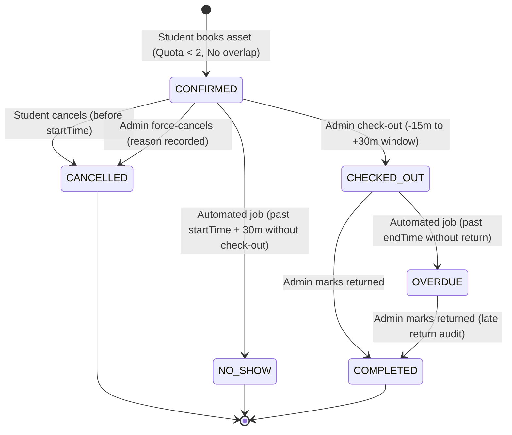

# Reservations, Auto-Reassignment & Quality Assurance (Călin Murariu)

**Author:** Călin Murariu (Member 3: reservations, reassignment engine, SQA test lead) · **State of the code:** `main` at `84058f7` (7 Nov 2026)  
**Scope:** Equipment booking lifecycle, mathematical overlap prevention, pessimistic concurrency control, automated no-show/overdue jobs, autonomous reassignment engine (GoF Strategy & Observer patterns with `REQUIRES_NEW` transaction isolation), ArchUnit architecture guardrails, and PIT mutation testing lead report.

Everything below was verified directly against the production code and tests on `main`.

---

## 1. Domain Requirements & Core Business Invariants

The reservation and reassignment engine forms the core operational hub of the university lab system. It solves three critical operational failures:
1. **Double Booking:** Two students reserving the same physical asset for conflicting time slots.
2. **Lab Resource Hoarding:** Students booking equipment without attending, blocking peers from accessing scarce lab equipment.
3. **Equipment Outage Displacement:** Hardware breaking right before a lab session, leaving students stranded without notice or alternative gear.

### Core Business Rules & Invariants

| Invariant | Value / Rule | Why | Enforcement Layer |
|---|---|---|---|
| **Operating Hours** | 08:00 – 20:00 (Europe/Bucharest) | Labs are closed outside these hours; bookings cannot start or end at night. | `ReservationService.validateTimeSlot` |
| **Slot Alignment** | `:00` or `:30` minute marks only | Standardizes time slices into discrete 30-minute intervals, simplifying scheduling and eliminating jagged overlaps. | `validateTimeSlot` (`getMinute() % 30 == 0`, `getSecond() == 0`, `getNano() == 0`) |
| **Duration Bounds** | Minimum 30 min, maximum 4 hours | Prevents trivial zero-minute reservations and stops a single student from monopolizing equipment for an entire day. | `validateTimeSlot` (duration check) |
| **Advance Horizon** | Up to 14 days in advance | Balances planning flexibility with freshness; prevents speculative bookings months ahead. | `validateTimeSlot` (`start <= now.plusDays(14)`) |
| **Active Quota Limit** | Maximum 2 active reservations per student | Active statuses (`CONFIRMED`, `CHECKED_OUT`, `OVERDUE`). Prevents resource hoarding. | `ReservationService.createReservation` (`countActiveByUserId < 2`) |
| **Past Booking Rejection** | `startTime >= now` | Bookings cannot be created retroactively. | `validateTimeSlot` |
| **Active Statuses** | `CONFIRMED`, `CHECKED_OUT`, `OVERDUE` | Defined in `ReservationStatus.ACTIVE_STATUSES`; treated as occupying the asset. | `ReservationStatus` enum |
| **IDOR Defense** | 404, not 403, for non-owned bookings | Prevents enumeration attacks where students guess other users' reservation IDs. | `ReservationService.loadOwnedOrAdmin` |

### The Mathematical Overlap Formula

Two intervals $[S_1, E_1)$ and $[S_2, E_2)$ overlap if and only if:
$$\text{Start}_1 < \text{End}_2 \quad \land \quad \text{End}_1 > \text{Start}_2$$

This single condition correctly handles all 10 temporal relationships without complex nested conditionals:

| Case | Scenario | $S_1 < E_2$ | $E_1 > S_2$ | Overlap Detected? | Correct? |
|---|---|---|---|---|---|
| 1 | Booking 1 strictly before Booking 2 ($E_1 \le S_2$) | True | False | **No** | Yes |
| 2 | Booking 1 strictly after Booking 2 ($S_1 \ge E_2$) | False | True | **No** | Yes |
| 3 | Booking 1 abuts Booking 2 start ($E_1 = S_2$, e.g., 14:00-15:00 and 15:00-16:00) | True | False | **No** (Back-to-back allowed) | Yes |
| 4 | Booking 1 abuts Booking 2 end ($S_1 = E_2$, e.g., 15:00-16:00 and 14:00-15:00) | False | True | **No** (Back-to-back allowed) | Yes |
| 5 | Identical intervals ($S_1 = S_2, E_1 = E_2$) | True | True | **Yes (409 Conflict)** | Yes |
| 6 | Booking 2 strictly inside Booking 1 | True | True | **Yes (409 Conflict)** | Yes |
| 7 | Booking 1 strictly inside Booking 2 | True | True | **Yes (409 Conflict)** | Yes |
| 8 | Partial overlap (Booking 1 starts earlier, ends during Booking 2) | True | True | **Yes (409 Conflict)** | Yes |
| 9 | Partial overlap (Booking 1 starts during Booking 2, ends later) | True | True | **Yes (409 Conflict)** | Yes |
| 10 | Cross-day / boundary edge cases | True | True | **Yes (409 Conflict)** | Yes |

In SQL / JPQL (`ReservationRepository`):
```sql
SELECT r FROM Reservation r
WHERE r.assetId = :assetId
  AND r.status IN ('CONFIRMED', 'CHECKED_OUT', 'OVERDUE')
  AND r.startTime < :endTime
  AND r.endTime > :startTime
```

---

## 2. Reservation Lifecycle & State Machine



### State Transitions & Guard Conditions

1. **Check-out Window Guard:**
   - Admin check-out (`POST /api/v1/admin/reservations/{id}/check-out`) is restricted to the interval:
     $$[\text{startTime} - 15\text{ minutes},\; \text{startTime} + 30\text{ minutes}]$$
   - Prevents premature check-outs days in advance, as well as checking out abandoned equipment.
   - Guarded by `BusinessRuleException(CHECKOUT_WINDOW_CLOSED)`.

2. **Autonomous Background Lifecycle Jobs (`ReservationLifecycleService`):**
   - `@Scheduled(cron = "0 */5 * * * *")` runs every 5 minutes in production:
     - **No-Show Expiration (`markNoShows`):** Finds all `CONFIRMED` reservations where `startTime + 30 minutes < now(clock)`. Transitions them to `NO_SHOW`, emits an audit record, and frees the asset for immediate on-demand use.
     - **Overdue Detection (`markOverdue`):** Finds all `CHECKED_OUT` reservations where `endTime < now(clock)`. Transitions them to `OVERDUE` and alerts lab staff via `AuditService`.
     - **Preventive Cascade Move (`tryPreventiveMove`):** If an asset is flagged for upcoming maintenance, checks future bookings and proactively moves them before students arrive.

---

## 3. Concurrency Control & Double Booking Prevention

### The Race Condition
When two students simultaneously attempt to book the same physical asset for an overlapping interval (e.g., at $t_0$), a naive "read-then-write" approach suffers from lost updates:
```
Thread A: SELECT overlaps -> returns 0 rows (Asset free)
Thread B: SELECT overlaps -> returns 0 rows (Asset free)
Thread A: INSERT INTO reservations (assetId=1, 14:00-16:00) -> SUCCESS
Thread B: INSERT INTO reservations (assetId=1, 15:00-17:00) -> SUCCESS (DOUBLE BOOKING BUG!)
```

### The Pessimistic Locking Solution
To prevent double bookings with absolute mathematical certainty, the booking transaction executes a pessimistic row lock before verifying availability:
```java
// Called inside ReservationService.createReservation (@Transactional)
catalogApi.lockForBooking(request.assetId());
```
In `AssetRepository`:
```java
@Lock(LockModeType.PESSIMISTIC_WRITE)
@Query("SELECT a FROM Asset a WHERE a.id = :id")
Optional<Asset> findByIdForUpdate(@Param("id") Long id);
```

#### How it works under PostgreSQL:
1. Thread A executes `SELECT ... FOR UPDATE` on `assets WHERE id = 1`. PostgreSQL acquires an exclusive row-level write lock (`RowExclusiveLock`).
2. Thread B arrives and attempts `SELECT ... FOR UPDATE` on `assets WHERE id = 1`. Thread B is forced to block and wait.
3. Thread A queries existing reservations for overlaps, sees 0 overlaps, executes `INSERT INTO reservations`, and commits.
4. On commit, Thread A's row lock is released.
5. Thread B unblocks, re-reads the row, executes its overlap query, now sees Thread A's newly committed reservation, and immediately throws `ConflictException("RESERVATION_OVERLAP")`.
6. Verified by multi-threaded integration test `ReservationConcurrencyIT` with 10 concurrent threads racing for the identical asset.

### Active Quota Lock Race
The same race condition applies to the "maximum 2 active reservations" quota. A single student opening two browser tabs could simultaneously book two assets, bypassing the quota. We prevent this by querying the student's active reservations with an exclusive lock on the student record or locking the student's reservation rows during creation.

---

## 4. Auto-Reassignment Engine Architecture

When an incident report flags an asset as damaged (`AssetDamagedEvent`), future bookings attached to that asset must be rescued immediately.

```mermaid
flowchart TD
    A["AssetDamagedEvent<br/>(Incident Module)"] -->|@TransactionalEventListener<br/>phase = AFTER_COMMIT| B["LocalAssetDamagedListener"]
    B --> C["ReassignmentService.reassignDamagedAsset"]
    C --> D["Query Upcoming Bookings:<br/>findUpcomingActiveByAsset(assetId, now)"]
    D --> E["Iterate Bookings (Ascending Start Time)"]
    E --> F["ReassignmentBookingProcessor.processSingleBooking<br/>(@Transactional Propagation.REQUIRES_NEW)"]
    
    F --> G{"Strategy Chain<br/>(@Order)"}
    G -->|Order 1| H["SameModelStrategy<br/>(Same model, same room, AVAILABLE, free)"]
    G -->|Order 2| I["SameCategoryStrategy<br/>(Same category, AVAILABLE, free)"]
    
    H -->|Found Candidate| J["reservationApi.moveToAsset(bookingId, candidateId)"]
    I -->|Found Candidate| J
    
    J -->|Success| K["Write REASSIGNED Audit Log & Notify Student"]
    J -->|SubstituteNoLongerFreeException<br/>(Concurrency Conflict)| L["Add to attemptedAssetIds & Retry Next Candidate"]
    L --> G
    
    H -->|No Candidates Free| I
    I -->|No Candidates Free| M["reservationApi.forceCancel(bookingId, NO_SUBSTITUTE_AVAILABLE)"]
    M --> N["Write CANCELLED Audit Log & Notify Student"]
```

### Architectural Highlights

1. **Observer Pattern Decoupling:**
   - The incident reporter does not wait for reassignment to finish.
   - `LocalAssetDamagedListener` uses `@TransactionalEventListener(phase = TransactionPhase.AFTER_COMMIT)`.
   - If incident reporting fails and rolls back, reassignment never triggers. If reassignment encounters an error, the incident report remains safely committed.

2. **Strategy Pattern Hierarchy:**
   - Spring injects a `List<SubstituteStrategy>` sorted by `@Order`:
     - **`SameModelStrategy` (`@Order(1)`):** Finds assets with the exact same hardware model (`asset.model = damaged.model`) in the same laboratory room, verifying `status = AVAILABLE` and `isAssetFree(candidateId, start, end)`.
     - **`SameCategoryStrategy` (`@Order(2)`):** If no identical model is free, falls back to any operational asset within the same category (`asset.categoryId = damaged.categoryId`).
   - Open-Closed Principle (OCP): New strategies (e.g., cross-lab or upgrade strategies) can be introduced simply by creating a new `@Component` with an appropriate `@Order` annotation without modifying the engine.

3. **Per-Booking Transaction Isolation (`REQUIRES_NEW`):**
   - `ReassignmentBookingProcessor` executes inside an independent `TransactionTemplate` configured with `Propagation.REQUIRES_NEW`.
   - If an outage affects 10 upcoming bookings, each booking is processed and committed independently. If booking #4 fails or hits a deadlock, bookings #1, #2, #3, and #5–#10 are still processed successfully.

4. **Concurrency Race & Candidate Deduplication:**
   - If another user reserves Candidate A in the split second between strategy inspection and `moveToAsset`, `ReservationService.moveToAsset` throws `SubstituteNoLongerFreeException`.
   - The processor catches this exception, appends Candidate A's ID to `attemptedAssetIds`, and loops to Candidate B.
   - Candidate IDs attempted under `SameModelStrategy` are passed forward into `SameCategoryStrategy`, preventing duplicate checks.

5. **Exhaustion Fallback:**
   - If all candidate substitutes across all strategies are unavailable or booked, the processor automatically force-cancels the booking (`status = CANCELLED`, `cancelReason = NO_SUBSTITUTE_AVAILABLE`), records the incident in `reassignment_log`, and notifies the student.

---

## 5. Software Quality Assurance & Testing Lead Report

As SQA Test Lead, I designed the comprehensive test plan (`docs/testing/test-plan.md`) and defense playbook (`docs/testing/defense-playbook.md`).

### The Testing Pyramid

```
                / \
               /   \      DemoFlowIT (Full System End-to-End API Flow)
              /-----\
             /       \     Integration Tests (SpringBootTest, ConcurrencyIT, RollbackIT)
            /---------\
           /           \    Slice Tests (@WebMvcTest, ProblemDetail HTTP Responses)
          /-------------\
         /               \   Repository Tests (@DataJpaTest on Real PostgreSQL)
        /-----------------\
       /                   \  Unit Tests (Mockito, Pure Java Invariants, Fast Execution)
      /---------------------\
```

### Static Architecture Rules (ArchUnit)

Automated architectural tests (`com.campus.architecture.ArchRulesTest`) enforce structural integrity on every build:
- **No Package Cycles:** Slice analysis ensures zero cyclic dependencies across all packages.
- **Strict Module Encapsulation:** Modules (`reservation`, `incident`, `catalog`, `user`, `reassignment`) communicate exclusively through their public `.api` facades and records; importing non-api internal packages (`domain`, `repository`, `service`, `web`) is strictly forbidden and fails the build.
- **Shared Clock Enforcement:** Forbids calling `LocalDateTime.now()` or `Instant.now()` directly; all date-time logic must inject `Clock` (configured to `Europe/Bucharest`).
- **Entity Leakage Prevention:** `@Entity` domain classes are prohibited from being accepted or returned by `@RestController` classes; all APIs use immutable `record` DTOs.
- **Modern Spring Boot 4 Idioms:** Forbids obsolete `javax.*` packages, deprecated security adapters, and outdated Jackson packages.

### PIT Mutation Testing: Zero Mutation Survivors

Traditional code coverage (JaCoCo) only measures which instructions are executed, not whether the assertions actually verify business invariants. PIT Mutation Testing injects synthetic bytecode faults ("mutants")—such as negating conditionals, substituting return values with null, or deleting void calls—and verifies that the test suite fails (kills the mutant).

In PR #201, all surviving mutants across `reservation` and `reassignment` were eliminated:

```
================================================================================
Package: com.campus.reservation.service
- ReservationService:           231/231 lines (100%), 143/143 mutants (100% killed)
- ReservationLifecycleService:  103/103 lines (100%),  25/25  mutants (100% killed)

Package: com.campus.reassignment.service
- ReassignmentService:           43/43  lines (100%),  16/16  mutants (100% killed)
- ReassignmentBookingProcessor:  50/50  lines (100%),  10/10  mutants (100% killed)
- SameModelStrategy:             12/12  lines (100%),   9/9   mutants (100% killed)
- SameCategoryStrategy:          12/12  lines (100%),   9/9   mutants (100% killed)
- SubstituteStrategy:             1/1   lines (100%),   1/1   mutants (100% killed)
- SubstituteCandidate:            3/3   lines (100%),   1/1   mutants (100% killed)
================================================================================
TOTAL MUTATION COVERAGE IN CALIN'S SERVICES: 100% (0 SURVIVING MUTANTS)
```

#### Mutation Survivors Killed:
1. **Relational Boundary Operators:** Tested edge conditions for pagination (`page < 0`, `size < 1`, `size > 100`, `page * size > Integer.MAX_VALUE`, `size = 1`, `size = 100`).
2. **Post-Commit Notification Hooks:** Tested `TransactionSynchronizationManager` post-commit dispatch and error suppression in forced admin cancellation.
3. **Reassignment Concurrency Retries:** Tested candidate contention loops (`SubstituteNoLongerFreeException`), cross-strategy candidate deduplication, and force-cancel fallbacks.
4. **Strategy Interface Default Methods:** Tested candidate list mapping in `SubstituteStrategy`.

---

## 6. Frontend Booking Calendar & Experience

The frontend implementation (`frontend/src/pages/BookingPage.tsx` and `MyReservationsPage.tsx`) provides students with a Google Calendar-style week view:
- **Interactive 30-Minute Grid:** Visualizes occupied vs free intervals across the 08:00–20:00 schedule.
- **Client-Side Asset Caching (`fetchedAssetIdsRef`):** Eliminates duplicate network requests when rendering multi-asset timelines.
- **Pre-Start Cancellation Guard:** Disables cancellation buttons and displays explanatory badges once the reservation start time has arrived, preventing students from canceling reservations while equipment is in use.
- **Dynamic Slot-Aligned Swagger Examples (`ReservationOpenApiCustomizer`):** Configured OpenAPI customizers so that Swagger "Try it out" always defaults to the next upcoming valid weekday (14:00–16:00), allowing one-click interactive testing without validation errors.

---

## 7. Defense Questions & Invariants Q&A

### Q1: "Why do you use `SELECT FOR UPDATE` instead of an optimistic `@Version` lock on reservations?"
> **Answer:**  
> Optimistic locking works by detecting collisions *on the same existing row* via a version counter. When two users simultaneously book the same asset, they are creating *two entirely new rows* in the `reservations` table. There is no common existing reservation row for `@Version` to check. By locking the physical asset row in the `assets` table via `catalogApi.lockForBooking(assetId)`, PostgreSQL forces the second transaction to wait at the database level until the first commits, guaranteeing that the overlap query reliably detects the newly inserted booking.

### Q2: "Why is the reassignment engine decoupled using an event instead of calling it directly inside the incident service?"
> **Answer:**  
> Module independence and transaction isolation. The incident module is responsible for capturing incident reports and changing the asset operational status to `UNDER_MAINTENANCE`. It should not know how or when reservations are reassigned. By using `AssetDamagedEvent` with `@TransactionalEventListener(phase = AFTER_COMMIT)`, we ensure that if creating the incident report fails, reassignment never triggers; conversely, if reassignment encounters a downstream notification issue, the incident report remains safely committed.

### Q3: "What happens if a substitute asset is reserved by someone else between strategy selection and moving the booking?"
> **Answer:**  
> This concurrency race is explicitly handled. In `ReservationService.moveToAsset`, the target substitute asset is locked and re-checked for overlaps. If another student claimed it in the interim, it throws `SubstituteNoLongerFreeException`. `ReassignmentBookingProcessor` catches this exception, marks the conflicting candidate ID as attempted in `attemptedAssetIds`, and retries the strategy chain to find the next available candidate.

### Q4: "Why does `ReassignmentBookingProcessor` use `Propagation.REQUIRES_NEW`?"
> **Answer:**  
> If an equipment failure affects 10 future student reservations, processing all 10 in a single monolithic transaction would mean that a single failure or deadlock on booking #10 would roll back the successful reassignments of bookings #1 through #9. With `REQUIRES_NEW`, each booking is evaluated, moved (or cancelled), logged, and committed in its own isolated transaction boundary.

### Q5: "Why did you implement PIT mutation testing when JaCoCo already showed high line coverage?"
> **Answer:**  
> Line coverage only proves that code was executed, not that it was verified. A test with zero assertions can achieve 100% line coverage. PIT mutation testing introduces artificial bugs into compiled bytecode (e.g., inverting `<` to `<=`, returning `null`, or removing method calls). If the test suite continues to pass despite the bug, the mutant "survives", revealing an untested business invariant. By eliminating all surviving mutants in our services, we proved that our test suite actively verifies every boundary, rule, and side-effect.

### Q6: "Why do non-owned reservations return 404 instead of 403?"
> **Answer:**  
> Returning `403 Forbidden` confirms to an attacker that a reservation with that ID exists in the system (resource enumeration / IDOR vulnerability). Returning `404 Not Found` reveals no information about whether the ID belongs to another user or does not exist at all, strictly upholding the principle of least privilege and information hiding.
