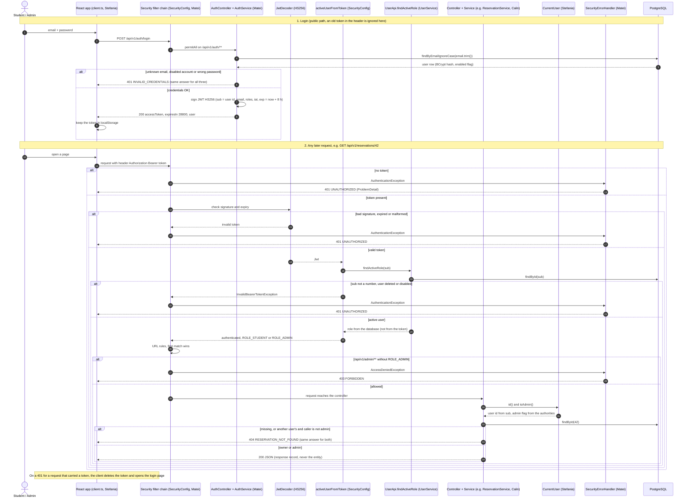

# Security (Matei Necula)

**Author:** Matei Necula (Member 1: cloud, security, auth) · **State of the code:** `main` at `99d0261` (5 Nov 2026)
**Scope:** login, tokens, who may call what, security errors, secrets, and the planned AWS setup. Ownership checks inside other modules (Calin's reservations, Stefania's incidents) are described here only as far as security depends on them.

Everything below was checked against the code on `main`. Items marked **planned (W7–W9)** are designed in an ADR but not built yet.

---

## 1. Goals and threat model

### What we protect

| Asset | Why it matters |
|---|---|
| Accounts and passwords | A stolen account can book, cancel and report in someone else's name |
| Other students' reservations | A student must not see or cancel another student's booking |
| Incident reports | The reporter comes from the login, so a report can't be filed in someone else's name |
| Admin functions | Catalog changes, check-out/return, resolving incidents, running the lifecycle jobs, the reassignment log: all under `/api/v1/admin/**` |
| Incident photos | Files uploaded by users. The storage layer (type, size, magic-byte and key checks) is on `main`; the upload endpoint itself is not on `main` yet |
| Secrets | The JWT signing secret, the database password, the first admin's password, AWS access |

### Who attacks

| Attacker | What they can do |
|---|---|
| Curious student | Has a normal account, uses the UI and Swagger, changes ids in URLs |
| Malicious student | Crafts requests by hand, edits the token, sends extra JSON fields, tries admin paths, uploads non-images |
| Outsider | No account; scans URLs, sends odd paths, guesses passwords |
| Ourselves | A teammate adds an endpoint and forgets a rule, or a secret is committed by mistake |

### Threats (STRIDE)

| STRIDE | Threat | Example in our app | Mitigation | Where (code / test) |
|---|---|---|---|---|
| Spoofing | Forge a token | Write a JWT by hand with `sub: 3` (the admin) | HS256 signature with a secret only the backend knows | `SecurityConfig.jwtDecoder` · `SecurityConfigTest.invalidTokenIsRejected` |
| Spoofing | Guess or steal a password | Try passwords on `/auth/login` | BCrypt hashes only; the same 401 for unknown email, wrong password and disabled account | `AuthService.login` · `AuthServiceTest.loginRejects*` |
| Spoofing | Keep using an old token | An admin disables a student, who still holds an 8 h token | The account is checked on every request (#117) | `activeUserFromToken` · `SecurityConfigTest.disabledUserIsRejected…`, `deletedUserIsRejected…` |
| Tampering | Edit the role in the token | Change `roles: ["STUDENT"]` to `["ADMIN"]` | The signature breaks; and even a validly signed token can't raise the role, because the role is read from the database | `SecurityConfigTest.roleComesFromTheDatabaseNotFromTheToken` |
| Tampering | Mass assignment | Send `"userId": <other>` when booking or `"reportedById": <other>` when reporting; send `"role": "ADMIN"` to register | The owner always comes from `CurrentUser` (the token); `RegisterRequest` has no role field | `SecurityPassIT.userIdInTheBodyIsIgnored` · `AuthFlowIT.registeredStudentCanLogInAndUseTheToken` |
| Tampering | Path tricks | `/api/v1/..;/admin/x`, `;` in a URL | Spring Security's firewall rejects them before any rule runs | `SecurityConfigTest.firewallRejectionIsProblemJson` |
| Tampering | Malicious upload | HTML renamed to `.jpg`; a key like `../../etc/passwd` | Liviu's `StorageValidation`: allowed types, 5 MB, magic bytes, random UUID keys, strict key pattern | `LocalStorageServiceTest`, `S3StorageServiceTest` |
| Repudiation | "I didn't change that" | An admin edits an asset | Liviu's `AuditService` writes `audit_logs` with the actor id from `CurrentUser` | `DatabaseAuditServiceTest` |
| Information disclosure | IDOR | Student B opens `/api/v1/reservations/{A's id}` | 404, the same as for a missing id | `ReservationService.loadOwnedOrAdmin` · `SecurityPassIT.otherStudentCannotReadMyReservation` |
| Information disclosure | Error bodies leak internals | A database error shows SQL or a stack trace | Every error is a `ProblemDetail` with a fixed message; unexpected errors are only logged | `SecurityPassIT.errorBodiesAreCleanProblemDetails`, `unexpectedErrorHidesTheDatabaseMessage` |
| Information disclosure | Password hash in a response | `GET /users/me` returns the whole user | Response records (`UserResponse`, `UserSummary`) have no hash field | `AuthRequestsTest.userResponseNeverContainsThePasswordHash`, `AuthFlowIT.meReturnsTheAccountOfTheToken` |
| Denial of service | Huge uploads, hanging AWS calls | A 1 GB "photo"; SES not answering | Multipart limit 5 MB / 6 MB; AWS SDK timeouts 10 s / 20 s; e-mails sent `@Async` | `application.yml`, `AwsConfig` · `ProdProfileStartupTest` |
| Elevation of privilege | Student calls an admin endpoint | `POST /api/v1/admin/assets` with a student token | `/api/v1/admin/**` needs `ROLE_ADMIN` | `SecurityPassIT.everyAdminEndpointIsClosedToStudentsAndAnonymousCallers` |
| Elevation of privilege | A forgotten rule | A new path outside `/api/v1` | `denyAll()` for every path not listed | `SecurityConfigTest.otherApiPathsAreDeniedEvenWithAToken`, `writesOutsideTheApiAreDeniedEvenWithAToken` |

Rate limiting, lockout and the other gaps are listed in section 9.

---

## 2. Authentication

### Register and login

| Step | What happens | Code |
|---|---|---|
| Register | `POST /api/v1/auth/register` with `email`, `password`, `fullName`. Always creates a **STUDENT**: the request has no role field, so nobody can make themselves admin | `AuthController`, `AuthService.register`, `RegisterRequest` |
| Email | Trimmed before validation (#165), stored in lower case, `UNIQUE` column. A taken email is `409 EMAIL_TAKEN`, also when two registrations race (the unique constraint catches the second one) | `RegisterRequest`, `User` constructor, `AuthService.register` |
| Password storage | `PasswordEncoderFactories.createDelegatingPasswordEncoder()`: BCrypt, hash stored with a `{bcrypt}` prefix, so the algorithm can be changed later without breaking old hashes | `SecurityConfig.passwordEncoder` |
| Login | `POST /api/v1/auth/login`. Unknown email, disabled account and wrong password all give the same `401 INVALID_CREDENTIALS`; so does a password over 72 bytes (BCrypt's limit; register never stores one) | `AuthService.login` |
| First admin on AWS | Register never makes admins, so in `prod` the first admin is created from `ADMIN_EMAIL` / `ADMIN_PASSWORD` at startup, only if the account doesn't exist yet. The password is never logged | `AdminBootstrap` (`@Profile("prod")`) |
| Dev accounts | `student1`, `student2`, `admin@campus.test` with password `password`, **dev profile only** | `UserSeeder` (`@Profile("dev")`) |

### Password rules

| Rule | Why |
|---|---|
| 8 to 72 characters (`@Size`) | Minimum length; 72 is BCrypt's input limit |
| At most **72 bytes** (`isPasswordWithinBcryptLimit`, `@AssertTrue`) | Bug fixed in #54: `@Size` counts characters, but BCrypt counts bytes. 40 × "ș" (80 bytes in UTF-8) passed validation and made `encode()` throw, which was a 500. Now it is `400 VALIDATION_FAILED` |
| Password not trimmed | Spaces can be part of a password |
| `AdminBootstrap` checks the same limits | A bad `ADMIN_PASSWORD` stops the app at startup instead of creating an admin nobody can log in with |

### The token (JWT)

| Property | Value | Where |
|---|---|---|
| Algorithm | HS256 (HMAC-SHA256, one shared secret signs and verifies) | `SecurityConfig.jwtEncoder` / `jwtDecoder`, `AuthService.createToken` |
| Claims | `sub` = user id, `email`, `roles`, `iat`, `exp` | `AuthService.createToken`, `docs/api-contract.md` §3 |
| Lifetime | 8 h (`app.jwt.expiration`), returned as `expiresIn: 28800` | `application.yml`, `LoginResponse` |
| Secret | `app.jwt.secret`: a fake committed value in dev and test, `JWT_SECRET` from the environment in prod. HS256 needs at least 32 bytes: a shorter secret stops the app at startup (`jwtEncoder` bean, `KeyLengthException`; checked 6 Nov: 31 bytes fails, 32 works). The same secret also keys the pickup codes (`PickupCodes`, with the label `pickup-v1` so a code and a token can't be swapped); rotating it only changes the current codes, which is harmless) | `application-dev.yml`, `application-prod.yml` |
| Sessions | None: `SessionCreationPolicy.STATELESS`, no cookies; every request sends `Authorization: Bearer <token>` | `SecurityConfig.apiChain` |
| CSRF | Off. CSRF abuses cookies the browser sends by itself; we use no cookies | `SecurityConfig.apiChain` |
| CORS | None configured: frontend and API share one origin (Vite proxy in dev, the same container in prod, ADR-002) | – |

### Why Spring's OAuth2 resource server and not `jjwt`

| Reason | Detail |
|---|---|
| Less own security code | The resource server already has the filter that reads `Authorization: Bearer`, checks the signature and `exp`, and turns failures into a 401. With `jjwt` we would write and test that filter ourselves |
| Same library signs and verifies | `NimbusJwtEncoder` and `NimbusJwtDecoder` share one `secretKey()` and the same `MacAlgorithm.HS256`, so a token from login is exactly what the filter accepts (`AuthFlowIT`) |
| Boot 4 idiom | Old tutorials use `jjwt` with `Jwts.parser().setSigningKey`; AGENTS.md lists it as a Boot 2/3 idiom not to use |
| Swagger fits | `OpenApiConfig` declares a `bearerAuth` scheme, so Swagger's **Authorize** button sends the same header |

### Why the token is checked against the database on every request (#117)

Before #117 the role came from the token's `roles` claim and nobody looked at the account again. A disabled, deleted or demoted user kept their old rights for up to 8 hours.

Now `activeUserFromToken` runs after the signature and expiry checks and calls `UserApi.findActiveRole(sub)`:

| Database says | Result |
|---|---|
| User exists and is enabled | Authorities = `ROLE_` + role **from the database** |
| User deleted or disabled | `InvalidBearerTokenException` → 401 `UNAUTHORIZED` |
| `sub` missing or not a number | Same 401 (#158; it used to be a 500 from `Long.valueOf`) |

**Cost:** one primary-key lookup per request with a token. **Benefit:** disabling or demoting an account works at once, without refresh tokens or a revocation list. The `roles` claim stays in the token (contract §3) but no longer decides anything. `UserApi` is injected through an `ObjectProvider`, so Liviu's `@WebMvcTest` slices (which import `SecurityConfig` without a `UserApi` bean) still start.

### Fixes to the token flow

| Issue / PR | Problem | Fix |
|---|---|---|
| #116 / #126 | Login answered 401 when the browser still sent an expired token: the token filter runs before `permitAll()`, and the frontend sends the saved token on every call | `ignoreTokenOnAuthPaths()`: on `/api/v1/auth/**` the header is not read at all |
| #117 / #128 | Disabled or demoted users kept access until the token expired | Account check on every request (above) |
| #158 / #176 | A signed token with a non-numeric or missing `sub` gave 500 | `userId(jwt)` turns `NumberFormatException` into `InvalidBearerTokenException` (401) |

---

## 3. JWT sequence diagram

Source: [`docs/diagrams/jwt-auth-sequence.mmd`](../diagrams/jwt-auth-sequence.mmd) (GitHub renders the copy below).

---

## 4. Authorization (RBAC)

### The rules in `SecurityConfig`

Spring checks them top to bottom and the **first match wins**:

| # | Path | Rule |
|---|---|---|
| 1 | `/api/v1/auth/**` | `permitAll` (and the token header is ignored, #116) |
| 2 | `/actuator/health/**`, `/v3/api-docs/**`, `/swagger-ui/**`, `/swagger-ui.html` | `permitAll` |
| 3 | `/error` | `permitAll` (Spring forwards failures there; protecting it would turn a 404 into a 401) |
| 4 | `/api/v1/admin/**` | `hasRole("ADMIN")`. Must stay above rule 5, or rule 5 would let students in |
| 5 | `/api/v1/**` | `authenticated()` (any active user) |
| 6 | `/api/**`, `/actuator/**` | `denyAll()` (other API versions, every actuator endpoint except health) |
| 7 | `GET /**` | `permitAll`: the React app (`index.html`, JS files, page routes) served by `SpaConfig`. It holds no data; all data comes from `/api` |
| 8 | anything else | `denyAll()`: a path nobody listed fails closed |

**The admin prefix rule.** Admin-only endpoints must live under `/api/v1/admin/**`. Teammates never edit `SecurityConfig`; putting the endpoint under the prefix is enough. `SecurityPassIT` reads the list of all admin mappings from Spring at runtime, so a new admin endpoint is tested the day it is added (16 endpoints on `main`).

### Roles × endpoint groups

"401" = no token or a rejected token; "403" = valid token, role not enough. Derived from the rules above and the tests named in the last column.

| Endpoint group | No token | STUDENT | ADMIN | Test |
|---|---|---|---|---|
| `/api/v1/auth/**` (ping, register, login) | ✅ | ✅ | ✅ | `AuthControllerTest`, `SecurityConfigTest.authEndpointsIgnoreAnInvalidToken` |
| `GET /api/v1/users/me` | 401 | ✅ own account only | ✅ own account only | `AuthFlowIT.meReturnsTheAccountOfTheToken` |
| Catalog reads (`GET /assets`, `/assets/{id}`, `/categories`, `/lab-rooms`) | 401 | ✅ (retired assets hidden from search) | ✅ (all assets) | `SecurityPassIT.errorBodiesAreCleanProblemDetails` (404 `ASSET_NOT_FOUND` as student) |
| Reservations (`/api/v1/reservations/**`: book, `/me`, `/me/summary`, availability, `/{id}`, `/{id}/cancel`) | 401 | ✅ own only; another student's id → **404** | ✅ any reservation | `SecurityPassIT` IDOR tests |
| `POST /api/v1/incidents` | 401 | ✅ (reporter = token's user) | ✅ | `SecurityPassIT.userIdInTheBodyIsIgnored` |
| `/api/v1/admin/**` (catalog CRUD, incident list/resolve, reservation search/check-out/return/jobs, reassignment log) | 401 | **403** | ✅ | `SecurityPassIT.everyAdminEndpointIsClosedToStudentsAndAnonymousCallers` |
| Swagger UI + `/v3/api-docs` | ✅ | ✅ | ✅ | `SecurityConfigTest.swaggerIsPublic` |
| `/actuator/health` | ✅ | ✅ | ✅ | `SecurityConfigTest.healthCheckIsPublic` |
| Other `/actuator/**` (e.g. `/actuator/info`) and `/api/**` outside `/api/v1` | 401 | 403 | 403 | `SecurityConfigTest.otherApiPathsAreDeniedEvenWithAToken` |
| SPA routes (`GET /`, `/reservations`, `/admin/incidents`, static files) | ✅ | ✅ | ✅ | `SpaFrontendTest` |
| Non-GET outside `/api` (e.g. `POST /something-else`) | 401 | 403 | 403 | `SecurityConfigTest.writesOutsideTheApiAreDeniedEvenWithAToken` |

The SPA routes being public is not a hole: `/admin/incidents` in the browser is only the React page. The data behind it comes from `/api/v1/admin/incidents`, which still needs `ROLE_ADMIN`.

### Ownership: other students' resources return 404, not 403

URL rules only know the role, not who owns reservation 42. Ownership is checked in each module's **service**, with the user id from the token:

- `CurrentUser.id()` (Stefania) reads `sub` from the already verified token. Services never take a user id from the request body (`SecurityPassIT.userIdInTheBodyIsIgnored`).
- `ReservationService.loadOwnedOrAdmin` (Calin) throws the same `404 RESERVATION_NOT_FOUND` for "doesn't exist" and "belongs to someone else". A 403 would confirm that the id exists, so a student could count other people's bookings by trying ids (IDOR enumeration).
- `/me` lists filter by the token's user (`SecurityPassIT.myListsOnlyShowMyOwnReservations`).
- Incidents: on `main` a student can only create a report; reading and resolving incidents is under `/api/v1/admin/incidents`.

---

## 5. Error handling for security

All errors follow RFC 9457 `ProblemDetail` with an extra `code`, so the frontend can react to the code instead of parsing text.

| Case | Who answers | Status + `code` |
|---|---|---|
| No token, invalid, expired, disabled/deleted account, bad `sub` | `SecurityErrorHandler.commence` (Matei) | 401 `UNAUTHORIZED` |
| Valid token, role not enough | `SecurityErrorHandler.handle(AccessDeniedException)` | 403 `FORBIDDEN` |
| URL blocked by the firewall (`;`, encoded `/`, `..`) | `SecurityErrorHandler.handle(RequestRejectedException)`, registered as a `RequestRejectedHandler` bean (#118) | 400 `REQUEST_REJECTED` |
| Wrong login | `AuthService` → Liviu's `GlobalExceptionHandler` | 401 `INVALID_CREDENTIALS` |
| Someone else's reservation | Calin's service → `GlobalExceptionHandler` | 404 `RESERVATION_NOT_FOUND` |
| Any unexpected exception (e.g. SQL error) | `GlobalExceptionHandler.handleUnexpected`: logs it, answers a fixed text | 500 `INTERNAL_ERROR` |

Why a separate handler: 401 and 403 happen inside the security filters, before a controller runs, so Liviu's `@RestControllerAdvice` never sees them. `SecurityErrorHandler` writes the same JSON shape by hand (#44).

**No internals in responses.** `SecurityPassIT.errorBodiesAreCleanProblemDetails` sends nine error cases (404 ×2, 400 ×3, 409, 405, 401, 403) and checks each body for leak markers (`exception`, `com.campus`, `org.springframework`, `hibernate`, `sql`, `insert into`, …). `unexpectedErrorHidesTheDatabaseMessage` throws a `DataIntegrityViolationException` containing SQL and a constraint name and checks that neither reaches the client. A related fix: #52 removed `spring.mvc.problemdetails.enabled`, which made Spring Boot answer MVC errors before Liviu's handler, without our `code`.

---

## 6. Secrets and configuration

| Setting | dev (`application-dev.yml`) | test (`application-test.yml`) | prod (`application-prod.yml`) |
|---|---|---|---|
| Database | `DB_URL` / `DB_USERNAME` / `DB_PASSWORD`, defaults `localhost:5432/campus`, `campus` / `campus` | `campus_test`, `campus` / `campus` (CI overrides with `SPRING_DATASOURCE_*`) | `DB_URL`, `DB_USERNAME`, `DB_PASSWORD`, no defaults |
| JWT secret | fake committed value (≥ 32 bytes) | different fake value | `JWT_SECRET`, no default |
| AWS | not used (`LocalStorageService`, `LoggingNotificationService`) | not used | `AWS_REGION`, `PHOTO_BUCKET`, `MAIL_FROM`; **no AWS keys**, the SDK uses the EC2 instance role |
| First admin | seeded dev accounts | none | `ADMIN_EMAIL`, `ADMIN_PASSWORD` (optional, default empty) |

The dev and test values are deliberately fake and only work on a laptop database. In prod every secret has no default, so a missing one stops the app instead of falling back to a dev value.

### What is never committed

| Protection | Where |
|---|---|
| `.gitignore`: `.env`, `*.env.local`, `*.tfstate`, `*.tfvars`, `infra/.terraform/`, `backend/uploads/` | repo root |
| `.dockerignore`: `.git`, `**/.env`, `infra`, `docs`, build output, so none of it ends up in the image | repo root |
| GitHub **secret scanning** and **push protection** are enabled on the repository (a push containing a known secret format is blocked) | repository settings (checked with `gh api`, 5 Nov 2026) |
| Rule for the team: a leaked secret is reported to Matei at once and rotated | AGENTS.md §3 |

### Planned (W7–W9)

| Item | Plan | Source |
|---|---|---|
| Prod secrets | SSM Parameter Store `SecureString` under `/campus/` (KMS-encrypted; created by Terraform, #250). Terraform generates the DB password and the JWT secret. The deploy script reads them with the instance role into a root-only env file (`chmod 600`) and starts the container with `--env-file`. No extra library: Spring sees plain environment variables | ADR-003 |
| No rotation | Parameter Store has no automatic rotation; a leaked secret is changed by hand and the app redeployed | ADR-003 (consequences) |
| Deploy credentials | GitHub Actions assumes an AWS role through **OIDC**: no AWS keys stored in GitHub | ADR-002, ADR-005 |

---

## 7. Cloud security (planned, W7–W9)

**Part of this exists, applied with Terraform** (`infra/` on `main`, #249 and #250): the network and security groups, the private photo bucket, the ECR repository, the instance role and the SSM parameters. RDS is written but off until the W7 deploy. **Not there yet:** EC2, CloudFront and `deploy.yml`. The rest is the design in ADR-002/003/005.

| Area | Design | Source |
|---|---|---|
| HTTPS | CloudFront in front of the server with its default `*.cloudfront.net` certificate. **Limitation:** CloudFront → EC2 is plain HTTP | ADR-002 |
| Server reachability | EC2 security group accepts port 8080 **only from CloudFront** (AWS prefix list `com.amazonaws.global.cloudfront.origin-facing`). No SSH port: shell through SSM Session Manager | ADR-002; groups created by Terraform (#249) |
| Database | RDS PostgreSQL 18 in private subnets, encrypted, not publicly accessible; port 5432 only from the EC2 security group | ADR-002 |
| Photos | Private S3 bucket (created by Terraform, #250). The app reaches it only through the instance role | ADR-002, doc 23 |
| Least-privilege instance role | `s3:PutObject/GetObject/DeleteObject` on `<bucket>/*`, `s3:ListBucket` on the bucket (so a missing photo is a 404, not a 403, #148), `ses:SendEmail`, read `/campus/*` parameters, pull from ECR, write logs | ADR-002, doc 29; role created by Terraform (#250) |
| E-mail | SES starts in **sandbox**: it only sends to verified addresses. For the demo the team's addresses get verified | doc 23, `docs/whats-left.md` W9 |
| AWS account | Root with MFA and no keys; daily work through IAM user `terraform-admin` (known risk: long-lived key without MFA, kept only on Matei's laptop); budget alerts at $5/$20/$40 | ADR-005 |

**Already in code for prod:**

| Item | Detail | Where |
|---|---|---|
| Container runs as non-root | `adduser -S app`, `USER app` | `Dockerfile` |
| No AWS keys in the app | `S3Client` / `SesV2Client` use the SDK's default credentials chain (instance role) | `AwsConfig` |
| Timeouts | 10 s per attempt, 20 s total on S3 and SES, so a hanging call can't hold a request thread or a transaction | `AwsConfig` |
| E-mail failures don't break bookings | `SesNotificationService.notifyUser` is `@Async` and catches `RuntimeException` (#171) | `SesNotificationService` |
| Same upload checks as in dev | `S3StorageService` uses Liviu's `StorageValidation` | `S3StorageService` |
| Prod profile starts without AWS | The SDK only connects on the first real call | `ProdProfileStartupTest` |

---

## 8. Verification

### Security tests

| Test class | What it proves |
|---|---|
| `SecurityConfigTest` (18 tests, real app + DB) | Health and Swagger are public; other API paths need a token (401 JSON); a broken token is 401; `/auth/**` ignores a broken token; students get 403 on admin paths, admins pass; other API versions and non-GET writes outside `/api` are denied even for admins; firewall rejection is ProblemDetail; disabled, deleted and demoted users; `sub` missing or non-numeric is 401; passwords are BCrypt hashes |
| `SecurityPassIT` (7 tests, real logins) | IDOR read and cancel → 404; `/me` lists only own data; `userId` / `reportedById` in the body are ignored; **every** admin endpoint is 403 for students and 401 without a token; nine error bodies are clean; an SQL error doesn't leak |
| `AuthFlowIT` | A token from login is accepted by the filter; self-registered users are students (403 on admin); `/users/me` returns the token's user without a hash; login works while an old token is still sent (#116); email is trimmed (#165); duplicate email → 409 |
| `AuthServiceTest` | Real BCrypt hash stored; token claims and `exp` exact; wrong password, unknown email and disabled account all give `INVALID_CREDENTIALS`; duplicate insert → 409 |
| `AuthRequestsTest` | Validation rules; the 72-byte limit; `UserResponse` has no hash |
| `AuthControllerTest` | Public endpoints, 201 / 400 / 401 status codes |
| `UserServiceTest` | `findActiveRole` empty for disabled or missing users; `me()` uses the token's id |
| `AdminBootstrapTest` | Admin created with a hash only when missing; existing account untouched; too-short password stops startup |
| `ErrorJsonTest` | MVC errors (validation, bad JSON, unknown path) keep their `code` |
| `SpaFrontendTest` | React routes are served; unknown API paths stay a 401 JSON, not the web page |
| `ProdProfileStartupTest` | The prod profile starts with the S3/SES adapters, and `notifyUser` runs through the `@Async` proxy |
| `LocalStorageServiceTest`, `S3StorageServiceTest` (Liviu, Matei) | Type, magic-byte and path-traversal checks; missing key → 404 |

### Bugs found and fixed

| Issue / PR | Bug | Fix | Guarded by |
|---|---|---|---|
| (in #54) | Passwords over 72 bytes but ≤ 72 characters gave 500 | `@AssertTrue isPasswordWithinBcryptLimit` → 400 | `AuthRequestsTest.rejectsPasswordLongerThan72BytesEvenIfShortInCharacters` |
| #52 | Validation and MVC errors lost their `code` (Spring Boot's handler answered first) | Removed `spring.mvc.problemdetails.enabled` | `ErrorJsonTest` |
| #67 / #70 | Security probes used real endpoints, so tests broke when Liviu mapped them | Probe paths no controller maps | `SecurityConfigTest` (`PROBE`, `ADMIN_PROBE`) |
| #116 / #126 | Login refused while an expired token was still sent | Bearer resolver ignores `/api/v1/auth/**` | `SecurityConfigTest.authEndpointsIgnoreAnInvalidToken`, `AuthFlowIT.loginWorksWhileAnExpiredTokenIsStillSent` |
| #118 / #127 | Firewall-rejected URLs answered without our `code` | `RequestRejectedHandler` bean | `SecurityConfigTest.firewallRejectionIsProblemJson` |
| #117 / #128 | Disabled, deleted or demoted users kept access for up to 8 h | Account + role from the DB on every request | `SecurityConfigTest.disabledUser…`, `deletedUser…`, `roleComesFromTheDatabaseNotFromTheToken` |
| #158 / #176 | Token with a bad `sub` → 500 | `InvalidBearerTokenException` → 401 | `SecurityConfigTest.tokenWithNonNumericSubjectIsRejected`, `tokenWithoutSubjectIsRejected` |
| #165 / #175 | `" ana@campus.test "` rejected by `@Email` before trimming | Trim in the record's constructor | `AuthFlowIT.registerTrimsSpacesAroundTheEmail`, `AuthRequestsTest.trimsEmailAndNameButNotThePassword` |
| #148, #171 / #177 | Missing S3 key could show as 403 → 500 without a hint; SES lookup outside the `try`; slow SES blocked the caller | Log naming `s3:ListBucket` (IAM fix planned), lookup inside the `try`, `@Async` | `S3StorageServiceTest`, `SesNotificationServiceTest`, `ProdProfileStartupTest` |

The security pass itself (#139) found no new bug. For #116, #117, #118, #158, #165 and #148 the new tests were first run without the fix and failed (personal docs 20–22 and 27–29), so they really guard the bug.

---

## 9. Known limitations and future work

| Limitation | Effect | What production would do |
|---|---|---|
| No refresh tokens, 8 h lifetime | The user logs in again after 8 h | Short access token + refresh token (decision in `docs/decisions.md` §5) |
| No logout on the server | Logging out only deletes the token in the browser; a copied token works until it expires, unless the account is disabled (#117) | Token revocation list or short lifetimes |
| Token in `localStorage` | Any XSS bug in the frontend could read it | `HttpOnly` cookie + CSRF protection, or a strict Content-Security-Policy |
| No rate limiting and no account lockout on login | Passwords can be guessed at full speed; BCrypt only slows each attempt | Rate limit per IP/account (e.g. at CloudFront/WAF), lockout or CAPTCHA after failures |
| Weak password rule | Only 8 characters minimum; no check against common passwords | Breached-password check |
| Registration reveals existing emails | `409 EMAIL_TAKEN`; also an unknown email skips BCrypt on login, so it answers a bit faster | Same response for "taken" and "created" + e-mail verification |
| No e-mail verification | Anyone can register any address as a student | Confirmation link before the account is enabled |
| Disabling and demoting users has no endpoint on `main` yet | The #117 check works, but today an account can only be disabled in the database (Stefania's user admin endpoints will add it) | – |
| One shared HS256 secret | Anyone who gets `JWT_SECRET` can sign tokens for any existing user id, including the admin | RS256 with the private key only in the auth service; secret rotation |
| No automatic secret rotation | ADR-003 accepted it for cost | Secrets Manager rotation |
| Swagger UI public in prod | Anyone can read the API description (data still needs a token) | Disable springdoc in prod or put it behind the admin role |
| CloudFront → EC2 is plain HTTP (planned setup) | Traffic between CloudFront and the server is unencrypted | Domain + certificate on the origin (ADR-002) |
| One server, long-lived `terraform-admin` key | No high availability; a leaked key gives full access | ECS + ALB, Identity Center (ADR-002, ADR-005) |
| No test sends an expired but correctly signed token | Expiry is enforced by Spring's default JWT validator, and the claim is checked in `AuthServiceTest`, but no end-to-end test covers it | Add one with a fixed clock in the past |
