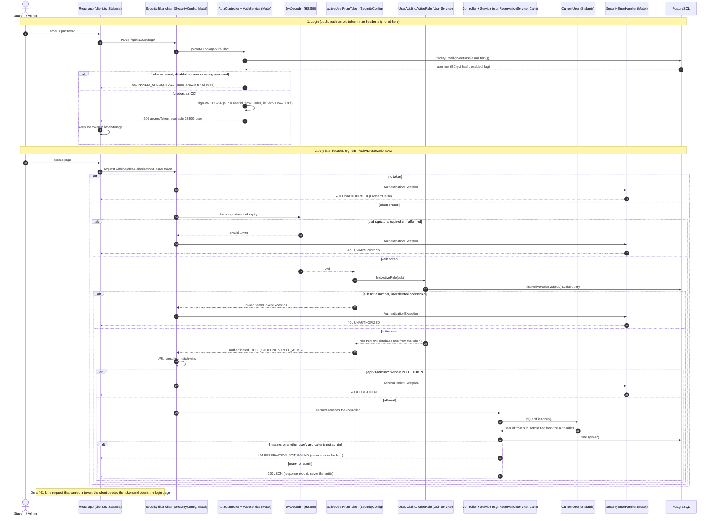

# Security (Matei Necula)

**Author:** Matei Necula (Member 1: cloud, security, auth) · **State of the code:** `main` at `545e334` (28 Nov 2026)  
**Scope:** login, tokens, pickup pass codes, who may call what, security errors, secrets, and the deployed AWS setup (paused between demos to save credits). Ownership checks inside other modules (Calin's reservations, Stefania's incidents) are described here only as far as security depends on them. Full AWS IaC & CI/CD details live in [`docs/report/aws-and-cicd.md`](aws-and-cicd.md).

Everything below was checked directly against the code and Terraform on `main` (`545e334`). Known limitations and unmerged follow-ups are listed honestly in section 9.

---

## 1. Goals and threat model

### What we protect

| Asset | Why it matters |
|---|---|
| Accounts and passwords | A stolen account can book, cancel, transfer and report in someone else's name |
| Other students' reservations | A student must not see, cancel, extend or transfer another student's booking |
| Incident reports and photos | The reporter comes from the login, so a report can't be filed in someone else's name; photos (`POST`/`GET /api/v1/incidents/{id}/photo`, `#210`) are validated by `StorageValidation` (type, size, magic bytes, key pattern), readable only by reporter or admin, and cleaned up on orphan failures |
| Pickup pass codes | Short-lived 6-digit / QR desk codes (`PickupCodes`, `#283`, `#318`) must not allow guessing or account enumeration |
| Calendar feed links | Secret-URL `.ics` subscriptions (`GET /api/v1/calendar/{token}.ics`, `#295`, `#299`, `#300`) rely on 256-bit random tokens so calendar apps work without exposing JWTs |
| Live notification streams | SSE streams (`GET /api/v1/live/stream`, `#317`, `#340`, `#344`) carry per-user events and must disconnect immediately if an account is disabled |
| Admin functions | Catalog CRUD/retire, incident triage & equipment reliability, reservation desk/lifecycle jobs, reassignment log & maintenance simulator, admin user management (`#206`/`#302`), audit logs (`#217`), and pickup pass verification (`#283`): all under `/api/v1/admin/**` |
| Secrets | `JWT_SECRET`, `DB_PASSWORD`, `ADMIN_PASSWORD`, and AWS deployment access |

### Who attacks

| Attacker | What they can do |
|---|---|
| Curious student | Has a normal account, uses the UI and Swagger, changes ids in URLs |
| Malicious student | Crafts requests by hand, edits the token, sends extra JSON fields, tries admin paths, uploads non-images, opens many SSE tabs |
| Outsider | No account; scans URLs, sends odd paths, probes CloudFront/EC2 directly, guesses passwords |
| Ourselves | A teammate adds an endpoint and forgets a rule, or a secret is committed by mistake |

### Threats (STRIDE)

| STRIDE | Threat | Example in our app | Mitigation | Where (code / test) |
|---|---|---|---|---|
| Spoofing | Forge a token | Write a JWT by hand with `sub: 3` (the admin) | HS256 signature with a secret only the backend knows | `SecurityConfig.jwtDecoder` · `SecurityConfigTest.invalidTokenIsRejected` |
| Spoofing | Guess or steal a password | Try passwords on `/auth/login` | BCrypt hashes only; the same `401 INVALID_CREDENTIALS` for unknown email, wrong password, disabled account and > 72-byte password (`#271`) | `AuthService.login` · `AuthServiceTest.loginRejects*` |
| Spoofing | Keep using an old token or race a disable | An admin disables a student who holds an 8 h token, or who is mid-booking / mid-SSE-open | Scalar JPQL `findActiveRoleById` checked on every JWT request (`#117`) and re-checked fresh after locks bypassing Hibernate's L1 cache (`#312`); `UserDisabledEvent` cancels future `CONFIRMED` bookings (`#302`/`#330`) and drops open SSE tabs (`#340`/`#344`) | `SecurityConfig.activeUserFromToken`, `UserRepository.findActiveRoleById` · `SecurityConfigTest.disabledUser*`, `FindActiveRoleFreshReadIT`, `LiveStreamIT` |
| Spoofing | Forge or enumerate a pickup pass | Try random 6-digit codes or probe user IDs at the desk | 30-second HMAC-SHA256 rotating code (`"pickup-v1\|userId\|step"` domain separation), constant-time `MessageDigest.isEqual`, single `409 PICKUP_CODE_INVALID` for wrong/expired/disabled/unknown user (`#283`, `#318`) | `PickupCodes`, `PickupPassService` · `PickupCodesTest`, `PickupPassServiceTest` |
| Tampering | Edit the role in the token | Change `roles: ["STUDENT"]` to `["ADMIN"]` | Signature breaks; even a validly signed token can't raise the role because authorities come from the database | `SecurityConfigTest.roleComesFromTheDatabaseNotFromTheToken` |
| Tampering | Mass assignment | Send `"userId": <other>` when booking or `"reportedById": <other>` when reporting; send `"role": "ADMIN"` to register | Owner always comes from `CurrentUser` (the verified token); `RegisterRequest` has no role field | `SecurityPassIT.userIdInTheBodyIsIgnored` · `AuthFlowIT.registeredStudentCanLogInAndUseTheToken` |
| Tampering | Path tricks | `/api/v1/..;/admin/x`, `;` in a URL | Spring Security's firewall rejects them before any rule runs, returning ProblemDetail JSON (`#118`) | `SecurityConfigTest.firewallRejectionIsProblemJson` |
| Tampering | Malicious upload | HTML renamed to `.jpg`; a key like `../../etc/passwd` | Liviu's `StorageValidation`: allowed types (JPEG/PNG/WebP), 5 MB limit, magic bytes, random UUID keys, strict key pattern (`#90`, `#210`) | `LocalStorageServiceTest`, `S3StorageServiceTest` |
| Repudiation | "I didn't change that" | An admin edits an asset, disables a user, or verifies a pickup pass | Liviu's `AuditService` writes `audit_logs` in the caller's transaction with actor id from `CurrentUser` | `DatabaseAuditServiceTest`, `PickupPassServiceTest` |
| Information disclosure | IDOR | Student B opens `/api/v1/reservations/{A's id}` or `/api/v1/incidents/{A's id}` | `404`, identical to a missing id | `ReservationService.loadOwnedOrAdmin`, `IncidentService` · `SecurityPassIT.otherStudentCannotReadMyReservation` |
| Information disclosure | Error bodies leak internals | A database error shows SQL or a stack trace | Every error is RFC 9457 `ProblemDetail` with a fixed message; unexpected errors are logged only | `SecurityPassIT.errorBodiesAreCleanProblemDetails`, `unexpectedErrorHidesTheDatabaseMessage` |
| Information disclosure | Password hash in a response | `GET /users/me` or admin user listing returns the entity | Response records (`UserResponse`, `UserSummary`, `AdminUserResponse`) have no hash field; ArchUnit forbids `@Entity` in controllers | `AuthRequestsTest.userResponseNeverContainsThePasswordHash`, `AuthFlowIT.meReturnsTheAccountOfTheToken` |
| Denial of service | Huge uploads, hanging AWS calls, SSE tab floods, pool starvation | A 1 GB "photo"; slow SES blocking reassignments; sweeps starving 20 s SSE heartbeats; 100 open SSE tabs | Multipart limit 5 MB / 6 MB; AWS SDK timeouts 10 s / 20 s; isolated `campus-ses-` 8-thread pool (`#366`), 4-thread `campus-async-` pool (`#366`), and 3-thread `campus-sched-` pool (`#347`); max 5 SSE streams/user (`LiveStreams`, `#317`) | `application.yml`, `AsyncConfig`, `AwsConfig`, `LiveStreams` · `ProdProfileStartupTest`, `LiveStreamIT` |
| Elevation of privilege | Student calls an admin endpoint | `POST /api/v1/admin/assets` or `POST /api/v1/admin/pickup-pass/verify` with a student token | `/api/v1/admin/**` requires `ROLE_ADMIN` | `SecurityPassIT.everyAdminEndpointIsClosedToStudentsAndAnonymousCallers` |
| Elevation of privilege | A forgotten rule | A new path outside `/api/v1` | `denyAll()` for every path not explicitly listed | `SecurityConfigTest.otherApiPathsAreDeniedEvenWithAToken`, `writesOutsideTheApiAreDeniedEvenWithAToken` |

Rate limiting, change-password, and the other known gaps are listed honestly in section 9.

---

## 2. Authentication

### Register and login

| Step | What happens | Code |
|---|---|---|
| Register | `POST /api/v1/auth/register` with `email`, `password`, `fullName`. Always creates a **STUDENT**: the request has no role field, so nobody can make themselves admin | `AuthController`, `AuthService.register`, `RegisterRequest` |
| Email | Trimmed before validation (`#165`), stored in lower case, `UNIQUE` column. A taken email is `409 EMAIL_TAKEN`, also when two registrations race (unique constraint catches the second one) | `RegisterRequest`, `User` constructor, `AuthService.register` |
| Password storage | `PasswordEncoderFactories.createDelegatingPasswordEncoder()`: BCrypt, hash stored with a `{bcrypt}` prefix so the algorithm can be upgraded later without breaking old hashes | `SecurityConfig.passwordEncoder` |
| Login | `POST /api/v1/auth/login`. Unknown email, disabled account, wrong password, and passwords over 72 UTF-8 bytes (`#271`) all return the same `401 INVALID_CREDENTIALS`; BCrypt runs outside a DB transaction so slow hashing never holds a DB connection (`#271`) | `AuthService.login` |
| First admin on AWS | Register never creates admins, so in `prod` the first admin is bootstrapped from `ADMIN_EMAIL` / `ADMIN_PASSWORD` at startup only if that email does not exist yet. The password is never logged | `AdminBootstrap` (`@Profile("prod")`, `#88`) |
| Dev accounts | `student1`, `student2`, `admin@campus.test` with password `password`, **dev profile only** | `UserSeeder` (`@Profile("dev")`, `#55`) |

### Password rules

| Rule | Why |
|---|---|
| 8 to 72 characters (`@Size`) | Minimum length; 72 is BCrypt's input limit |
| At most **72 UTF-8 bytes** (`isPasswordWithinBcryptLimit`, `@AssertTrue`) | Bug fixed in `#54` (and login guard in `#271`): `@Size` counts characters, BCrypt counts bytes. 40 × "ș" (80 bytes) passed `@Size` and caused `encode()` to fail or truncate silently. Now rejected cleanly (`400 VALIDATION_FAILED` on register, `401 INVALID_CREDENTIALS` on login) |
| Password not trimmed | Spaces can be part of a password |
| `AdminBootstrap` checks the same limits | A bad `ADMIN_PASSWORD` stops startup instead of creating an un-loggable admin |

### The token (JWT)

| Property | Value | Where |
|---|---|---|
| Algorithm | HS256 (HMAC-SHA256, one shared secret signs and verifies) | `SecurityConfig.jwtEncoder` / `jwtDecoder`, `AuthService.createToken` |
| Claims | `sub` = user id, `email`, `roles`, `iat`, `exp` | `AuthService.createToken`, `docs/api-contract.md` §3 |
| Lifetime | 8 h (`app.jwt.expiration`), returned as `expiresIn: 28800` | `application.yml`, `LoginResponse` |
| Secret | `app.jwt.secret`: fake committed value in dev/test, `JWT_SECRET` (64 random chars from SSM `SecureString`) in prod. HS256 requires ≥ 32 bytes (shorter fails at startup with `KeyLengthException`). Also keys `PickupCodes` with `"pickup-v1"` domain separation (`#283`) so a pickup code and a JWT can never be swapped | `application-dev.yml`, `application-prod.yml`, `PickupCodes` |
| Sessions | None: `SessionCreationPolicy.STATELESS`, no cookies; every request sends `Authorization: Bearer <token>` (including SSE via `fetch`, never in query strings) | `SecurityConfig.apiChain`, `frontend/src/api/live.ts` |
| CSRF | Off. CSRF abuses cookies sent automatically by browsers; we use no cookies | `SecurityConfig.apiChain` |
| CORS | None configured: frontend and API share one origin (Vite proxy in dev, CloudFront → single Spring Boot container in prod, ADR-002) | `SpaConfig`, `infra/cdn.tf` |

### Why Spring's OAuth2 resource server and not `jjwt`

| Reason | Detail |
|---|---|
| Less custom security code | The resource server already reads `Authorization: Bearer`, verifies signature and `exp`, and turns failures into 401. |
| Single library signs and verifies | `NimbusJwtEncoder` and `NimbusJwtDecoder` share one `secretKey()` and `MacAlgorithm.HS256` (`AuthFlowIT`). |
| Spring Boot 4 idiom | `jjwt` (`Jwts.parser().setSigningKey`) is a Boot 2/3 pattern disallowed by `AGENTS.md` §3. |
| Swagger integration | `OpenApiConfig` declares `bearerAuth` and strips the lock icon only on `/api/v1/auth/**` and `GET /api/v1/calendar/*` (`#184`, `#366`). |

### Why the account is checked fresh against PostgreSQL on every request (`#117`, `#312`)

Before `#117`, authorities came from the JWT's `roles` claim, so a disabled, deleted, or demoted user kept old access for up to 8 hours. `activeUserFromToken` now calls `UserApi.findActiveRole(sub)` after signature/expiry verification:

| Database says | Result |
|---|---|
| User exists and `enabled = true` | Authorities = `ROLE_` + role **from PostgreSQL** |
| User deleted or `enabled = false` | `InvalidBearerTokenException` → `401 UNAUTHORIZED` |
| `sub` missing or non-numeric | Same `401 UNAUTHORIZED` (`#158`, instead of 500 `NumberFormatException`) |

**Why a scalar JPQL query (`#312`):** Inside a running transaction (such as Calin's booking/hold/transfer flows re-checking `findActiveRole` after acquiring `lockUserQuota`, `#310`), `UserRepository.findById(id)` returned Hibernate's L1-cached `User(enabled = true)` even after an admin had disabled the user in a concurrent committed transaction. `UserRepository.findActiveRoleById` (`select u.role from User u where u.id = :id and u.enabled = true`) queries the database directly, bypassing the L1 entity cache (`FindActiveRoleFreshReadIT`, `#312`).

**Instant fan-out on disable (`#302`, `#330`, `#340`, `#344`):** When an admin calls `POST /api/v1/admin/users/{id}/disable`, `AdminUserService` publishes `UserDisabledEvent` (`AFTER_COMMIT`, synchronous `REQUIRES_NEW` listeners): `UserDisabledReservationListener` cancels upcoming `CONFIRMED` bookings, `UserDisabledLiveStreamListener` immediately closes open SSE tabs, and `LiveStreamController` re-checks `findActiveRole` right after registering an emitter to close the open-vs-disable race.

### Secondary authentication mechanisms on `main`

| Mechanism | Purpose | Security Properties |
|---|---|---|
| **Pickup pass (`#283`, `#318`)** | Student proves physical presence at the lab desk via 6-digit code or QR (`campus-pickup:1:<userId>:<code>`) | Stateless HMAC-SHA256 over `"pickup-v1\|userId\|step"` (30 s windows, current + previous step accepted), constant-time `MessageDigest.isEqual`, audited (`PICKUP_PASS_VERIFIED`), uniform `409 PICKUP_CODE_INVALID` |
| **Calendar feed token (`#295`, `#299`, `#300`)** | Calendar apps (Google/Apple/Outlook) subscribe to `GET /api/v1/calendar/{token}.ics` without JWT headers | 32 random bytes (`SecureRandom`) Base64URL-encoded (43 chars, 256-bit entropy), rotatable by the student at `/api/v1/reservations/me/calendar-feed`; `SecurityConfig` permits only `GET` and ignores stale `Authorization` headers on `/api/v1/calendar/**` |

### Fixes to the token & filter flow

| Issue / PR | Problem | Fix |
|---|---|---|
| `#116` / `#126` | Login returned 401 when the browser sent an expired token | `ignoreTokenOnAuthPaths()` ignores the Bearer header on `/api/v1/auth/**` |
| `#117` / `#128` | Disabled or demoted users kept access until JWT expiry | Live DB check via `UserApi.findActiveRole` on every request |
| `#158` / `#176` | Signed token with missing or non-numeric `sub` caused 500 | `userId(jwt)` converts `NumberFormatException` into `401 UNAUTHORIZED` |
| `#271` | Login passed > 72-byte passwords to BCrypt and held a DB tx during hashing | Early UTF-8 byte-length rejection (`401`) and non-transactional password verification |
| `#295` | Public `.ics` calendar feed needed GET access without being broken by stale browser JWTs | Added `GET /api/v1/calendar/*` `permitAll()` and skipped Bearer resolution on `/api/v1/calendar/**` |
| `#308` | Behind CloudFront, Swagger called EC2 HTTP and `HEAD /` returned 401 | `@Server(url = "/")` in `OpenApiConfig` and `HEAD /**` `permitAll()` in `SecurityConfig` |
| `#312` | `findActiveRole` read stale Hibernate L1 cache inside transactions | Replaced `findById` with scalar JPQL `findActiveRoleById` (`FindActiveRoleFreshReadIT`) |

---

## 3. JWT sequence diagram

Source: [`docs/diagrams/jwt-auth-sequence.mmd`](../diagrams/jwt-auth-sequence.mmd) (GitHub renders the copy below).

---

## 4. Authorization (RBAC)

### The rules in `SecurityConfig`

Spring evaluates them top to bottom and the **first match wins** (`backend/src/main/java/com/campus/config/SecurityConfig.java`):

| # | Path & Method | Rule |
|---|---|---|
| 1 | `/api/v1/auth/**` | `permitAll` (and Bearer header is ignored, `#116`) |
| 2 | `/actuator/health/**`, `/v3/api-docs/**`, `/swagger-ui/**`, `/swagger-ui.html` | `permitAll` |
| 3 | `/error` | `permitAll` (Spring forwards failures here; protecting it would turn a 404 into a 401) |
| 4 | `/api/v1/admin/**` | `hasRole("ADMIN")`. Must stay above rule 6, or rule 6 would let students in |
| 5 | `GET /api/v1/calendar/*` | `permitAll` (`#295`; 256-bit secret token in path; Bearer header ignored on `/api/v1/calendar/**`; non-GET falls through to rule 6) |
| 6 | `/api/v1/**` | `authenticated()` (any active user) |
| 7 | `/api/**`, `/actuator/**` | `denyAll()` (other API versions, every actuator endpoint except health) |
| 8 | `GET /**` | `permitAll`: React SPA (`index.html`, static JS/CSS, client routes) served by `SpaConfig` |
| 9 | `HEAD /**` | `permitAll` (`#308`: uptime/CDN probes; API paths stay closed by rules 4–7) |
| 10 | `anyRequest()` | `denyAll()`: any unlisted path/method fails closed |

**The admin prefix rule.** Admin-only endpoints must live under `/api/v1/admin/**`. Teammates never edit `SecurityConfig`; putting the controller under `/api/v1/admin/**` is enough. `SecurityPassIT` reflects `RequestMappingHandlerMapping` at runtime so every new admin route is tested automatically (**29 `/api/v1/admin/**` route mappings across 11 controllers on `main`**, including the `/audit-log` alias alongside `/audit-logs`).

### Roles × endpoint groups

"401" = no token or rejected token; "403" = valid token, insufficient role.

| Endpoint group | No token | STUDENT | ADMIN | Test |
|---|---|---|---|---|
| `/api/v1/auth/**` (ping, register, login) | ✅ | ✅ | ✅ | `AuthControllerTest`, `SecurityConfigTest.authEndpointsIgnoreAnInvalidToken` |
| `GET /api/v1/calendar/{token}.ics` (`#295`, `#300`) | ✅ (token in URL) | ✅ | ✅ (non-GET → 401/auth) | `SecurityConfigTest.calendarFeedIsPublic`, `calendarFeedIgnoresStaleToken`, `postOnCalendarPathStillNeedsLogin` |
| `GET /api/v1/users/me` & `GET /api/v1/users/me/pickup-pass` (`#82`, `#283`) | 401 | ✅ own account/pass only | ✅ own account/pass only | `AuthFlowIT.meReturnsTheAccountOfTheToken`, `PickupPassControllerTest` |
| Catalog reads (`GET /assets`, `/assets/{id}`, `/categories`, `/lab-rooms`) | 401 | ✅ (`RETIRED` assets hidden, `#278`) | ✅ (all assets) | `SecurityPassIT.errorBodiesAreCleanProblemDetails`, `AssetControllerTest` |
| Reservations (`/api/v1/reservations/**`: book, bundle, holds, transfers, extend, availability, next-free-slots, calendar-feed settings, `/me`, `/{id}`, `/{id}/cancel`) | 401 | ✅ own only; another student's id → **404** | ✅ any reservation | `SecurityPassIT` IDOR tests, `ReservationControllerTest` |
| Projects (`/api/v1/projects/**`: search, details, `POST /{slug}/reserve`, `#236`, `#243`) | 401 | ✅ (books under `CurrentUser`) | ✅ | `ProjectControllerTest`, `ProjectReservationServiceTest` |
| Incidents (`POST /incidents`, `GET /incidents/me`, `GET /incidents/{id}`, `POST`/`GET /incidents/{id}/photo`, `#108`, `#210`) | 401 | ✅ own reports & photos only (others → **404**) | ✅ any report/photo | `SecurityPassIT.userIdInTheBodyIsIgnored`, `IncidentControllerTest` |
| Live notifications (`GET /api/v1/live/stream`, `#317`, `#344`) | 401 | ✅ own stream (max 5 tabs; instant drop on disable) | ✅ own stream | `LiveStreamIT` |
| `/api/v1/admin/**` (catalog CRUD/retire, incident triage & reliability `#291`, reservation desk/cancel-upcoming/lifecycle jobs, reassignment log & maintenance simulator `#351`, user admin `#206`/`#302`, audit logs `#217`, `POST /admin/pickup-pass/verify` `#283`) | 401 | **403** | ✅ | `SecurityPassIT.everyAdminEndpointIsClosedToStudentsAndAnonymousCallers`, `AdminPickupPassControllerTest`, `AdminUserControllerTest` |
| Swagger UI + `/v3/api-docs` | ✅ | ✅ | ✅ | `SecurityConfigTest.swaggerIsPublic`, `OpenApiDocsIT` |
| `/actuator/health` | ✅ | ✅ | ✅ | `SecurityConfigTest.healthCheckIsPublic` |
| Other `/actuator/**` and `/api/**` outside `/api/v1` | 401 | 403 | 403 | `SecurityConfigTest.otherApiPathsAreDeniedEvenWithAToken` |
| SPA routes (`GET /**`, `HEAD /**`, `#114`, `#308`) | ✅ | ✅ | ✅ | `SpaFrontendTest` |
| Non-GET/HEAD outside `/api` (e.g. `POST /something-else`) | 401 | 403 | 403 | `SecurityConfigTest.writesOutsideTheApiAreDeniedEvenWithAToken` |

SPA routes being public is not a security hole: `/admin/users` in the browser only returns the React shell; all data comes from `/api/v1/admin/**`, which still enforces `ROLE_ADMIN`.

### Ownership: other students' resources return 404, not 403

URL rules only know the role, not who owns reservation 42 or incident 7. Ownership is enforced in each module's **service** using the user id from the verified JWT:

- `CurrentUser.id()` (Stefania) reads `sub` from the verified token. Request bodies cannot spoof an owner (`SecurityPassIT.userIdInTheBodyIsIgnored`).
- `ReservationService.loadOwnedOrAdmin` (Calin) throws the same `404 RESERVATION_NOT_FOUND` for both missing and non-owned bookings, preventing IDOR enumeration.
- `/me` endpoints filter strictly by `currentUser.id()` (`SecurityPassIT.myListsOnlyShowMyOwnReservations`).
- Incidents (`#108`, `#210`): students can create reports (`POST /api/v1/incidents`), inspect their own (`GET /incidents/me`, `GET /incidents/{id}`), and upload/view photos on their own incidents (`POST`/`GET /incidents/{id}/photo`); accessing another student's incident or photo returns `404`, while triage actions live under `/api/v1/admin/incidents/**`.

---

## 5. Error handling for security

All errors follow RFC 9457 `ProblemDetail` with a machine-readable `code`, so the frontend reacts to codes instead of parsing prose.

| Case | Who answers | Status + `code` |
|---|---|---|
| No token, invalid, expired, disabled/deleted account, bad `sub` | `SecurityErrorHandler.commence` (Matei) | `401 UNAUTHORIZED` |
| Valid token, role not enough | `SecurityErrorHandler.handle(AccessDeniedException)` | `403 FORBIDDEN` |
| URL blocked by firewall (`;`, encoded `/`, `..`) | `SecurityErrorHandler.handle(RequestRejectedException)` bean (`#118`) | `400 REQUEST_REJECTED` |
| Wrong login / disabled user / > 72-byte password | `AuthService` → Liviu's `GlobalExceptionHandler` | `401 INVALID_CREDENTIALS` |
| Wrong/expired pickup pass or disabled/missing student | `PickupPassService` → `GlobalExceptionHandler` | `409 PICKUP_CODE_INVALID` |
| Someone else's reservation or incident | Service → `GlobalExceptionHandler` | `404 RESERVATION_NOT_FOUND` / `INCIDENT_NOT_FOUND` |
| Any unexpected exception (e.g. SQL error) | `GlobalExceptionHandler.handleUnexpected`: logs stack trace, answers generic text | `500 INTERNAL_ERROR` |

`SecurityErrorHandler` is required because filter-chain 401/403/400 errors occur before Spring MVC controllers run, so Liviu's `@RestControllerAdvice` never sees them (`#44`, `#127`). `SecurityPassIT.errorBodiesAreCleanProblemDetails` checks nine distinct error responses plus an injected `DataIntegrityViolationException` for leak markers (`exception`, `com.campus`, `org.springframework`, `hibernate`, `jdbc`, `sql`, `insert into`, `constraint`, …).

---

## 6. Secrets and configuration

| Setting | dev (`application-dev.yml`) | test (`application-test.yml`) | prod (`application-prod.yml`) |
|---|---|---|---|
| Database | `DB_URL` / `DB_USERNAME` / `DB_PASSWORD`, defaults `localhost:5432/campus`, `campus` / `campus` | `campus_test`, `campus` / `campus` (CI overrides via `SPRING_DATASOURCE_*`) | `DB_URL` (`sslmode=require`), `DB_USERNAME`, `DB_PASSWORD`, no defaults |
| JWT secret | fake committed value (≥ 32 bytes) | different fake value | `JWT_SECRET` (64-char SSM `SecureString`), no default |
| AWS | not used (`LocalStorageService`, `LoggingNotificationService`) | not used | `AWS_REGION`, `PHOTO_BUCKET`, `MAIL_FROM`; **no AWS keys**, SDK uses EC2 instance role |
| First admin | seeded dev accounts (`UserSeeder`) | none | `ADMIN_EMAIL`, `ADMIN_PASSWORD` (optional, default empty; SSM `SecureString`) |

In `prod`, required secrets have no defaults, so a missing variable halts startup rather than falling back to a dev value.

### What is never committed

| Protection | Where |
|---|---|
| `.gitignore`: `.env`, `*.env.local`, `*.tfstate`, `*.tfvars`, `infra/.terraform/`, `backend/uploads/` | repo root |
| `.dockerignore`: `.git`, `**/.env`, `infra`, `docs`, build output | repo root |
| GitHub **secret scanning** and **push protection** enabled on the repository | repository settings |
| Team rule: any leaked secret is reported to Matei at once and rotated (`docs/runbook.md` §6) | `AGENTS.md` §3 |

### Live AWS secrets & deploy credentials (`infra/`, applied 17 Nov & 22 Nov)

| Item | Live Implementation | Source |
|---|---|---|
| Prod secrets | Terraform (`infra/ssm.tf`, `#250`, `#304`) generates random `DB_PASSWORD` (32 chars), `JWT_SECRET` (64 chars), and `ADMIN_PASSWORD` (24 chars) as KMS-encrypted SSM `SecureString` parameters under `/campus/`. `/usr/local/bin/campus-deploy` materializes them under `umask 077` into root-only `/etc/campus.env` (mode `0600`) for `docker run --env-file`. | ADR-003, `infra/ssm.tf`, `infra/user-data.sh.tftpl` |
| Deploy credentials | GitHub Actions (`deploy.yml`, `#320`) assumes `campus-hub-github-deploy` via **OIDC** (`id-token: write`, 1-hour STS token, immutable `main` subject `repo:FundamenteleInginerieiSoftware@338709262/campus-hub@1407699804:ref:refs/heads/main`). Zero static AWS keys exist in GitHub. Applied and proved live 22 Nov 2026. | ADR-002, ADR-005, `infra/github-deploy.tf` |

---

## 7. Cloud security (deployed; paused between demos)

All three Terraform stages (`#249`, `#250`, `#304`), the RDS auto-start SNS alert (`#309`), and the GitHub OIDC deploy role (`#320`) are applied and verified live on CloudFront (17 Nov and 22 Nov 2026; paused between demos via `docs/runbook.md` §2 to conserve AWS credits).

| Area | Live Implementation | Source |
|---|---|---|
| HTTPS & headers | CloudFront `*.cloudfront.net` (`redirect-to-https`, HTTP/2+3) with `Managed-SecurityHeadersPolicy` (HSTS `max-age=31536000`, `nosniff`), `Authorization`-keyed pass-through policy (`max_ttl = 1`), and `Managed-AllViewerExceptHostHeader`. **Known limit:** CloudFront → EC2 is plain HTTP. | `infra/cdn.tf` (`#304`) |
| Server reachability | EC2 SG accepts TCP `8080` **only** from AWS managed prefix list `com.amazonaws.global.cloudfront.origin-facing`. **No SSH port 22**; operator shells use SSM Session Manager. | `infra/security_groups.tf` (`#249`) |
| Metadata & disk | EC2 enforces **IMDSv2** (`http_tokens = "required"`, `http_put_response_hop_limit = 2` for Docker container SDK access) and encrypted 20 GB gp3 root EBS. | `infra/compute.tf` (`#304`) |
| Database | RDS PostgreSQL 18 (`db.t4g.micro`) in 2 private subnets with no internet route, encrypted gp3 storage, `publicly_accessible = false`, TCP `5432` only from EC2 SG, zero egress rules, TLS enforced by `?sslmode=require`. | `infra/network.tf`, `infra/rds.tf`, `infra/ssm.tf` |
| Photos & images | Private S3 bucket (`PublicAccessBlock` all 4 flags + SSE-AES256); immutable commit-SHA ECR repository with `scan_on_push = true` (caught Alpine `zlib` `CVE-2026-4738` on 9 Nov; patched via `apk upgrade --no-cache` in `#252` → 0 findings). | `infra/storage.tf`, `Dockerfile` |
| Least-privilege EC2 role | `s3:Put/Get/DeleteObject` on `bucket/*`, `s3:ListBucket` on bucket (404 vs 403, `#177`), `ses:SendEmail`, `ssm:GetParameter*` on `/campus` + `/campus/*`, ECR pull, CloudWatch `/campus-hub/app` write, SSM core. | `infra/iam.tf` (`#250`) |
| Container & app runtime | Non-root `USER app` on Alpine JRE 25 (`Dockerfile`), `--memory 1536m`, `AwsConfig` 10 s / 20 s SDK timeouts, `SesNotificationService` isolated on `campus-ses-` pool (`#366`) + live push before email (`#332`), `campus-sched-` 3-thread pool (`#347`). | `Dockerfile`, `AwsConfig`, `AsyncConfig`, `SesNotificationService` |
| AWS account hygiene | Root with MFA and no keys; daily Terraform runs via `terraform-admin` on Matei's laptop only; budget alerts at $5/$20/$40; SNS email alert on 7-day RDS auto-start (`#309`). | ADR-005, `infra/alerts.tf` |

---

## 8. Verification

### Security tests on `main`

| Test class | What it proves |
|---|---|
| `SecurityConfigTest` (**21 tests**, real app + DB) | Health and Swagger are public; protected API paths require a valid JWT (`401 UNAUTHORIZED`); `/auth/**` ignores invalid tokens; `GET /api/v1/calendar/*` is public and ignores stale tokens while `POST` returns 401 (`#295`); students get 403 on admin paths, admins pass; other `/api/**` and non-GET/HEAD writes outside `/api` are denied even for admins; firewall rejection is `400 REQUEST_REJECTED` JSON; disabled, deleted, and demoted users; missing/non-numeric `sub` → 401; BCrypt hashes |
| `SecurityPassIT` (**7 tests**, real logins) | IDOR read and cancel → 404; `/me` lists only own data; `userId` / `reportedById` in body ignored; runtime reflection sweep over **every** `/api/v1/admin/**` route mapping (`403` student, `401` anonymous); nine error bodies + injected SQL error contain zero leak markers |
| `AuthFlowIT` (**6 tests**) | Real login JWT accepted by filter; self-registered users are students (`403` on admin); `/users/me` returns profile without hash; login works while an old token is sent (`#116`); email trimmed (`#165`); duplicate email → `409` |
| `FindActiveRoleFreshReadIT` (**1 test**, PostgreSQL) | Disabling a user in a concurrent `REQUIRES_NEW` transaction is seen immediately inside an already-open transaction via scalar `findActiveRoleById` (`#312`) |
| `PickupCodesTest`, `PickupPassServiceTest`, `PickupPassControllerTest`, `AdminPickupPassControllerTest` | 6-digit stability, current/previous 30 s window, expired/wrong/disabled → `409 PICKUP_CODE_INVALID`, audit log entry, students get `403` on verify (`#283`) |
| `AuthServiceTest`, `AuthRequestsTest`, `AuthControllerTest`, `UserServiceTest`, `UserControllerTest`, `AdminBootstrapTest` | BCrypt hashing, exact claims/`exp`, 72-byte UTF-8 boundary (`#54`, `#271`), no hash in responses, bootstrap password guards |
| `AdminUserConcurrencyIT` (Stefania, `#355`) | Concurrent last-admin lock prevents demoting/disabling the final enabled administrator |
| `LiveStreamIT` (Liviu, `#317`, `#340`, `#344`) | JWT-authenticated SSE stream, 5-stream cap, immediate disconnect on `UserDisabledEvent`, post-open active-role check |
| `OpenApiDocsIT` (`#184`, `#366`) | Every non-public endpoint inherits `bearerAuth` + `401`; every `/api/v1/admin/**` lists `403`; `/api/v1/auth/**` and `GET /api/v1/calendar/*` have `security: []`; all 4xx/5xx reference `ProblemDetail` |
| `ErrorJsonTest`, `SpaFrontendTest`, `SpaConfigTest`, `ProdProfileStartupTest`, `LocalStorageServiceTest`, `S3StorageServiceTest`, `SesNotificationServiceTest` | Uniform ProblemDetail `code`, SPA routing vs API 401, prod profile + isolated `campus-ses-` pool (`#366`), magic-byte/path-traversal upload guards |

### Bugs found and fixed

| Issue / PR | Bug | Fix | Guarded by |
|---|---|---|---|
| `#54`, `#271` | Passwords > 72 UTF-8 bytes (≤ 72 chars) failed BCrypt on register (500) or truncated on login; login held a DB tx during BCrypt | `@AssertTrue isPasswordWithinBcryptLimit` (`400`) + early login byte check (`401`) outside tx | `AuthRequestsTest`, `AuthServiceTest` |
| `#52` | Validation and MVC errors lost `code` (Spring Boot default handler ran first) | Removed `spring.mvc.problemdetails.enabled` | `ErrorJsonTest` |
| `#67` / `#70` | Security probes used real routes, breaking when controllers landed | Dedicated unmapped probe paths (`PROBE`, `ADMIN_PROBE`) | `SecurityConfigTest` |
| `#116` / `#126` | Login refused while an expired token was still sent | Bearer resolver ignores `/api/v1/auth/**` | `SecurityConfigTest`, `AuthFlowIT` |
| `#118` / `#127` | Firewall-rejected URLs answered without ProblemDetail `code` | `RequestRejectedHandler` bean | `SecurityConfigTest.firewallRejectionIsProblemJson` |
| `#117` / `#128` | Disabled, deleted or demoted users kept access for up to 8 h | DB active-role check on every JWT request | `SecurityConfigTest` |
| `#158` / `#176` | Token with missing or non-numeric `sub` → 500 | `InvalidBearerTokenException` → `401 UNAUTHORIZED` | `SecurityConfigTest` |
| `#165` / `#175` | `" ana@campus.test "` rejected by `@Email` before trimming | Trim in record compact constructor | `AuthFlowIT`, `AuthRequestsTest` |
| `#148`, `#171` / `#177` | Missing S3 key showed 403 without hint; slow SES blocked caller | `s3:ListBucket` in IAM + `try`-wrapped lookup + `@Async` | `S3StorageServiceTest`, `SesNotificationServiceTest` |
| `#252` | ECR scan caught critical `zlib` `CVE-2026-4738` in Alpine base image | `apk upgrade --no-cache` in `Dockerfile` Stage 3 | ECR `scan_on_push` (0 findings) |
| `#295` | Calendar apps cannot send JWT headers and stale browser tokens broke `.ics` links | `GET /api/v1/calendar/*` `permitAll()` + Bearer skip | `SecurityConfigTest` (3 calendar tests) |
| `#308` | Behind CloudFront, Swagger called EC2 HTTP and `HEAD /` returned 401 | `@Server(url = "/")` + `HEAD /**` `permitAll()` | `SpaFrontendTest`, live CloudFront check |
| `#312` | `findActiveRole` returned Hibernate L1-cached `User(enabled=true)` after quota lock wait | Scalar JPQL `findActiveRoleById` | `FindActiveRoleFreshReadIT` |
| `#347`, `#366` | Single scheduler thread risked SSE drops under CloudFront 30 s timeout; SES shared 2-thread async pool | 3-thread `campus-sched-` pool + dedicated 8-thread `campus-ses-` pool | `ProdProfileStartupTest`, `SesNotificationServiceTest` |

---

## 9. Known limitations and future work

| Limitation (honest state on `main` `545e334`) | Effect | Planned follow-up / production mitigation |
|---|---|---|
| No rate limiting or account lockout on `/api/v1/auth/login` and `/register` | Passwords can be guessed at BCrypt speed without IP throttling | **In-flight follow-up** (per-IP rate limiting on auth endpoints, not yet merged on `main`); in production, pair with AWS WAF |
| No self-service change-password endpoint on `main` yet | Users cannot rotate their own password through the UI/API yet | **In-flight follow-up** (`POST /api/v1/users/me/change-password`, not yet merged on `main`) |
| No end-to-end test sending an expired-but-validly-signed JWT on `main` yet | Expiry is enforced by Spring's default `JwtTimestampValidator` and verified on claim generation in `AuthServiceTest`, but not yet via MockMvc end-to-end | **Planned follow-up** in `SecurityConfigTest` with an `exp` in the past |
| No refresh tokens, 8 h JWT lifetime, no server-side logout list | Logging out deletes the token in the browser; a copied token works until expiry unless the account is disabled (`#117`/`#312`) | Short-lived access token + rotating refresh token (`docs/decisions.md` §5) or token revocation list |
| Token stored in `localStorage` | Any XSS bug in the frontend could read the JWT | `HttpOnly` cookie + CSRF protection, or a strict Content-Security-Policy |
| Basic password policy & no email verification on registration | 8–72 char/byte rule without breached-password check; `409 EMAIL_TAKEN` reveals registered emails | Breached-password check + neutral signup response with confirmation link |
| One shared HS256 secret, no automatic SSM secret rotation | Compromise of `JWT_SECRET` allows signing tokens for any active user; rotation is manual (`docs/runbook.md` §6) | RS256 asymmetric keys + AWS Secrets Manager rotation (ADR-003) |
| Swagger UI public in prod | Anyone can inspect API schemas (all protected data still requires JWT) | Disable springdoc in prod or restrict behind `ROLE_ADMIN` |
| CloudFront → EC2 is plain HTTP; SG allows any CloudFront distribution | Last network hop inside AWS is unencrypted | Custom domain + ACM cert on origin + secret `X-Origin-Verify` header (ADR-002) |
| Single EC2 / single-AZ RDS / long-lived `terraform-admin` key | No HA; leaked laptop key has admin scope | ECS + ALB, Multi-AZ RDS, IAM Identity Center (ADR-002, ADR-005) |

**Future work (post-defense template extraction):** After the `v1.0.0` defense, the domain-agnostic security stack (`SecurityConfig`, scalar active-role verification, `PickupCodes`, `StorageValidation`, and Terraform/OIDC cloud guardrails) is designed to extract cleanly into a reusable GitHub Template Repository—see [`docs/reusable-template-blueprint.md`](../reusable-template-blueprint.md).
