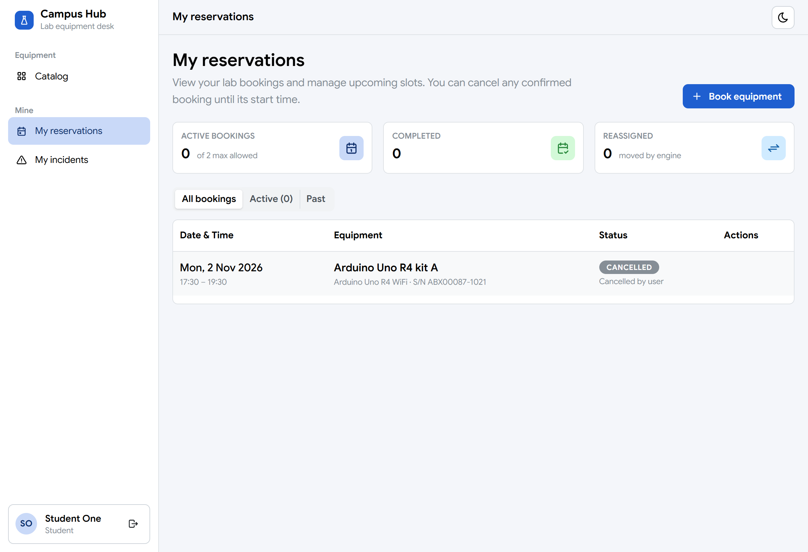
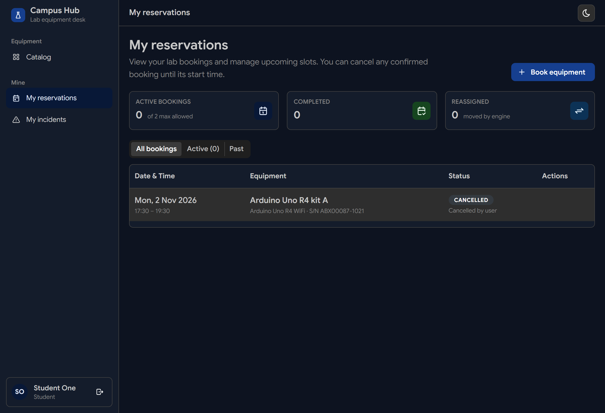
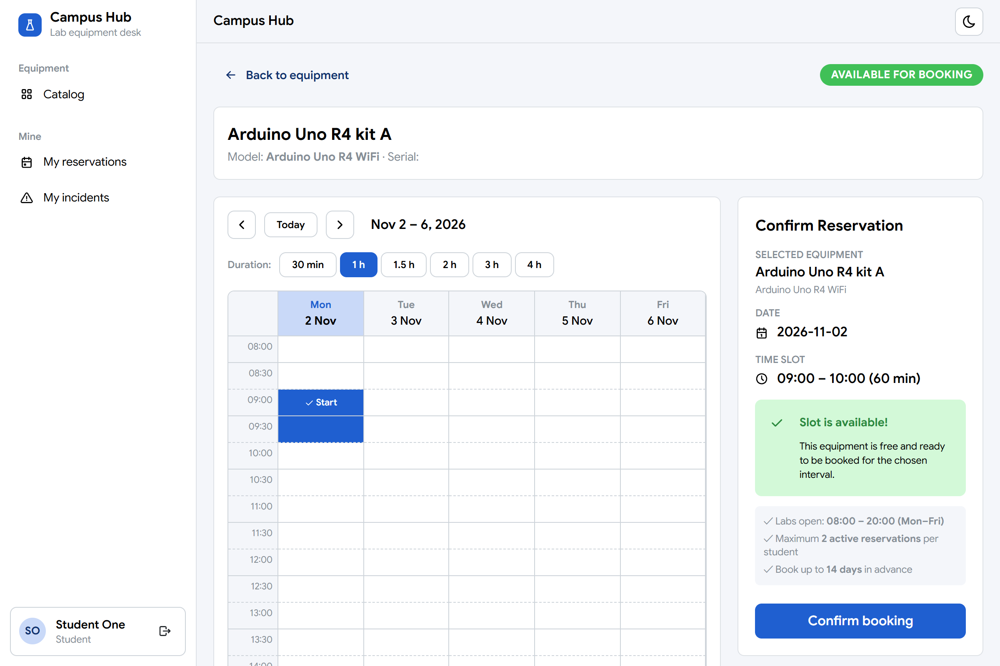
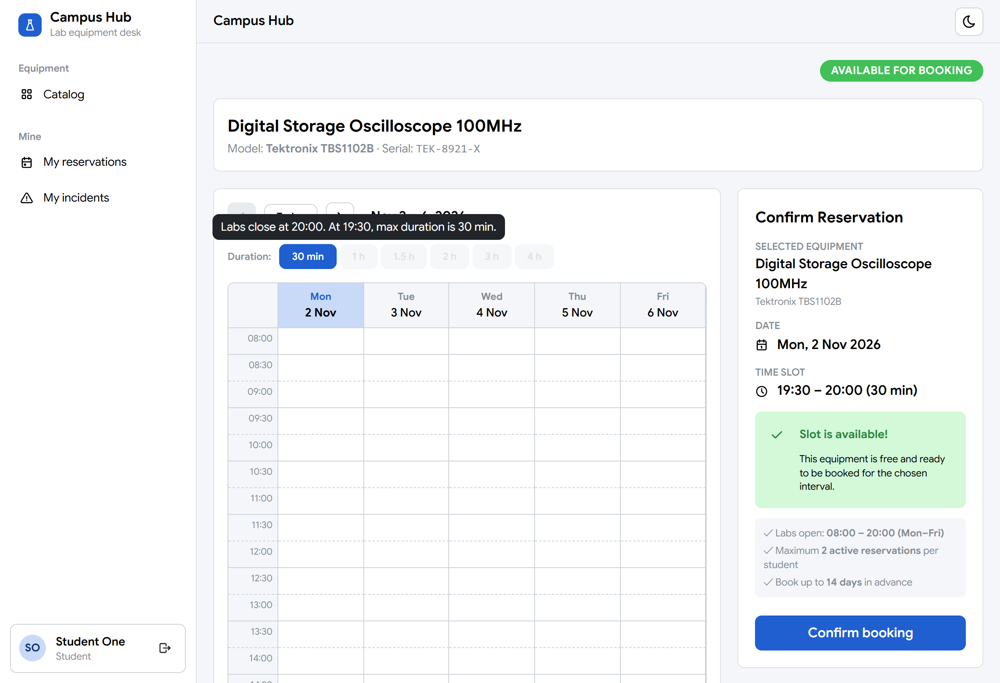
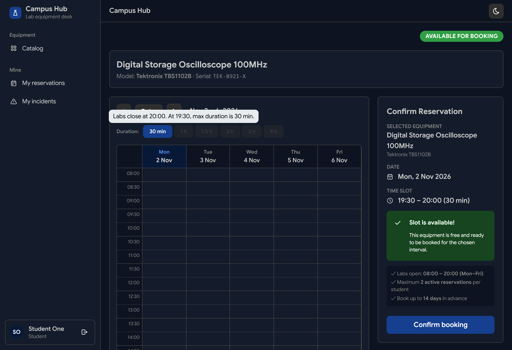
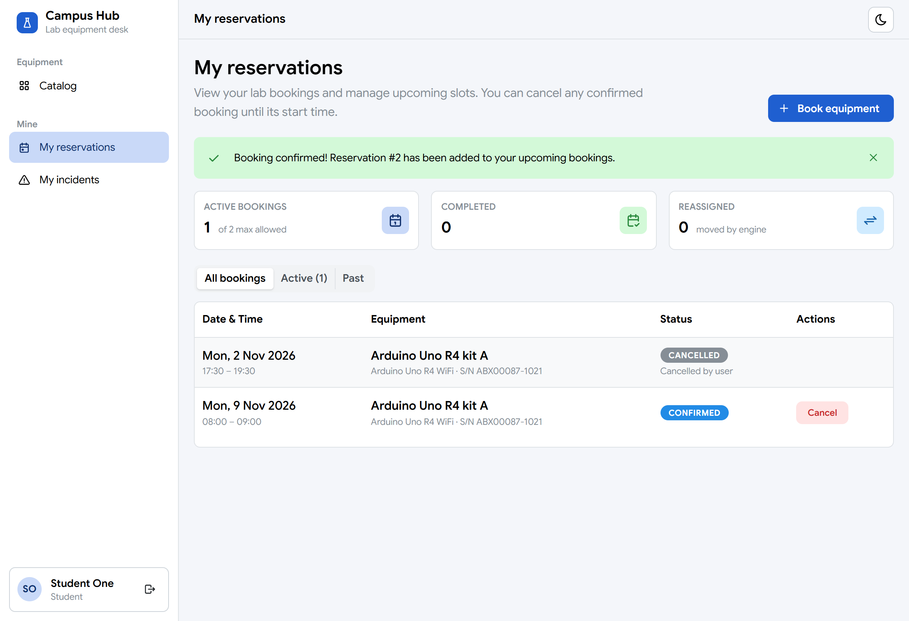

# Frontend Reservations & Interactive Booking Calendar (Murariu Călin)

**Role:** Member 3, Reservations & Auto-Reassignment  
**Date:** 2026-11-01  
**Folder:** `frontend/src/pages/`, `frontend/src/components/`, `frontend/src/api/`  
**Branch / PR:** `feat/reservation-frontend-pages`  
**See also:** `AGENTS.md` §1 (Calin owns reservation frontend & booking flow), `docs/modules/frontend.md`

---

## Part 1: In simple terms

A key objective of Campus Hub is providing students with a seamless, intuitive experience when borrowing laboratory hardware (such as Arduino kits, oscilloscopes, and robotic arms) and managing their active bookings.

### 1. "My Reservations" Dashboard (`/reservations`)
When students log into Campus Hub and navigate to "My reservations", they are greeted by an organized overview of all their past and upcoming bookings:
- **Statistics Overview:** Three key metric cards at the top highlight their active bookings count (max 2 allowed per student), total completed returns, and bookings rescued automatically by the reassignment engine.
- **Tab Filtering:** Students can switch between "Active" (confirmed, checked out, overdue) and "Past" (returned, cancelled, expired) bookings.
- **Visual Status Badges:** Color-coded badges instantly convey equipment status (`CONFIRMED` in blue, `CHECKED_OUT` in teal, `OVERDUE` in red, `RETURNED` in green, `CANCELLED` in grey).
- **Auto-Reassignment Indicator:** If equipment was damaged and the engine substituted the asset, a badge clearly displays `"Reassigned by engine (originally: Asset #X)"`.
- **Cancellation Flow:** For upcoming confirmed reservations, students can cancel with a single click after confirming in a safe modal dialog.

#### Screenshots — My Reservations Dashboard & Cancellation Modal:
| Light Mode | Dark Mode |
|---|---|
|  |  |

| Safe Cancellation Confirmation Modal |
|---|
|  |

### 2. Google Calendar-Style Week Booking View (`CalendarBookingView`)
Instead of typing abstract date-time strings into text inputs, students interact with a visual timetable modeled after Google Calendar:
- **Time Window:** Displays Monday through Friday, 08:00 to 20:00 in 30-minute intervals matching laboratory opening hours.
- **Visual State & Real-Time Conflict Detection:** Students pick any 30-minute interval on the timetable; the component automatically validates opening hours and past time slots, and checks real-time slot availability via the backend availability endpoint (`/api/v1/reservations/availability`), reporting whether the slot is free or conflicted along with the exact RFC 9457 error code.
- **Smart Duration Constraint at Closing Time (20:00 Rule):**
  - Lab rules state that bookings cannot extend past the 20:00 laboratory closing time.
  - When a student picks a late start time (e.g. 19:30), the selector **automatically greys out / disables** durations longer than 30 minutes (1h, 1.5h, 2h, etc.).
  - The duration is automatically capped to 30 minutes, preventing invalid requests before they reach the server.
- **Instant Booking Confirmation:** Clicking "Confirm booking" calls the backend API and redirects the user directly to their updated "My reservations" view via React Router's `useNavigate` (preserving SPA client state without full page reloads).

#### Screenshots — Interactive Booking Calendar & Confirmation Banner:
| Google Calendar Timetable | 20:00 Closing Rule Restriction (19:30 slot) |
|---|---|
|  |  |

| Calendar in Dark Mode | Instant Booking Confirmation Banner |
|---|---|
|  |  |


---

## Part 2: Technical details

### Files Created & Modified

| File | Change | Description |
|---|---|---|
| `backend/.../ReservationController.java` | Modified | Added `GET /api/v1/reservations/me/summary` aggregate counts and multi-status query support on `/me` |
| `backend/.../ReservationService.java` | Modified | Implemented `getMySummary()` and multi-status `getMyReservations` |
| `backend/.../ReservationRepository.java` | Modified | Added `countByUserIdAndOriginalAssetIdIsNotNull` and `findByUserIdAndStatusInOrderByStartTimeAsc` |
| `backend/.../ReservationSummaryResponse.java` | Created | DTO record for active, completed, and reassigned aggregate counts |
| `docs/api-contract.md` | Modified | Updated contracts with `/me/summary` and `/me` multi-status filter parameters |
| `docs/modules/reservation.md` | Modified | Updated reservation frontend and REST integration documentation |
| `frontend/src/api/reservations.ts` | Created | API client methods (`fetchMyReservations`, `fetchMyReservationSummary`, `fetchReservationById`, `cancelReservation`, `createReservation`, `checkAvailability`, `fetchAssetSummary`) and TypeScript types (`Reservation`, `ReservationStatus`, `ReservationSummary`, `AvailabilityResponse`, `AssetSummary`) |
| `frontend/src/api/errorMessages.ts` | Modified | Added user-friendly descriptions for reservation error codes (`RESERVATION_CONFLICT`, `RESERVATION_LIMIT_REACHED`, `OUTSIDE_OPENING_HOURS`, `BOOKING_IN_PAST`, `INVALID_DURATION`, `ASSET_NOT_BOOKABLE`, `ASSET_NOT_FOUND`, `NO_ASSETS_AVAILABLE`) |
| `frontend/src/pages/MyReservationsPage.tsx` | Created | Full dashboard page for `/reservations` featuring server-backed statistics cards, server-side segmented filter tabs, `PagedTable`, cancellation modal, and instant confirmation alerts |
| `frontend/src/components/CalendarBookingView.tsx` | Created | Interactive Google Calendar timetable with synchronized week navigation, responsive Mantine Grid layout, live availability checks, RFC 9457 error display, and 20:00 closing duration limiter |
| `frontend/src/App.tsx` | Modified | Connected route `/reservations` to `<MyReservationsPage />`; kept `/catalog` as Liviu's `<PlaceholderPage>` |
| `documentation/Murariu_Calin/08-frontend-reservations-and-booking.md` | Created | Personal documentation and teammate integration guide |

---

## Integration Guide for Liviu (@NliviuN)

> [!IMPORTANT]
> **Liviu:** The booking component is already built, fully tested, and waiting for your Catalog page (`CatalogPage.tsx`). You do **not** need to write reservation API calls or time-slot logic.

### How to embed `CalendarBookingView` in `CatalogPage.tsx`

When a student clicks on an equipment card in `/catalog`, you can display the Google Calendar booking view inline replacing the catalog list (with a "Back to equipment" button):

```tsx
import { useState } from 'react'
import { useNavigate } from 'react-router'
import CalendarBookingView from '../components/CalendarBookingView.tsx'
import type { AssetSummary } from '../api/reservations.ts'

export default function CatalogPage() {
  const [selectedAsset, setSelectedAsset] = useState<AssetSummary | null>(null)
  const navigate = useNavigate()

  // If the student clicked "Book" or clicked on an asset card:
  if (selectedAsset) {
    return (
      <CalendarBookingView
        asset={selectedAsset}
        onBack={() => setSelectedAsset(null)}
        onSuccess={(createdReservation) => {
          // Booking confirmed! Redirect student to their reservations page
          navigate('/reservations')
        }}
      />
    )
  }

  // Otherwise, render your catalog grid / table:
  return (
    <div>
      {/* Liviu's category filters, search input, and asset cards */}
      <button
        onClick={() =>
          setSelectedAsset({
            id: asset.id,
            name: asset.name,
            model: asset.model,
            categoryName: asset.categoryName,
            roomName: asset.roomName,
            status: asset.status,
          })
        }
      >
        Book equipment
      </button>
    </div>
  )
}
```

### Component Props Reference

#### `CalendarBookingView` Props:
- `asset: AssetSummary` (required) — Object containing `id`, `name`, `model`, `categoryName`, `roomName`, and `status`.
- `onBack: () => void` (required) — Callback invoked when the user clicks "← Back to catalog".
- `onSuccess?: (reservation: Reservation) => void` (optional) — Callback invoked after successful booking. If omitted, it automatically navigates to `/reservations` using React Router's `useNavigate()`.

---

## 20:00 Closing Time Rule Implementation

In `CalendarBookingView.tsx`, the duration options are dynamically evaluated based on the selected slot start time:

```typescript
// Lab closes strictly at 20:00
const [slotHour, slotMin] = startTime.split(':').map(Number)
const startMinutesFromMidnight = slotHour * 60 + slotMin
const closingMinutesFromMidnight = 20 * 60 // 1200 minutes (20:00)
const remainingMinutesUntilClose = closingMinutesFromMidnight - startMinutesFromMidnight

// Calculate maximum duration allowed: min(240 min, remaining time until 20:00)
const maxAllowedMinutes = Math.min(240, remainingMinutesUntilClose)

// Options exceeding maxAllowedMinutes are greyed out (disabled)
const DURATION_OPTIONS = [
  { value: '30', label: '30 minutes', minutes: 30 },
  { value: '60', label: '1 hour', minutes: 60 },
  { value: '90', label: '1.5 hours', minutes: 90 },
  { value: '120', label: '2 hours', minutes: 120 },
  { value: '180', label: '3 hours', minutes: 180 },
  { value: '240', label: '4 hours', minutes: 240 },
]
```

If the user previously had `60` minutes selected and switches start time to `19:30`, the effective duration is instantly clamped to `30` minutes, preventing any 400/409 bad request to the server.

---

### 3. Engine Indicators: "Moved" and "Force-Cancelled"

In accordance with W8 requirements (`docs/whats-left.md`), student bookings affected by incidents or disaster-recovery actions are explicitly labeled:
- **Moved Bookings:** When `originalAssetId != null`, the equipment cell displays an outlined blue badge (`<IconArrowsExchange size={12} /> Moved from Asset #X`) with a full tooltip explaining the substitute change.
- **Force-Cancelled Bookings:** When an incident cannot find any free substitute, the reservation is force-cancelled. The Status cell displays an orange badge (`Force-cancelled by engine`) with a tooltip providing the incident ID and damage reason from `cancelReason`.

### 4. Edge-Case Hardening (#151)

- **`Today` Button & Week Navigation (`CalendarBookingView.tsx`):** Reused `initialSchedule` in `handleToday()` and local-time date parsing (`parseDateKey`) in `handlePrevWeek()` / `handleNextWeek()` so clicking `Today` on a weekend or after `19:30` jumps to the next valid weekday slot instead of requesting `09:00` on a weekend/past time.
- **Exact 14-Day Slot Horizon (`CalendarBookingView.tsx`):** Evaluated `toSlotDate(d, stepTime) > maxBookingDate` per 30-minute cell and `toSlotDate(d, '08:00') > maxBookingDate` on day headers so time slots on day `+14` later than the current time of day are disabled in the grid rather than failing with `409 BOOKING_TOO_FAR_AHEAD`.
- **Empty Last Page Step-Back (`MyReservationsPage.tsx`):** When cancelling the last reservation on `pageNumber > 0` shrinks `totalPages` below `pageNumber + 1`, the effect automatically steps back to `response.totalPages - 1` so pagination controls remain visible and earlier pages are displayed immediately. The step-back only matters on the Active tab; on the All tab the cancelled row stays in the list, so the page does not shrink.

---

## Verification & Build Status

1. **Linter Check:**
   ```bash
   cd frontend && npm run lint
   # Output: 0 warnings, 0 errors
   ```
2. **TypeScript Compilation & Production Build:**
   ```bash
   cd frontend && npm run build
   # Output: tsc -b && vite build -> BUILD SUCCESSFUL (dist/ generated)
   ```
3. **Backend Spotless & Architecture Rules:**
   ```bash
   cd backend && ./gradlew spotlessCheck
   # Output: BUILD SUCCESSFUL
   ```
