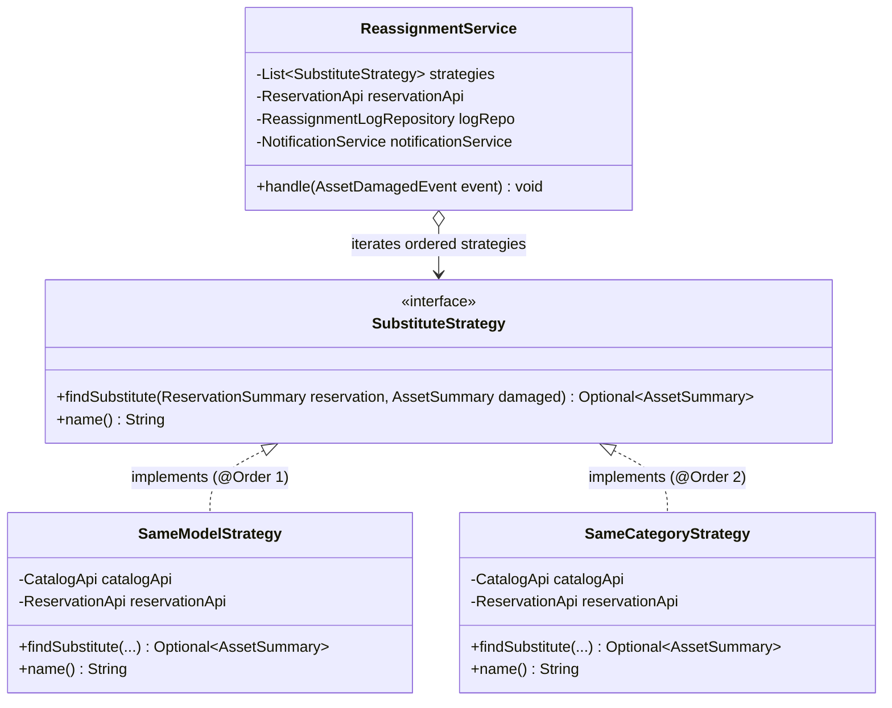

# Strategy Pattern Design & Architecture: Auto-Reassignment Engine

**Member 3:** Murariu Călin ([@Swiorx](https://github.com/Swiorx))  
**Module:** `com.campus.reassignment`  
**Pattern:** GoF Strategy Pattern (Behavioral)  
**Deliverable:** Defense Documentation & Architectural Specification  

---

## Part 1: In simple terms

### The Real-World Problem
Imagine you are an engineering student who reserved the lab's high-precision oscilloscope (Asset #101, Tektronix TBS1052B) for tomorrow at 10:00 to finish your diploma project. An hour before your slot, another student accidentally burns the input channel on that oscilloscope and submits an incident report.

What should happen to your reservation?
- If the system does nothing, you show up at the lab tomorrow only to find a broken machine, wasting your day.
- If the system immediately cancels your reservation, you lose your slot even if there were two identical Tektronix oscilloscopes sitting completely untouched in the adjacent rack!
- If a lab technician has to manually reassign bookings, human delay and fatigue make errors inevitable.

### The Strategy Solution
Our auto-reassignment engine handles this by trying a sequence of replacement rules—known in software engineering as the **Strategy Pattern**.

Think of it like a smart navigation app searching for alternate routes:
1. **Best Route (Same Model):** First, search for an **identical machine** (same exact model, e.g. another Tektronix TBS1052B), ideally in the same lab room. If one is free, your reservation is seamlessly moved there. You won't even notice a difference in knobs or menus.
2. **Alternative Route (Same Category):** If all identical machines are booked or broken, search for any **compatible substitute in the same equipment category** (e.g. an Agilent DSOX1102G oscilloscope). It's a different model, but it still measures signals and gets your lab homework done.
3. **No Route (Graceful Fallback):** If literally every oscilloscope in the building is occupied or broken, the engine gracefully force-cancels the booking, writes the explanation into the reassignment audit log, and notifies you immediately so you can plan accordingly.

By decoupling the search rules from the execution engine, adding a third or fourth rule in the future (such as "Same Lab Room Only" or "High-Tier Equipment") takes zero changes to the core engine.

---

## Part 2: Technical details

### 1. GoF Strategy Pattern Structure

The design strictly follows the classic Gang of Four (GoF) Strategy Pattern:



#### Roles in the Pattern:
- **Strategy Interface (`SubstituteStrategy`)**: Declares the uniform contract for finding candidate replacement assets during a designated time window.
- **Concrete Strategies (`SameModelStrategy`, `SameCategoryStrategy`)**: Encapsulate the specific criteria for querying the catalog and checking temporal overlap.
- **Context (`ReassignmentService`)**: Maintains an ordered list of `SubstituteStrategy` beans, delegates candidate evaluation, moves reservations, and handles fallback cancellation.

---

### 2. Spring Integration & Strategy Ordering

In traditional object-oriented programming, the context is often manually configured with a specific strategy. In Spring Boot, we leverage Spring's dependency injection container to inject **all** registered strategies ordered by priority:

```java
@Service
@RequiredArgsConstructor
public class ReassignmentService {

    // Spring auto-injects all beans implementing SubstituteStrategy
    // sorted according to their @Order annotation.
    private final List<SubstituteStrategy> strategies;
    private final ReservationApi reservationApi;
    private final ReassignmentLogRepository logRepository;
    private final NotificationService notificationService;
    private final Clock clock;
    ...
```

#### Ordering Contract:
- `SameModelStrategy` is annotated with `@Order(1)` (highest priority).
- `SameCategoryStrategy` is annotated with `@Order(2)` (fallback priority).

When `handle(event)` executes:
```java
for (SubstituteStrategy strategy : strategies) {
    Optional<AssetSummary> candidate = strategy.findSubstitute(booking, damaged);
    if (candidate.isPresent()) {
        boolean moved = reservationApi.moveToAsset(booking.id(), candidate.get().id(), "Incident #" + event.incidentId());
        if (moved) {
            reassignmentLogRepository.save(new ReassignmentLog(event.incidentId(), booking.id(), event.assetId(), candidate.get().id(), ReassignmentOutcome.REASSIGNED, strategy.name(), now));
            notificationService.notifyUser(booking.userId(), "Reservation moved to substitute asset");
        }
        break; // First matching strategy wins
    }
}
```

---

### 3. Concrete Strategy Algorithms

#### Strategy 1: `SameModelStrategy` (`@Order(1)`)
1. **Catalog Query:** Calls `CatalogApi.findAvailableAssets(categoryId)` or queries assets where `model.equalsIgnoreCase(original.model())` and `status == AssetStatus.AVAILABLE`.
2. **Exclusion Filter:** Excludes the damaged asset itself (`candidate.id() != original.id()`), `RETIRED` assets, and `UNDER_MAINTENANCE` assets.
3. **Availability Verification:** For each candidate, calls `ReservationApi.findActiveReservationsForAssetBetween(candidate.id(), start, end)`. If empty, the asset is free.
4. **Ranking & Tie-Breaking:**
   - Preference 1: Same lab room (`candidate.labRoomId().equals(original.labRoomId())` comes first).
   - Preference 2 (Tie-breaker): Deterministic ordering by lowest asset ID (`Comparator.comparing(AssetSummary::id)`).

#### Strategy 2: `SameCategoryStrategy` (`@Order(2)`)
1. **Catalog Query:** Queries all active assets in `original.categoryId()`.
2. **Exclusion Filter:** Excludes the damaged asset, same-model assets already evaluated by Strategy 1, and unavailable assets (`UNDER_MAINTENANCE`, `RETIRED`).
3. **Availability Verification:** Checks for conflicting reservations in the interval.
4. **Ranking:** Same lab room first, then deterministic lowest ID.

---

### 4. Open-Closed Principle (OCP)

The primary architectural advantage of this design is adherence to the **Open-Closed Principle** (Software entities should be open for extension, but closed for modification):

- **Zero modifications to `ReassignmentService`:** To introduce a new strategy (e.g. `AiSmartRecommenderStrategy` or `SameDepartmentStrategy`), a developer simply creates a new class annotated with `@Component` and `@Order(3)` implementing `SubstituteStrategy`.
- **Zero modification to existing strategies:** `SameModelStrategy` and `SameCategoryStrategy` are completely decoupled from each other and can be unit tested in complete isolation.

---

### 5. Transaction Boundaries & Exception Safety

The auto-reassignment engine runs in an isolated transaction to ensure that failures or lack of substitutes never impact the originating incident report:

1. **Observer Decoupling:** `LocalAssetDamagedListener` receives `AssetDamagedEvent` using `@TransactionalEventListener(phase = TransactionPhase.AFTER_COMMIT)`.
2. **Isolated Transactions:** `ReassignmentService.handle` delegates each booking to `ReassignmentBookingProcessor`, running in an isolated `@Transactional(propagation = Propagation.REQUIRES_NEW)` transaction.
3. **Absence of Substitute is Normal Business Flow:** When no substitute is found, the engine does **not** throw an exception that triggers rollback. Instead, it calls `ReservationService.forceCancel(res.id())` and records `ReassignmentLog(outcome = FORCE_CANCELLED, reason = "NO_SUBSTITUTE_FOUND")`. The transaction commits cleanly.

---

### 6. Academic Defense Q&A Preparation

**Q1: Why use the Strategy Pattern instead of a simple `if-else` or `switch` inside `ReassignmentService`?**
> *Answer:* An `if-else` block tightly couples all substitute algorithms into a single monolithic class. As business rules expand (e.g., adding room proximity scoring, equipment capability matching, or student priority levels), the service class would become bloated, violating the Single Responsibility Principle and Open-Closed Principle. The Strategy Pattern decouples each rule into an isolated, individually testable component.

**Q2: How does Spring know which strategy to execute first?**
> *Answer:* Spring's `List<SubstituteStrategy>` injection natively honors the `@Order` annotation on each component bean. `SameModelStrategy` has `@Order(1)`, while `SameCategoryStrategy` has `@Order(2)`. Spring automatically arranges them in ascending order inside the injected list.

**Q3: What happens if two substitute assets have the same priority?**
> *Answer:* We implemented a deterministic tie-breaker in both strategies: after sorting by same-room preference, candidate assets are sorted by ascending `id` (`thenComparing(AssetSummary::id)`). This guarantees 100% deterministic, reproducible behavior in tests and production.
