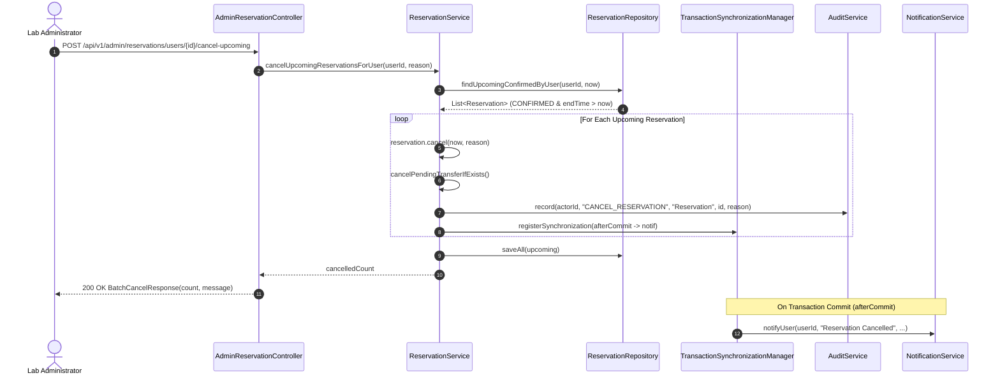

# 27. Cancel Upcoming Reservations for User Facade & Admin Endpoint (#229 Part 2)

**Author:** Călin Murariu (@Swiorx)  
**Date:** 2026-11-10  
**Issue:** #229 (Part 2)  
**Pull Request:** `feat/reservation-cancel-disabled-user-bookings`

---

## Part 1: In Simple Terms

### Ce problemă rezolvăm?
Atunci când un administrator suspendă sau dezactivează contul unui student (`POST /api/v1/admin/users/{id}/disable`), studentul nu se mai poate autentifica pe platformă. Cu toate acestea, rezervările viitoare pe care le crease anterior rămâneau în sistem cu statusul `CONFIRMED`.
Acest lucru producea trei efecte negative majore:
1. **Blocarea resurselor de laborator:** Echipamentele rezervate de studentul dezactivat rămâneau ocupate și indisponibile pentru ceilalți studenți până când trecea intervalul orar sau intra sweep-ul automat de no-show (+30 de minute după start).
2. **Declanșarea inutilă a motorului de reatribuire:** Dacă un echipament se defecta, motorul de reasignare încerca să găsească înlocuitor pentru o rezervare a unui student care oricum nu mai avea acces în campus și îi trimitea notificări pe email.
3. **Oferte de transfer orfane:** Dacă studentul respectiv inițiase un transfer de rezervare către un coleg (`ReservationTransfer`), transferul rămânea agățat în stare `PENDING`.

### Ce am implementat?
Am adăugat o metodă dedicată în fațada publică `ReservationApi` și un endpoint administrativ în `AdminReservationController`:
- **Fațadă Java:** `int cancelUpcomingReservationsForUser(Long userId, String reason)` disponibilă pentru invocare inter-module sau joburi de mentenanță.
- **Endpoint HTTP REST:** `POST /api/v1/admin/reservations/users/{userId}/cancel-upcoming?reason=...` protejat pentru rolul `ADMIN`.
- **Efecte automate:**
  - Anulează toate rezervările viitoare cu status `CONFIRMED` ale utilizatorului respectiv.
  - Anulează automat orice ofertă de transfer `PENDING` asociată acelor rezervări, notificând colegul că transferul nu mai este valabil.
  - Înregistrează fiecare anulare în jurnalul de audit (`CANCEL_RESERVATION`).
  - Trimite notificări pe email utilizatorului după comiterea cu succes a tranzacției (`afterCommit`).
  - **Important:** Echipamentele deja ridicate fizic (`CHECKED_OUT` sau `OVERDUE`) nu sunt anulate automat, deoarece ele se află în posesia fizică a studentului și trebuie predate fizic la biroul de laborator de către administrator prin procedura standard de returnare (`POST /api/v1/admin/reservations/{id}/return`).

---

## Part 2: Technical Details

### 1. Architectural Alignment & Boundaries
Conform regulilor din `AGENTS.md` și ArchUnit (`ModuleBoundaryArchitectureTest`):
- `com.campus.reservation` depinde de `com.campus.user.api` (pentru roluri și existență student).
- Păstrăm decuplarea strictă fără cicluri bidirecționale (`no_cycles_between_modules`): pachetul `user` nu importă clase interne din `reservation`. În schimb, Ștefania (@m1runa-stefan1a) poate apela noul endpoint REST sau fațada `ReservationApi` atunci când finalizează partea sa din Issue #229 în modulul `user/admin/`.



### 2. Contract Updates
#### `ReservationApi.java`
```java
/**
 * Cancels all upcoming CONFIRMED reservations for a specific user (e.g. when an administrator
 * disables their account or revokes lab privileges; #229 Part 2).
 *
 * <p>Also automatically cancels any pending outgoing transfer offers for those reservations.
 *
 * @param userId the ID of the user whose upcoming bookings should be cancelled
 * @param reason explanation for cancellation (e.g. "User account disabled by administrator")
 * @return the number of upcoming reservations that were cancelled
 */
int cancelUpcomingReservationsForUser(Long userId, String reason);
```

#### `AdminReservationController.java`
- `POST /api/v1/admin/reservations/users/{userId}/cancel-upcoming`
- Query Params: `reason` (optional, default: `"Account disabled by administrator"`)
- Response: `200 OK`
```json
{
  "count": 2,
  "message": "Successfully cancelled 2 upcoming reservation(s)"
}
```

### 3. Database Query
Optimizat prin interogare directă indexată pe `userId` și `endTime`:
```sql
SELECT r FROM Reservation r
WHERE r.userId = :userId
  AND r.status = com.campus.reservation.api.ReservationStatus.CONFIRMED
  AND r.endTime > :cutoff
ORDER BY r.startTime ASC
```

### 4. Test Coverage & Verification Plan
- **Unit Tests (`ReservationServiceTest`):**
  - Anulează toate rezervările viitoare `CONFIRMED` ale utilizatorului.
  - Anulează ofertele de transfer `PENDING` asociate și notifică destinatarul transferului.
  - Emite notificări către utilizator exclusiv după comiterea tranzacției (`afterCommit`).
  - Tratează cazul în care utilizatorul nu are rezervări viitoare (returnează 0).
  - Tratează cazul `userId == null` (returnează 0).
  - Folosește motivul implicit atunci când parametrul `reason` este null sau blank.
- **Repository Integration Test (`ReservationRepositoryTest`):**
  - Verifică filtrarea corectă pe bază de date reală PostgreSQL pentru `findUpcomingConfirmedByUser`.
- **Controller Test (`AdminReservationControllerTest`):**
  - Returnează `200 OK` cu `BatchCancelResponse` pentru `ROLE_ADMIN`.
  - Returnează `403 FORBIDDEN` pentru `ROLE_STUDENT`.
  - Returnează `401 UNAUTHORIZED` pentru apeluri neautentificate.
