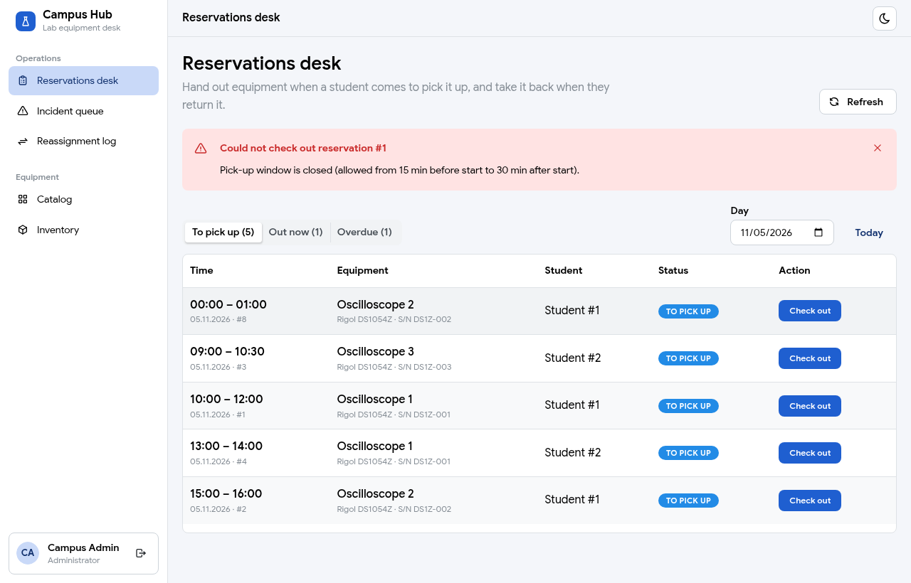
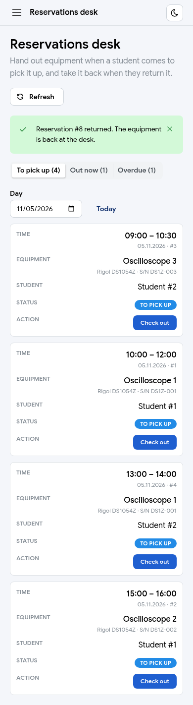

# Reservations desk: the admin's page at the lab counter (Necula Matei)

**Role:** Member 1, Cloud, Security & Auth (frontend: admin reservations desk page)
**Date:** 2026-11-05
**Branch / PR:** `feat/frontend-reservations-desk`
**See also:** `docs/modules/frontend.md` (Stefania's conventions), `docs/api-contract.md` §3 (Calin's admin reservation endpoints), `documentation/Murariu_Calin/08-frontend-reservations-and-booking.md` (My reservations page)

---

## Part 1: In simple terms

When a student comes to the lab to pick up a booked oscilloscope, the admin behind the counter has to mark it as "taken". When the student brings it back, the admin marks it as "returned". This page is where the admin does that.

1. **The admin opens "Reservations desk"** in the side menu (only admins see it).
2. **The page shows three lists**, chosen with tabs at the top:
   - **To pick up:** bookings for the chosen day that nobody has collected yet (today by default, Romanian time);
   - **Out now:** equipment a student has right now;
   - **Overdue:** equipment that should already be back.
   Each tab shows how many bookings it holds.
3. **Each row says when, what and who:** the time slot, the equipment name and serial number, and the student's number (the app has no way yet for an admin to look up another user's name).
4. **"Check out"** on a booking in "To pick up" hands the equipment to the student. The booking moves to "Out now".
5. **"Return"** on a booking in "Out now" or "Overdue" takes it back. The booking leaves the desk lists.
6. **If the backend says no, the page says why in plain words.** For example, a student can only pick up from 15 minutes before to 30 minutes after the start, so clicking too early shows "Could not check out reservation #1: Pick-up window is closed (allowed from 15 min before start to 30 min after start)."
7. **After every click the lists reload**, so the admin always sees the real state, also when a colleague at another desk did something in the meantime.
8. **On a phone each booking is a small card** with its button, so nothing hides off the side of the screen.

**Result:** the "Reservations desk" placeholder is replaced by a working page. Tested on the real app: a booking was checked out and returned through the page, and a check-out outside the pick-up window showed the friendly error.

---

## Part 2: Technical details

### Files

| File | Change |
|---|---|
| `frontend/src/pages/ReservationsDeskPage.tsx` | New: the page, plus a small `PhoneList` and `StatusBadge` used only here |
| `frontend/src/api/reservationDesk.ts` | New: `searchReservations`, `checkOutReservation`, `returnReservation` |
| `frontend/src/App.tsx` | The `<PlaceholderPage title="Reservations desk" …>` element → `<ReservationsDeskPage />` (+ one import). Nothing else |
| `02-files-explained.md` | Rows for the two new files and this doc |

Not touched (shared or someone else's): `package.json`, `client.ts`, `errorMessages.ts`, `components/`, `layout/`, `navigation.ts` (the menu entry already existed), Calin's `src/api/reservations.ts` (I import his types and `fetchAssetSummary` from it instead of copying them).

### Endpoints used (all already on `main`)

| Call | Owner | Used for |
|---|---|---|
| `GET /api/v1/admin/reservations?status=&date=&page=&size=` | Calin (`AdminReservationController`) | The list of the open tab, and the tab counts (`size=1`, only `totalElements` is read) |
| `POST /api/v1/admin/reservations/{id}/check-out` | Calin | "Check out" button: `CONFIRMED` → `CHECKED_OUT`, `409 CHECKOUT_WINDOW_CLOSED` outside start −15 / +30 min |
| `POST /api/v1/admin/reservations/{id}/return` | Calin | "Return" button: `CHECKED_OUT`/`OVERDUE` → `RETURNED`, else `409 INVALID_RESERVATION_STATUS_TRANSITION` |
| `GET /api/v1/assets/{id}` (through Calin's `fetchAssetSummary`) | Liviu | Equipment name, model and serial number per row |

The endpoints are under `/api/v1/admin/**`, so my `SecurityConfig` already lets only admins call them (403 for students). The page itself sits inside Stefania's `<RequireAdmin>` route, but that only hides it; the backend rule is the real protection.

### How the page works

| Piece | What it does | Why |
|---|---|---|
| `TAB_STATUS` | One status per tab: `CONFIRMED`, `CHECKED_OUT`, `OVERDUE` | The search endpoint takes **one** `status`, so one tab = one request |
| `date` only on "To pick up" | "Out now" and "Overdue" send no `date` | Equipment that is out must come back whatever day it was booked; an overdue item from yesterday would be hidden by a "today" filter |
| `todayInBucharest()` | `Intl.DateTimeFormat('en-CA', { timeZone: 'Europe/Bucharest' })` → `"2026-11-05"` | The backend `Clock` uses Europe/Bucharest. With the browser's zone, a laptop set to UTC would show yesterday's list for the first hours after midnight |
| `timeOf` / `dayOf` | Cut `"2026-11-05T14:00:00"` as a string | The backend sends local times without an offset; `new Date(...)` would reinterpret them in the browser's zone |
| List effect (`[tab, date, pageNumber, reloadToken]`) | Loads the page, sorts it by start time (earliest first), then loads the asset names | The backend sorts newest first; at the counter the next pick-up should be on top |
| `ignore` flag in both effects | The cleanup sets `ignore = true`; a late answer of an old request is dropped | Without it, switching tabs fast could show the old tab's rows (the bug found in review of Calin's page) |
| `loading` | Set to `true` in each handler that changes the effect's inputs, set to `false` in `finally` only by the latest request | `oxlint` warns about `setState` directly inside an effect (`set-state-in-effect`). Each handler first checks that something changed (same tab, same day, same page → return), otherwise the effect doesn't run and the spinner would never stop |
| `changePage` guard | `if (newPage === pageNumber) return` | Mantine's `Pagination` also calls `onChange` when the current page is clicked again (review of Calin's page) |
| `setPageData(null)` on tab change | Shows the loader instead of the old rows | The old tab's rows would show the wrong button for a moment |
| `runAction` | Calls check-out or return, shows a green notice or a red alert, then **always** reloads | After a 409 the row is usually out of date (already returned, no-show job ran), so reloading shows the truth |
| Error alert | Title "Could not check out reservation #1", text from `errorMessage()` (`errorMessages.ts`) | Calin already added `CHECKOUT_WINDOW_CLOSED`, `INVALID_RESERVATION_STATUS_TRANSITION`, `RESERVATION_NOT_FOUND` there, so no new codes were needed. The title says which row failed |
| `busyId` | The clicked button shows a spinner, the others are disabled | No double clicks while a request is running |
| `useMediaQuery('(max-width: 48em)')` → `PhoneList` | Below Mantine's `sm` breakpoint each booking becomes a card using the **same** `columns` | `PagedTable` scrolls sideways under 600 px, which hid the button column at 390 px. I didn't change Stefania's shared `PagedTable`; `PhoneList` reuses the column renderers, so there is one definition of what a row shows |
| Student column `Student #id` | No name | `main` has no admin endpoint to look up another user (`/users/me` only returns yourself). I didn't invent one |

### How it was tested

| Check | Result |
|---|---|
| `npm ci && npm run lint && npm run build` | 0 lint warnings, build OK (the "chunk larger than 500 kB" warning is the same on `main`) |
| Real app: scratch PostgreSQL 18 on `:5441`, `DB_URL=… SERVER_PORT=8441 ./gradlew bootRun` (dev profile), Vite with a local copy of `vite.config.ts` proxying to `:8441` (`:8080` was taken on my machine) | Started, Flyway ran, seed accounts created |
| Admin API (curl): 1 category, 1 lab room, 3 oscilloscopes; students booked 4 slots for 5 Nov through `POST /api/v1/reservations` | 201 each; a 5th, overlapping booking → `409 RESERVATION_CONFLICT` |
| Rows inside the pick-up window, one `CHECKED_OUT` and one `OVERDUE` row inserted with SQL | Needed because the test ran just after midnight: the booking rules (Mon–Fri 08:00–20:00, not in the past) make an in-window booking impossible through the API at that hour |
| Page, logged in as `admin@campus.test` (headless Chromium + `playwright-core`) | "To pick up (5)", "Out now (1)", "Overdue (1)", names and serials shown, earliest first |
| "Check out" on #1 (starts 10:00) | `409`, red alert "Could not check out reservation #1: Pick-up window is closed …" |
| "Check out" on #8 (starts 00:00), then "Return" on it in "Out now" | `200` + `200`; green notices; counts updated; DB: `RETURNED` with `checked_out_at`/`returned_at`; `audit_logs` has `CHECK_OUT_RESERVATION` + `RETURN_RESERVATION` with actor 3 (admin) |
| Return again via curl | `409 INVALID_RESERVATION_STATUS_TRANSITION` |
| Phone width 390 px | Cards, buttons visible, `scrollWidth = 390` (no sideways page scroll) |
| Dark mode (the top-bar toggle) | Readable |

### Problems hit and fixes

| Problem | Fix |
|---|---|
| First version set `loading = true` at the top of the effect → `oxlint` warning `react(set-state-in-effect)` | Set it in the handlers instead, each guarded by "did something change?" |
| At phone width the table scrolled sideways and the button column was off-screen | `PhoneList`: the same columns as cards below 48em |
| A plain `ErrorAlert` said "Pick-up window is closed" without saying for which booking | Own red `Alert` with the reservation id as title, text still from `errorMessage()` |

### Known limitations / for teammates

| What | Who |
|---|---|
| The search sorts newest first and has no `sort` parameter; I sort each page on the client. With more than 20 pick-ups in one day, page 2 holds the earlier ones. A `sort=startTime,asc` option would fix it | Calin (only if needed) |
| No student names: an admin `GET /api/v1/admin/users/{id}` (or names in `ReservationResponse`) would let the desk show "Ana Pop" instead of "Student #2" | Stefania (user admin endpoints) |
| The search takes one `status`; the counts need 3 small requests | Fine for now |

## Screenshots

| Desktop: a check-out outside the pick-up window gets a readable 409 | Phone width: one card per booking |
|---|---|
|  |  |
