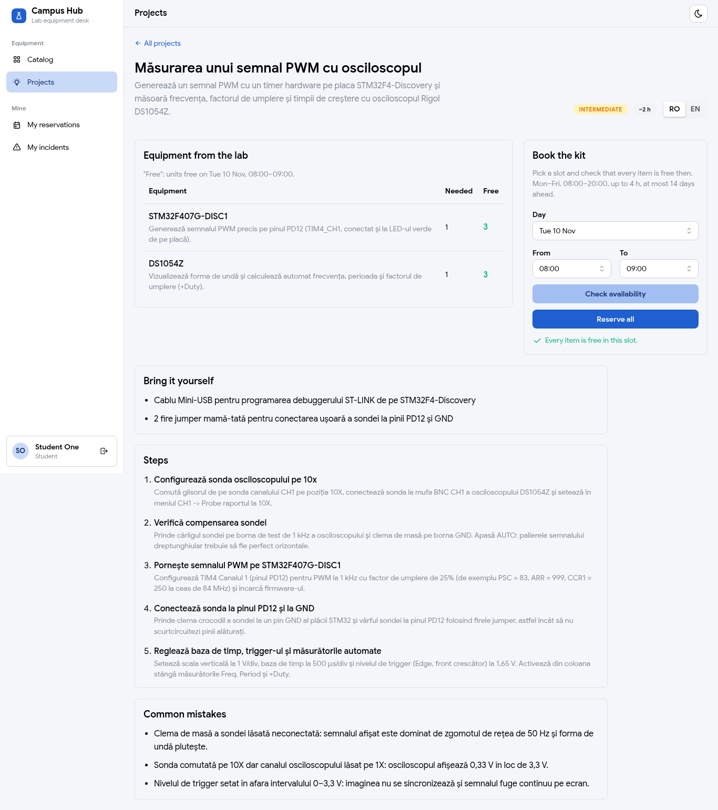
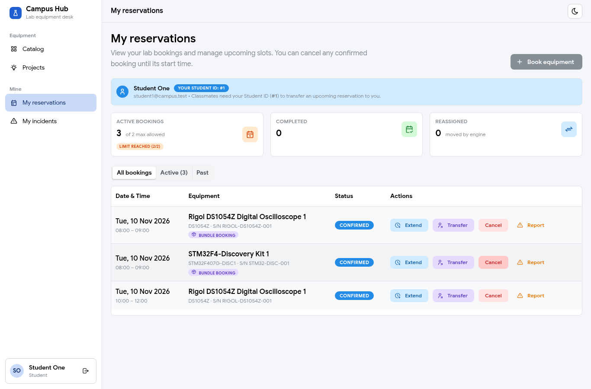
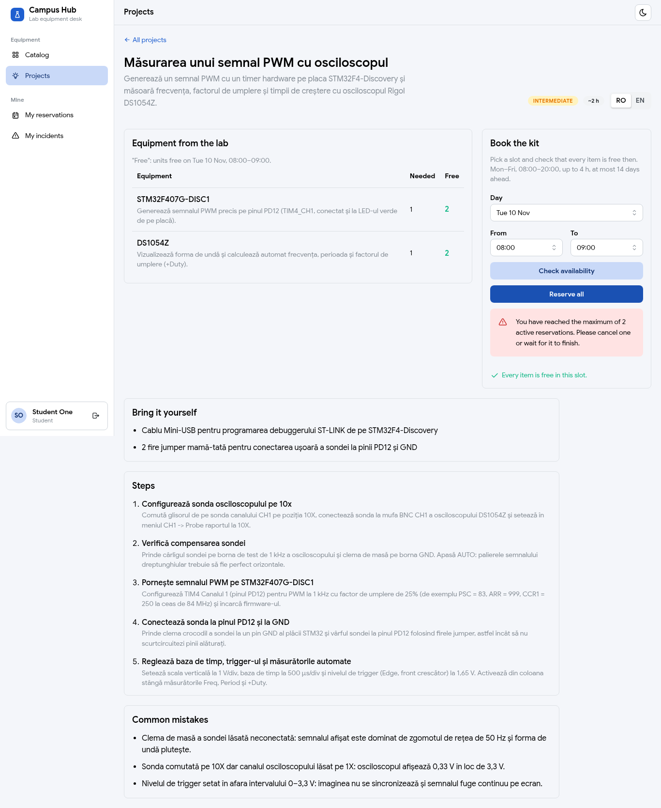
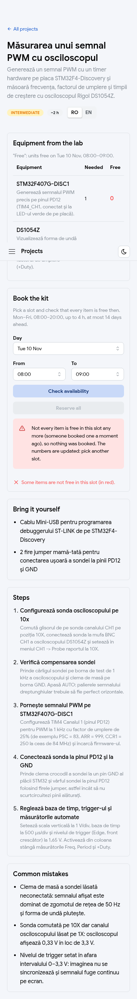

# Projects "Reserve all": book a whole project kit in one go (Necula Matei)

**Role:** Member 1, Cloud, Security & Auth (owner of the `project` module)
**Date:** 2026-11-09
**Branch / PR:** `feat/project-reserve-all` (issue #140)
**See also:** `38-project-assistant-design.md` (design), `39-project-engine.md` (library, search, availability), spec §7 (`docs/superpowers/specs/2026-11-09-project-assistant-design.md`), `docs/api-contract.md` (Projects section)

---

## Part 1: In simple terms

1. **What a student can do now.** On a project page (for example "Measuring a PWM signal with the oscilloscope") the student picks a time slot and asks for **Reserve all**. The server books one unit of every piece of equipment the project needs, in one go.
2. **How the units are chosen.** For each item on the project's list, in order, the server looks at the lab's working units of that model, smallest id first, and keeps the ones nobody has booked in that slot. It takes as many as the project needs (for example 2 Arduinos). Same request, same units, every time.
3. **All or nothing.** If even one item is short (all units busy, or the lab doesn't own that model yet), nothing is booked and the student gets a clear message naming the missing model. If everything is there, all units are booked together through Calin's reservation module and share one **bundle id**, so they show up as one kit in "My reservations".
4. **The usual booking rules still apply.** Opening hours, 30-minute steps, at most 4 hours, at most 14 days ahead, and the student limit are all checked by Calin's code, exactly like a normal booking. An admin is not limited.
5. **Safe when two students click at the same time.** The first check is only a quick look. The real booking locks every chosen unit and checks again, so if someone took a unit a second earlier, the student gets "already booked" instead of a double booking.

**Result:** `POST /api/v1/projects/{slug}/reserve` and the **Reserve all** button work on the real app: student1 booked the oscilloscope kit (2 units, one bundle id) with one click and landed on My reservations; the next attempts showed the expected errors.

### Frontend button

6. **The button.** On the project page, in the "Book the kit" card, under "Check availability", there is now a **Reserve all** button. It only lights up after the student checked availability for the slot in the selects and every item was free. While it books, it shows a spinner and can't be clicked twice.
7. **After booking** the student lands on **My reservations**, where the new bookings carry the "Bundle booking" badge.
8. **If the server says no** (limit reached, a unit taken a second earlier, outside opening hours), the message shows right under the button and the numbers in the table are loaded again, so the student sees what is really free now.

| Desktop: ready to book | Desktop: the kit in My reservations |
|---|---|
|  |  |
| **Desktop: student limit (409 from Calin's code)** | **Phone: someone was faster (409 `PROJECT_COMPONENT_UNAVAILABLE`)** |
|  |  |

---

## Part 2: Technical details

### Files

| File | Change |
|---|---|
| `project/service/ProjectReservationService.java` | New. `@Transactional reserve(slug, start, end)`: picks units, calls `ReservationApi.bookBundle` |
| `project/service/ProjectService.java` | `findProject` + `requireEndAfterStart` pulled out as package-private static helpers (shared with Reserve all, so both endpoints answer 404 / 400 the same way); corrected the comment on `isAssetFree` (it does not see holds) |
| `project/web/ReserveProjectRequest.java` | New. `@NotNull start`, `@NotNull end`, `@JsonFormat(lenient = FALSE)` |
| `project/web/ReserveProjectResponse.java`, `ReservedItem.java` | New. `{ bundleId, start, end, items: [{ assetId, assetName, model }] }` |
| `project/web/ProjectController.java` | New `POST /{slug}/reserve`, `201`, `@Valid`, Swagger `@Operation` + 201/400/404/409 (401/403 added globally by `OpenApiConfig`, #184) |
| `test/.../ProjectReservationServiceTest.java` | New, 9 Mockito tests |
| `test/.../ProjectControllerTest.java` | +6 slice tests for the new endpoint (+ `@MockitoBean ProjectReservationService`) |
| `docs/api-contract.md` | §5 `PROJECT_COMPONENT_UNAVAILABLE` 409; Projects table row, rules and JSON examples for the POST |
| `frontend/src/api/projects.ts` | `ReserveProjectResponse` / `ReservedItem` types, `reserveProject(slug, slot)` (shared `apiFetch`, no change to Stefania's `client.ts`), `PROJECT_COMPONENT_UNAVAILABLE` text in the local `PROJECT_MESSAGES` |
| `frontend/src/pages/ProjectDetailsPage.tsx` | "Reserve all" button + `reserveAll()` + `reserving` / `reserveError` state |
| `docs/screenshots/projects-10..14-*.png` | Real run screenshots (desktop + phone) |

### How it works (`ProjectReservationService.reserve`)

| Step | Code | Why |
|---|---|---|
| 1 | `ProjectService.findProject` → 404 `PROJECT_NOT_FOUND`; `requireEndAfterStart` → 400 `VALIDATION_FAILED` | Same helpers as `GET /projects/{slug}`, no duplicated rule |
| 2 | per component, file order: `catalogApi.findAvailableByModel(model, null)` → sort by id → `filter(isAssetFree(id, start, end, null))` → `limit(quantity)` | Lowest id first = deterministic (like the reassignment tie-break, #99). `null` exclude = same call as `ProjectService`. A model appears once per project (`ProjectLibrary` refuses duplicates), so no unit can be picked twice |
| 3 | fewer than `quantity` → `ConflictException("PROJECT_COMPONENT_UNAVAILABLE", "Not enough free units of '<model>' …")` | Also covers a model the catalog doesn't have yet (empty list). Nothing is booked |
| 4 | `reservationApi.bookBundle(currentUser.id(), ids, start, end)` | Calin's facade (#235). User id only from the JWT |
| 5 | map picked `AssetSummary` → `ReservedItem`, return with the bundle id | Items in the order they were picked |

**Transaction.** `reserve` is `@Transactional`; `bookBundle` is `@Transactional` too, so it joins the same transaction. If it throws, Spring rolls the whole thing back and the exception reaches Liviu's `GlobalExceptionHandler` unchanged (we never catch it, so no `UnexpectedRollbackException`).

**The pre-check is advisory.** Between step 2 and step 4 another student can book a unit. `bookBundle` locks every asset row in ascending id order (`CatalogApi.lockForBooking`), then checks `isBookable`, overlaps (`RESERVATION_CONFLICT`), other students' holds (`SLOT_HELD`), booking rules and the student quota. So a race ends in a 409, never a double booking. No retry loop (spec §11): the page tells the student to check again.

**What `bookBundle` checks (read from Calin's code, not changed):**

| Check | Code | Status |
|---|---|---|
| booking rules (`validateSlotRules`): past, alignment, 30 min–4 h, ≤ 14 days, 08:00–20:00 weekdays | `BOOKING_IN_PAST`, `SLOT_NOT_ALIGNED`, `INVALID_DURATION`, `BOOKING_TOO_FAR_AHEAD`, `OUTSIDE_OPENING_HOURS`, `INVALID_TIME_RANGE` | 409 (`BusinessRuleException`) |
| 1 to 5 ids, no null | `INVALID_BUNDLE_SIZE` | 409; can't happen here: `ProjectLibrary` caps a project at 5 units and requires ≥ 1 component |
| asset still `AVAILABLE` | `ASSET_NOT_BOOKABLE` | 409 |
| student quota (admins skip it) | `RESERVATION_LIMIT_REACHED` | 409 |
| overlap / hold | `RESERVATION_CONFLICT`, `SLOT_HELD` | 409 |

**Time zone offsets (#233).** Calin's reservation request records reject `"…Z"` / `"+02:00"` with `@JsonFormat(lenient = OptBoolean.FALSE)` (400 `MALFORMED_REQUEST`). `ReserveProjectRequest` uses the same annotation, so all booking endpoints behave alike. Checked by hand: without the annotation the offset test in `ProjectControllerTest` fails.

**Admin booking.** `bookBundle` treats the caller as admin when `currentUser.id()` equals the user id and the token has `ROLE_ADMIN` (or the account's role is ADMIN), and skips the quota. Reserve all always passes `currentUser.id()`, so an admin reserving a kit is not limited (seen on the real app below).

**Module rules.** `project` only uses `catalog.api`, `reservation.api` and `common` (`CurrentUser`, exceptions). Calin's ArchUnit rules (`ModuleBoundaryArchitectureTest`, `nothing_depends_on_project`) stay green.

### Tests

| Test | Rule |
|---|---|
| `picksLowestFreeIdPerModel` | ids arrive shuffled (12, 5, 9) → books 5 |
| `picksAsManyUnitsAsTheQuantity` | quantity 2 → the 2 lowest, then the next component; response echoes bundle id, start, end, names |
| `skipsUnitsBusyInTheSlot` | unit 1 busy → books 2 |
| `notEnoughFreeUnitsIs409NamingTheModel` | 1 free of 2 needed → 409 `PROJECT_COMPONENT_UNAVAILABLE` naming `DS1054Z`, `bookBundle` never called |
| `modelMissingFromTheCatalogIs409` | empty catalog list → same 409 |
| `bookBundleErrorPassesThroughUnchanged` | `RESERVATION_LIMIT_REACHED` from the facade is the same exception object |
| `bookingUserComesFromCurrentUser` | `CurrentUser.id()` = 42 → `bookBundle(42, …)` |
| `unknownSlugIs404` | 404 `PROJECT_NOT_FOUND`, no catalog/reservation call |
| `endNotAfterStartIs400` | end = start → 400 `VALIDATION_FAILED`, no catalog/reservation call |
| `ProjectControllerTest` (+6) | 201 + JSON shape, 400 missing `end` (`VALIDATION_FAILED`), 400 `Z` offset (`MALFORMED_REQUEST`), 401 without token, 404 code, 409 code |

Build: `SPRING_DATASOURCE_URL=jdbc:postgresql://localhost:5433/campus_p5 ./gradlew --no-daemon spotlessApply build` → **BUILD SUCCESSFUL, 957 tests, 0 failures** (942 on `main` + 15 new).

### Real app (bootRun on :8095, fresh database `campus_p5app`, dev seed, Mon 9 Nov 2026 20:11 campus time)

Slot: Tue 10 Nov 2026, 10:00–12:00.

| # | Request | Result |
|---|---|---|
| 1 | student1: `GET /projects/oscilloscope-pwm?start=…&end=…` | `STM32F407G-DISC1` 3 free, `DS1054Z` 2 free (seeded booking #1 already holds DS1054Z id 1 in this slot), `reservable: true` |
| 2 | student1: `POST /projects/oscilloscope-pwm/reserve` | **201** `bundleId 660ebcaa-…`, items: id 10 `STM32F4-Discovery Kit 1`, id 2 `Rigol DS1054Z Digital Oscilloscope 2` (id 1 skipped: busy) |
| 3 | student1: `GET /reservations/me` | ids 3 (asset 2) and 4 (asset 10), both `CONFIRMED`, both `bundleId 660ebcaa-…`; plus the seeded #1 (no bundle) |
| 4 | student1: same POST again | **409 `RESERVATION_LIMIT_REACHED`** ("Student cannot have more than 2 active reservations"): free units were still found (STM32 id 11, DS1054Z id 3), so the quota in `bookBundle` stopped it |
| 5 | admin: same POST | **201** (quota skipped), ids 11 + 3 |
| 6 | admin: same POST again | **409 `PROJECT_COMPONENT_UNAVAILABLE`** "Not enough free units of 'DS1054Z' in this slot: need 1, found 0" |
| 7 | admin: slot 21:00–22:00 | **409 `OUTSIDE_OPENING_HOURS`** (from `bookBundle`, unchanged) |
| 8 | `"2026-11-10T10:00:00Z"` in the body | **400 `MALFORMED_REQUEST`** |
| 9 | slug `nope` / end before start / no token | **404 `PROJECT_NOT_FOUND`** / **400 `VALIDATION_FAILED`** / **401** |

### Frontend (`ProjectDetailsPage.tsx`)

| Rule | Code | Why |
|---|---|---|
| Enabled only when the numbers are for this slot and the kit is free | `disabled={!kitReservable \|\| loading}` (`kitReservable` = selects == checked slot && `slotChecked` && `reservable`, from PR 4) | The student never books a slot they didn't check; the backend checks again anyway |
| No double submit | `loading={reserving}` (Mantine disables a loading button) + early return in `reserveAll` | Two clicks would send two bookings; the second would get a 409 |
| 201 | `navigate('/reservations')` | My reservations shows the kit with Calin's "Bundle booking" badge |
| 409 | `setReserveError(err)`, then `setLoading(true); setSlotToCheck({ ...slot })` | Reloads the availability for the same slot (a new object, so the effect runs even for an equal slot) |
| Spinner always ends | `setReserving(false)` in `finally`; the reload's `loading` ends in the existing effect's `finally` | The bug class from #133/#196 |
| Error text | `ProjectErrorAlert`: our `PROJECT_*` texts, else Stefania's shared `ErrorAlert` (reservation codes like `RESERVATION_LIMIT_REACHED`) | No edit to the shared `errorMessages.ts` |

Checks: `npm run lint` (0 warnings) and `npm run build` green.

**Real run in the browser** (backend :8095 on a fresh `campus_p5app`, Vite :5185 proxying to it, headless Chromium, slot Tue 10 Nov 08:00–09:00):

| # | Who / what | Result |
|---|---|---|
| 1 | student1 opens `oscilloscope-pwm` | Reserve all disabled before checking |
| 2 | Check availability | STM32 3 free, DS1054Z 3 free, Reserve all enabled (screenshot 10) |
| 3 | Reserve all | POST 201 → `/reservations`, 2 rows with "Bundle booking" (screenshot 11) |
| 4 | Same slot, check + Reserve all | POST 409, "You have reached the maximum of 2 active reservations…" under the button, numbers reloaded (2 / 2) (screenshot 12) |
| 5 | student2 on a phone (390 px) checks the slot | both items free, button enabled (screenshot 13) |
| 6 | admin books the kit twice through the API (the third try already gets 409 `PROJECT_COMPONENT_UNAVAILABLE`), then student2 clicks Reserve all | POST 409, our "Not every item is free…" text, table reloaded to 0 / 0 in red, button disabled (screenshot 14); no horizontal scroll (`scrollWidth` 390) |

The only browser console errors were the two expected `409` network lines.

### Problems and open points

| Point | Notes |
|---|---|
| Only `oscilloscope-pwm` is reservable today | `thermometer` and `multimeter-basics` use models Liviu hasn't seeded yet (e.g. `Breadboard + jumper wire kit`) → 409 `PROJECT_COMPONENT_UNAVAILABLE` |
| Check order | A missing model answers 409 `PROJECT_COMPONENT_UNAVAILABLE` before the booking rules are checked (they live inside `bookBundle`). Harmless, but a slot at 21:00 for an unseeded kit says "not enough units" instead of "outside opening hours" |
| Holds | `isAssetFree` ignores 1-minute holds, so a held unit can be picked and `bookBundle` answers `SLOT_HELD` even if another unit was free. Acceptable for now (no retry by design) |
| Quota counts rows | A 2-item kit leaves student1 with 3 active rows, so any next booking hits the limit (row 4). Calin's issue #240 (#228 point 4: a kit should count as 1 both ways) |
| No "booked" banner after the redirect | Calin's My reservations shows a banner only for `state.bookedId` (one reservation id). `bookBundle` returns only the bundle id, so we don't fake one; the "Bundle booking" badges show the result. If Calin wants a banner for kits, his page could read a `bookedBundleId` |
| Swagger example dates | `ReserveProjectRequest` examples are fixed dates (16 Nov 2026) and will expire; Calin's `ReservationOpenApiCustomizer` only updates his own schemas |
