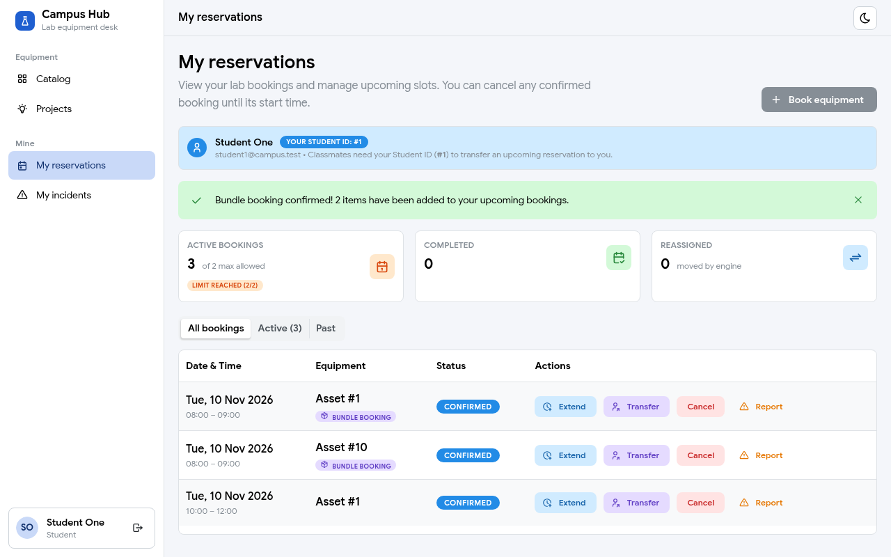

# Projects: show the "Bundle booking confirmed!" banner after Reserve all (Necula Matei)

**Role:** Member 1, Cloud, Security & Auth (owner of the `project` module)
**Date:** 2026-11-09
**Branch / PR:** `fix/frontend-project-bundle-banner` (issue #140)
**See also:** `42-project-reserve-all.md` (the Reserve all button), Calin's #246 (the banner in My reservations)

---

## Part 1: In simple terms

1. **The problem.** After "Reserve all" on a project page, the student landed on My reservations with no message. A single booking from the calendar shows a green "Booking confirmed!" banner there, so the kit felt like it was missing a confirmation.
2. **Calin's part (#246, merged).** My reservations can now show "Bundle booking confirmed! N items have been added…", but only if the page that sends the student there says which kit was booked and how many items it has.
3. **My part (this PR).** The project page now passes those two facts (the kit's bundle id and the number of booked units) when it opens My reservations.

**Result:** on the real app, student1 booked the oscilloscope kit and saw "Bundle booking confirmed! 2 items have been added to your upcoming bookings." After a page reload the banner is gone, as it should be.

The card "3 of 2 max allowed" in the screenshot is the old per-row count from #240 (a 2-item kit counted as 2 bookings). Calin's #247 fixes it; this PR doesn't touch it.

---

## Part 2: Technical details

| File | Change |
|---|---|
| `frontend/src/pages/ProjectDetailsPage.tsx` | `reserveAll` keeps the `ReserveProjectResponse` and calls `navigate('/reservations', { state: { bookedBundleId: booked.bundleId, bundleItemCount: booked.items.length } })` instead of `navigate('/reservations')` |
| `docs/screenshots/projects-15-bundle-banner.png` | Screenshot of the banner |

- **How it connects.** React Router keeps `state` with the history entry. Calin's `MyReservationsPage` reads `location.state` once in its `useState` initializer. It accepts `bookedId` (single booking) or `bookedBundleId` + `bundleItemCount` (kit), shows the banner, then calls `window.history.replaceState({}, …)` so a reload doesn't show it again.
- **Why `items.length`.** `POST /api/v1/projects/{slug}/reserve` answers `{ bundleId, start, end, items[] }` with one entry per booked unit (a project needing 2 Arduinos gives 2 items), which is what "N items" means on the banner.
- **Tests.** `npm run lint` and `npm run build` are green. Manual test on a fresh database (scratch PostgreSQL 18, dev seed): log in as student1, open `/projects/oscilloscope-pwm`, Check availability, Reserve all → the banner shows "2 items"; reload → no banner. This was run in headless Chromium with `playwright-core`.
