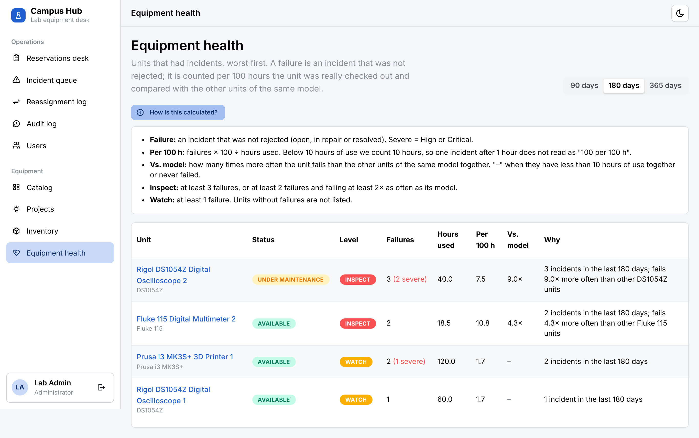
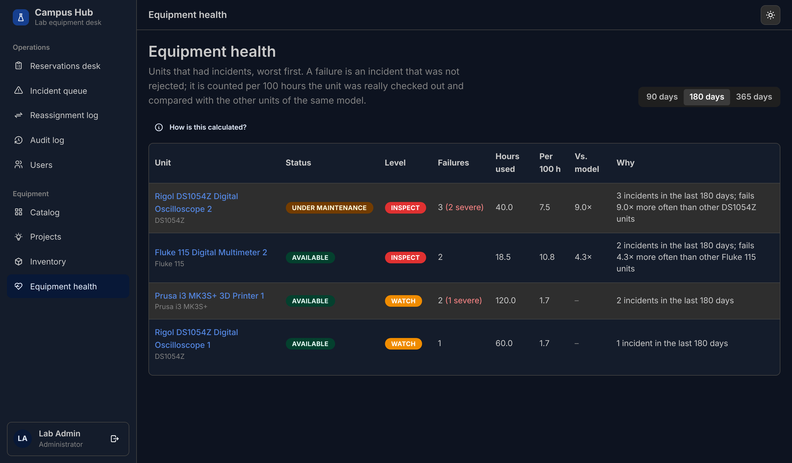
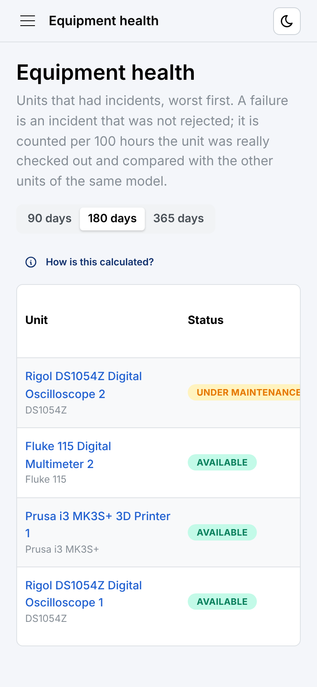
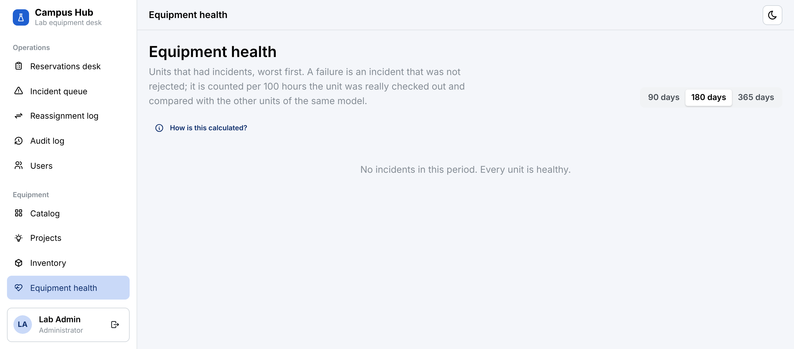

# Equipment Health Page (Vișan Ștefania)

**Role:** Member 4
**Date:** 2026-11-21
**Package:** `frontend/src` (pages, api, layout)
**PR:** PR 3 of 3 for equipment reliability (Refs #291); shows the report from PR 2 (`GET /api/v1/admin/reliability`, doc 11)

---

## Part 1: In simple terms

The admin menu has a new entry under **Equipment**: **Equipment health**. It opens a table of the units that broke in the chosen period, worst first.

| Column | What it says |
|---|---|
| Unit | the name (a link to the unit's page in the catalog) and the model under it |
| Status | Available / Under maintenance / Retired, same colours as the catalog |
| Level | **Inspect** (red): send it for inspection. **Watch** (yellow): keep an eye on it |
| Failures | how many incidents were not rejected, and how many of those were severe |
| Hours used | how long it was really checked out in the period |
| Per 100 h | failures per 100 hours of use |
| Vs. model | how many times more often it fails than the other units of the same model ("–" when there is not enough data) |
| Why | the sentence from the backend, e.g. "3 incidents in the last 180 days; fails 9.0× more often than other DS1054Z units" |

Above the table: the period (90 / 180 / 365 days, 180 by default) and **How is this calculated?**, which opens the rules in plain words, so an admin (or the professor) can check any row with a calculator.

The page only shows evidence. Retiring a unit stays in the inventory; the unit name links there.

---

## Part 2: Technical details

### Files

| File | What |
|---|---|
| `src/api/reliability.ts` | the types (`ReliabilityReport`, `AssetReliabilityItem`, `ReliabilityLevel`) and `fetchReliability(days)` |
| `src/pages/AdminReliabilityPage.tsx` | the page |
| `src/App.tsx` | route `reliability` under `admin` (so `RequireAdmin` sends a student away, like the other admin pages) |
| `src/layout/navigation.ts` | menu entry "Equipment health" (`IconHeartbeat`) in the admin "Equipment" group; the top bar title comes from it |
| `docs/screenshots/reliability-0*.png` | light (help open), dark, phone, empty |

### Decisions

- **The maths stays in the backend.** The page does no calculation; it formats what `ReliabilityCalculator` sent. Numbers are shown with `toFixed(1)` because JSON drops the `.0` (`40.0` arrives as `40`).
- **`null` → "–"**, never `0`: `vsModel`, `mtbfHours` and `avgRepairHours` are `null` when there is not enough data, and `0` would be a lie.
- **Same table as the other admin pages.** The report is not paged, so it is passed to `PagedTable` as one page (`totalPages: 1`, no pagination bar shown). Same borders, stripes, empty text and horizontal scroll.
- **Load in an effect keyed on `days`**, with an `ignore` flag so a slow answer for 365 days can't overwrite a newer one for 90. The error is reset on success and the spinner stops in `finally`. Clicking the period that is already selected does nothing.
- **On an error the table is hidden**, so "No incidents in this period. Every unit is healthy." is never shown for a report that failed to load. `ErrorAlert` shows the backend's message.
- **Badges keep their width** (`minWidth: max-content`): in a narrow column Mantine cuts a badge to "INSP…"; now the table scrolls instead. On a phone the unit column keeps 180 px and the table scrolls sideways, like the reservations desk.

### Checked

`npm run lint` and `npm run build` pass. In the browser (report mocked for the screenshots, then against the real backend from PR 2): the menu entry and the top bar title; the period switch sends `days=90` / `365`; the help panel opens and closes; the empty state; light and dark; phone width (390 px).

