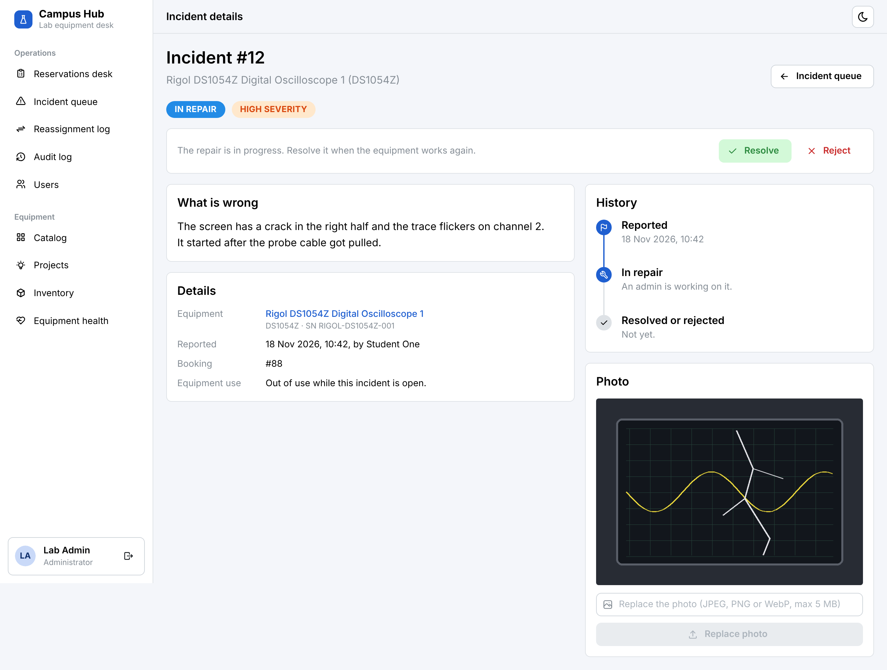
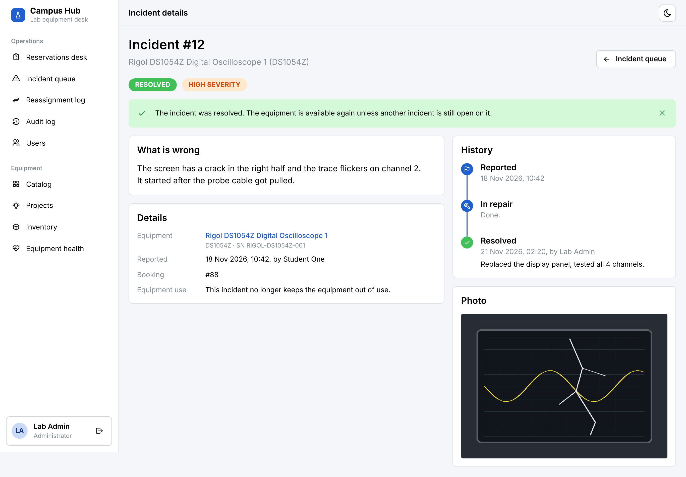
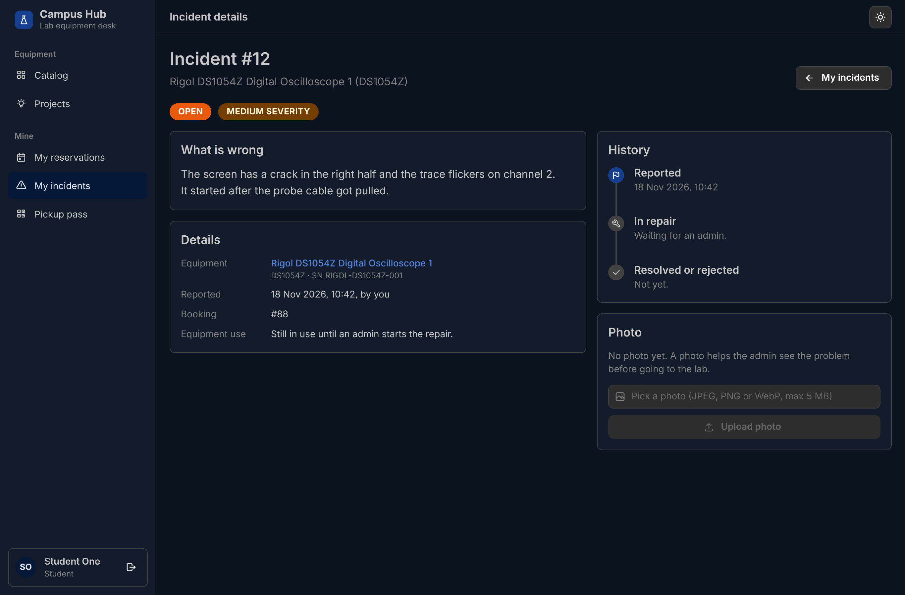
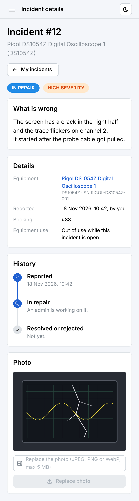
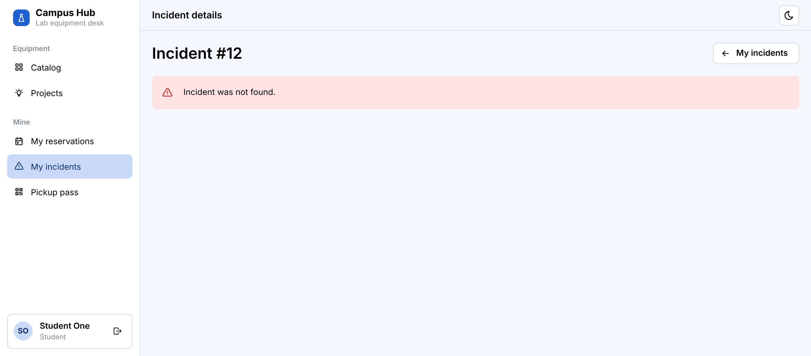

# Incident Details Page (Vișan Ștefania)

**Role:** Member 4
**Date:** 2026-11-21
**Package:** `frontend/src` (pages, api, layout)
**PR:** W7 "incident details" (the last page of my incident flow); no backend change, it uses `GET /api/v1/incidents/{id}` from #108

---

## Part 1: In simple terms

Until now an incident was only a row in a table: the description was cut after two lines, the photo opened in a pop-up, and an admin could not send a colleague a link to "incident #12".

Now every incident has its own page, **`/incidents/12`**. You get there by clicking the **`#12`** in My incidents, in the Incident queue or in the Reassignment log ("Incident #12").

| Part of the page | What it shows |
|---|---|
| Top | `Incident #12`, the equipment, the status and severity badges, a button back to the list you came from |
| What is wrong | the whole description, with the line breaks the student typed |
| Details | the equipment (link to its catalog page), when and by whom it was reported, the booking, whether the equipment is in use right now |
| History | Reported → In repair → Resolved / Rejected, with the date, who closed it (admin view) and the notes |
| Photo | the photo itself; while the incident is open, the reporter or an admin can add one or replace it |
| Admin bar | Start repair, Resolve, Reject, the same actions as in the queue, with the same explanations |

Who can open it: the student who reported it, and any admin. Anyone else gets "Incident was not found", because the backend answers 404 so it doesn't reveal which ids exist.

---

## Part 2: Technical details

### Files

| File | What changed |
|---|---|
| `src/pages/IncidentDetailsPage.tsx` | new: the page, with `PhotoPanel` |
| `src/api/incidents.ts` | `fetchIncident(id)`; `photoProblem(file)` moved here from the report form, so both places check the photo the same way |
| `src/components/ReportIncidentModal.tsx` | imports `photoProblem` instead of its own copy |
| `src/App.tsx` | route `incidents/:id` under "Student and admin" (`RequireAuth`; the backend decides reporter-or-admin) |
| `src/layout/navigation.ts` | top bar title "Incident details" for `/incidents/<id>` |
| `src/pages/MyIncidentsPage.tsx`, `IncidentQueuePage.tsx` | the `#` column is a link to the page |
| `src/pages/ReassignmentLogPage.tsx` | "Incident #N" goes to `/incidents/N` (it went to the whole queue before) |

### Decisions

- **No new endpoint.** `GET /api/v1/incidents/{id}` already returns everything; names come from `GET /assets/{id}` and, for an admin only, `GET /admin/users/{id}` (a student is the reporter, so the page says "by you"). A failed name lookup shows `#id` and is not an error.
- **The backend decides who may see it.** The route is only behind `RequireAuth`; someone else's incident is a 404 from the backend, shown with `ErrorAlert` ("Incident was not found") and a back button. A non-number id (`/incidents/abc`) doesn't call the backend at all.
- **Actions update the page from the response.** Start repair, Resolve (via `CloseIncidentModal`) and the photo upload all return the new `IncidentResponse`, which replaces the shown one: no reload, no stale status.
- **The photo is fetched with the token** and shown through a `blob:` URL that is freed when it is replaced or the page is left. Each loaded image remembers its `photoKey`, so after a replacement the old (already freed) image is never shown while the new one loads.
- **History is honest about what the backend stores.** There is no "repair started at" date in the API, so the middle step has no date; a closed incident shows "–" there, because it may have been resolved straight from `OPEN`.
- **Who closed it** is looked up when `resolvedById` changes, so after "Resolve" on this page the name appears without a reload.

### Checked

`npm run lint` and `npm run build` pass. In the browser (mocked answers for the screenshots): admin view with the photo and the action bar; Resolve with notes → status, history, notes and "by Lab Admin" update in place; student view in dark mode with "Upload photo"; phone width (one column); another user's incident → "Incident was not found".

